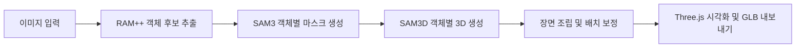
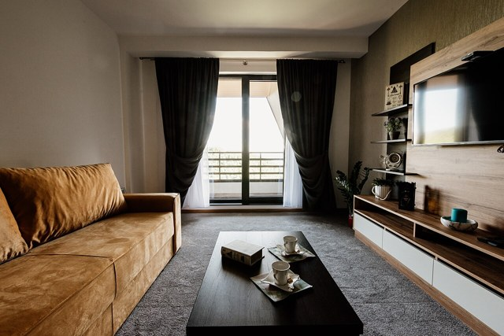
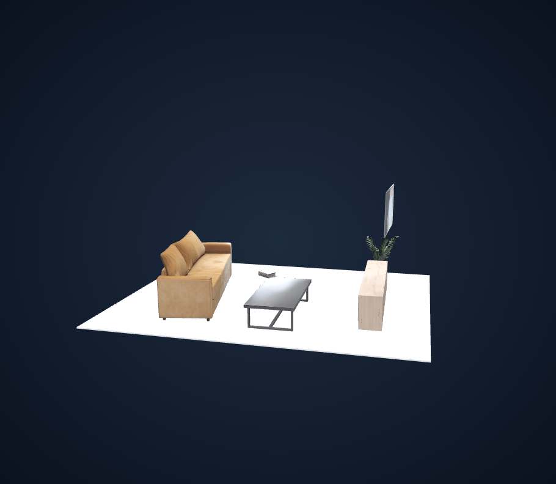

# MapMaker

> 현재 상태 (2026-10-18): **7단계 목표는 진행 중이며 운영은 v4입니다. 새 후보는 정식 배포하지 않았습니다.** 개발용 집 이미지에서 작은 벽 장식 복원과 중복 부분 감소를 확인했고, 사무실에서는 원본 배치를 손상시키던 이동을 차단했습니다. 식당의 새 추론 결과는 고정 선택 영역 대응이 5/8에서 6/8, 작은 객체가 0/1에서 1/1로 개선됐습니다. 이는 최종 메시·지지 관계·공간 전체의 품질 통과를 뜻하지 않습니다. 공간 빈틈과 지지 문제는 남아 있으며, 미사용 평가 입력의 v4/v5 기준선을 수집 중입니다. 저장 결과의 브라우저 표시·다운로드 검증과 최신 인증 업로드→생성 통합 검증은 구분합니다. 후자와 품질 통과 후 배포는 아직 남아 있습니다. [실행·품질 근거](docs/V10_LOCAL_PROGRESS.md)를 참고하세요.

> 이전 검증 (2026-10-16): 고정 평가 3장 × v4/v5/v7의 GPU 9회와 실제 결과의 브라우저 검증을 마쳤습니다. v7의 선택 객체 대응은 14/25, 작은 객체는 1/4로 v5와 같고 중복·지지·공간 복원 기준은 미달입니다. **v7은 배포하지 않았고 운영 release·환경·worker 설정을 v4로 복원했습니다.** [GPU 비교 결과와 7단계 현재 상태](docs/V7_GPU_COMPARISON.md), [구현 범위와 로컬 검증](docs/V7_VALIDATION_PLAN.md)을 참고하세요.

> 검증 상태 (2026-10-16): 이름에 의존하지 않는 보정과 관측 바닥·벽·천장 패치를 추가한 v6는 **실험 구현**입니다. 공개 입력 3장의 GPU 생성·브라우저 표시·다운로드는 통과했으나, 중복·지지 관계·공간 연속성의 품질 기준은 실패했습니다. 임시 검증 후 운영 release와 worker 설정은 v4로 복원했습니다. 아래 기본 기능 설명은 운영 v4 기준이며, v6 결과와 한계는 [품질 평가](docs/QUALITY_EVALUATION.md)에 기록했습니다.

**단일 이미지에서 객체별 3D 모델을 생성하고 하나의 장면으로 조립하는 프로젝트**

MapMaker는 이미지 한 장을 입력받아 주요 객체를 찾아 분리하고, 각 객체의 3D 형상과 배치를 추정하여 웹에서 확인할 수 있는 3D 장면을 생성합니다. RAM++, SAM3, SAM3D Objects를 하나의 처리 과정으로 연결하며, 생성된 객체는 개별 노드로 유지한 채 GLB 파일로 내보냅니다.

프로젝트의 목표는 **단일 이미지 기반 3D 생성 기술을 실제로 동작하는 시스템으로 구현하는 것**입니다. 기존 모델을 활용한 생성 과정부터 장면 조립·배치 보정, 원격 GPU 실행, 웹 시각화까지 연결한 1차 구현을 정리합니다.

현재 작업 목표는 평가 기준 구축, 이름에 의존하지 않는 보정, 중복 개선, 바닥·벽·천장 복원, 지지·관통 보정, 뷰어·내보내기, 통합 검증의 7단계입니다. 공간 전체 복원은 진행 중인 범위이며 아직 완료되지 않았습니다. 객체 편집 UI는 별도 후속 범위입니다. 실제 버전 비교 기록은 [GPU 비교 보고서](docs/V7_GPU_COMPARISON.md)에 정리합니다.

모델 연결·좌표 변환·배치 보정·원격 실행의 구체적인 방식은 [상세 구현 문서](docs/IMPLEMENTATION.md)에 정리했습니다.

미배포 작업 트리에는 `MAPMAKER_SUPPORTED_REPAIR=1`로 활성화하는 지지 자세 보정 단계가 추가됐습니다. 관측 공간 평면과 객체 메시에서 직접 측정한 국소 지지면을 후보로 삼고, 제한 회전·균일 크기·평면 방향 이동을 사용하며 원본 영상·기존 접촉·충돌 검사를 통과한 후보만 적용합니다. 개발 장면 30개 객체의 첫 통합 검사에서는 후보 3개 모두 원본 보존 조건에서 탈락해 적용 건수는 0이었습니다. 일부 깊이·관통 지표 개선을 전체 품질 통과로 취급하지 않으며, 기본값은 비활성입니다. 자세한 활성화 조건과 한계는 [상세 구현 문서](docs/IMPLEMENTATION.md)를 참고하세요.

## 운영 v4의 주요 기능

| 기능 | 설명 |
|---|---|
| 이미지 입력 | PNG·JPEG·WebP 업로드, 이미지 방향 및 색상 형식 정규화 |
| 객체 탐색·분리 | RAM++의 객체 후보를 바탕으로 SAM3가 객체별 마스크 생성 |
| 객체별 3D 생성 | SAM3D Objects로 메시와 위치·회전·크기 추정 |
| 장면 조립·보정 | 객체별 노드를 가진 장면 구성, 위쪽 방향 정렬, 지정된 가구의 Y=0 접지 |
| 웹 시각화 | 회전·확대·축소·이동, 객체별 표시 전환, 진행 상태, 바닥 기준 격자·좌표축 표시 |
| 결과 저장·내보내기 | 전체 장면 GLB 다운로드, 실행 ID 기반 결과 다시 열기, 중간 산출물·로그 보존 |

현재 입력 제한은 **25 MiB / 16 megapixels**, 장면당 분리 대상은 최대 **12개 객체**입니다. 일부 객체 생성에 실패하면 성공한 객체로 장면을 구성하고, 모든 객체가 실패하면 해당 실행을 실패 처리합니다. 객체 표시 전환은 뷰어에만 적용되며, 다운로드에는 생성된 전체 객체 장면이 저장됩니다. 바닥 메시를 추가하지 않으며, 뷰어의 격자와 좌표축은 GLB에 포함되지 않습니다.

## 처리 과정



1. **입력 준비**: 이미지의 EXIF 방향을 반영하고 RGB PNG로 정규화합니다.
2. **객체 후보 추출**: RAM++가 이미지의 태그를 추출합니다. 배경·재질·동작 등 독립 객체로 보기 어려운 태그를 제외하고 후보 이름을 정리합니다.
3. **객체 분리**: 후보 이름을 SAM3의 프롬프트로 사용하여 객체별 영역을 구합니다. 신뢰도·면적·중복 기준으로 마스크를 선택합니다.
4. **3D 생성**: SAM3D Objects에 원본 전체 이미지와 객체별 마스크를 전달하여 각 객체의 메시와 위치·회전·크기를 추정합니다.
5. **장면 구성**: 모델의 좌표계를 GLB에 맞게 변환하여 객체를 조립한 뒤, 방향과 바닥 배치를 보정합니다.
6. **결과 확인**: Three.js 뷰어에서 장면을 탐색하고 GLB를 다운로드합니다. 입력·마스크·객체 모델·메타데이터를 함께 저장하여 결과를 추적할 수 있습니다.

## 직접 구현한 부분

### 기존 모델 연결

RAM++ → SAM3 → SAM3D Objects의 입출력을 연결하고, 이미지 한 장으로 객체 탐색부터 3D 생성까지 진행되는 파이프라인을 구성했습니다. 모델별 Python·PyTorch·CUDA 의존성 차이를 고려해 비전 처리와 3D 생성 환경을 분리하고, 실행 상태와 오류를 하나의 작업 단위로 관리합니다.

각 모델은 객체 인식·분할·3D 추정을 담당하며, 본 프로젝트의 구현 기여는 이 모델들을 연결하고 생성 결과를 사용할 수 있는 시스템으로 구성한 부분에 있습니다.

### 장면 조립·배치 보정

객체의 메시와 추정된 위치·회전·크기를 이용하여 하나의 장면을 구성합니다. 각 객체는 독립 노드로 유지하고, 모델의 좌표계와 GLB 좌표계 사이의 변환을 처리합니다.

현재 보정은 다음 순서로 적용됩니다.

- 전체 객체의 위쪽 축 방향을 평균하여 장면을 월드 +Y 방향으로 정렬하고, 전체 메시의 최저점을 Y=0으로 이동합니다.
- 각 객체의 로컬 +Y 축을 개별적으로 월드 +Y에 정렬합니다.
- 의자·테이블·소파 등 지정된 가구는 메시의 최저점이 Y=0에 닿도록 이동합니다. 그 외 객체는 개별 회전 시 기준점 위치를 유지합니다.
- 바닥 메시를 추가하지 않습니다. 뷰어에서 Y=0 격자와 좌표축을 표시하여 접지 기준과 시점 방향을 확인합니다.

원본 객체 메시와 모델이 추정한 pose는 보존하고, 보정 변환을 별도로 기록합니다. 축 정렬과 접지를 위한 기하학적 후처리이며, 물리 시뮬레이션이나 객체 간 충돌 해결은 포함하지 않습니다.

### 원격 GPU 처리

현재 배포는 **인증 게이트웨이 → Runpod 웹/API endpoint → GPU Queue endpoint**로 구성됩니다. 웹/API가 입력을 S3에 저장하고 생성 작업을 제출하며, GPU worker가 추론·장면 조립·배치 보정·미리보기와 결과 게시까지 수행합니다. 로컬 Python 서버 없이 브라우저에서 사용할 수 있습니다.

작업 요청·상태·산출물은 S3에 보존합니다. 웹 worker가 재시작되어도 GPU 작업은 계속되며, 제출 응답이 불명확할 때는 자동 재제출하지 않습니다. 브라우저 인증 게이트웨이는 상시 실행 CPU Pod이므로 웹/API·GPU endpoint의 서버리스 실행과 별도입니다. 기존 Windows 로컬 서버 + 원격 GPU 경로도 유지합니다.

### 웹 뷰어

Three.js 기반으로 이미지 업로드, 생성 상태 표시, 3D 장면 탐색, 객체 표시 전환, GLB 다운로드를 구현했습니다. `/?run=<run_id>` 주소로 저장된 결과를 다시 열 수 있습니다.

## 구현 결과와 검증

아래는 이전 바닥 메시를 포함한 거실 장면의 WebGL 렌더링 기록입니다. 현재 뷰어는 바닥 메시 대신 격자·좌표축을 표시합니다. TV·책 등 일부 객체의 부유와 접촉 문제는 남아 있습니다.

| 원본 이미지 | 결과물 |
|:---:|:---:|
|  |  |

저장소에 보존된 검증 기록은 다음과 같습니다. 각 기록은 수행 당시의 구현과 입력을 기준으로 합니다.

| 검증 범위 | 기록된 결과 | 해석 범위 |
|---|---|---|
| 기존 GPU 생성·뷰어 검증 | 당시 29개 입력 중 22개 PASS, 7개는 16MP 입력 제한으로 실패 | 이전 배치 보정 버전의 전체 생성 경로 검증 |
| 배치 보정(v4) 기존 수치 검증 | 저장된 22개 장면·120개 객체의 축 정렬, 가구 46개의 접지 검사 통과 | 기존 추론 결과를 사용한 보정 검증이며 GPU 재추론은 아님 |
| 기존 보정의 화면 비교 | 대표 3개 장면·28개 객체를 재처리하고 전후 6개 뷰어 검사 통과 | 바닥 메시 제거 전 기록, 동일 카메라 조건의 비교 및 뷰어 동작 확인 |
| 2026-10-15 로컬 회귀 테스트 | 66개 통과 | 클라우드 서비스·모델을 mock한 테스트 포함 |
| 2026-10-15 배포 브라우저 검증 | 인증·업로드, 객체 6개 생성·표시, 전 객체 표시 전환, 회전, 46,012,620바이트 GLB 다운로드·전체 해시 일치, 새로고침 복원 통과 | 거실 샘플 1회 생성. 검증 도구 중단 후 동일 작업을 다시 열어 나머지 검사 완료 |

검증 PASS는 파일·좌표 변환·뷰어 동작이 검사 기준을 충족했다는 의미입니다. 실제 공간과의 복원 정확도나 시각적 완성도를 나타내는 점수는 아닙니다. [기존 샘플 5개 결과](docs/SAMPLES_BEFORE_AFTER_COMPARISON.md)는 이전 화면 기록입니다. 최신 검증의 근거와 관찰 사항은 [상세 구현 문서의 검증 절](docs/IMPLEMENTATION.md#8-검증과-해석)에 정리했습니다.

이전 **placement v5 품질 개선**은 실제 GPU에서 단일 이미지로 검증했습니다. 실제 지지면이 확인되는 소품의 높이 보정, 제한된 가구 겹침 완화, 고신뢰도 작은 마스크의 선택 슬롯 확보를 포함합니다. 회귀 테스트 78개와 저장 장면 3개·28개 객체의 재처리를 확인했습니다. 승인 후 운영 endpoint에 v5를 임시 적용하여 동일 거실 이미지의 GPU 생성과 인증·업로드·표시·다운로드를 검증하고 **운영 설정은 v4로 복원했습니다**. 객체는 6개에서 12개로 늘고 책·컵 2개의 높이가 보정됐으나 선반·수납장 중복 추출과 겹침은 남았습니다. 단일 입력 결과이므로 작은 객체 재현율 개선 수치는 확인하지 않았습니다. [개선 방식과 한계](docs/IMPLEMENTATION.md#9-로컬-v5-품질-개선)를 참고하세요.

현재 작업 트리는 **미배포 placement v10 이후 후보**입니다. 운영 v4의 최대 12개 객체·이름 기반 접지 설명과 달리, 후보는 최대 48개 객체를 선택하고 보정에는 이름을 쓰지 않습니다. 32개를 넘는 추가 선택에는 새로 표현하는 영역이 기존 작은 객체 최소 면적 이상이어야 합니다. 이 최대 48개 정책은 미배포 변경이며 실제 GPU 품질 검증 중입니다. 공간과 객체를 별도 GLB 그룹으로 내보내며 벽·천장·관측 표면 표시 전환과 내부 관찰을 지원합니다. 원본 카메라 좌표에서 제한된 자세를 제안하고, 실제 메시 이동 경로와 원본 마스크·깊이를 검사한 뒤 적용합니다. 천장 접촉과 열린 지지 메시의 다른 면에 대한 충돌 검사도 포함합니다. 관측 근거가 없는 공간 면은 보류하며, 메시 일부를 잘라내는 실험과 품질이 악화된 RGB·추가 깊이 조건 실험은 생성 경로에 적용하지 않습니다. [후속 구현·검증 기록](docs/V10_LOCAL_PROGRESS.md), [평가 기준](docs/QUALITY_EVALUATION.md)을 참고하세요.


## 현재 한계

- **형상과 배치의 불확실성**: 한 장의 이미지에서 추정하므로 가려진 부분, 얇은 구조, 작은 소품의 형상이 부정확하거나 객체가 누락될 수 있습니다. 실제 치수나 정확한 상대 배치를 보장하지 않습니다.
- **접촉·충돌 문제**: 운영 v4는 객체의 로컬 +Y를 사용합니다. 로컬 후보는 깊이·선분·표면 방향 근거를 추가했지만, 모든 다리의 접지나 소품의 올바른 지지 관계는 아직 검증하지 못했고 부유·관통·겹침이 남습니다.
- **장면 범위**: 운영 v4는 객체 중심의 장면입니다. 로컬 후보에 관측된 벽·천장·바닥 복원과 표시 전환이 있지만 공간 전체 복원 품질은 미달입니다. 객체 위치·크기를 직접 수정하는 편집 UI는 별도 미구현 범위입니다.
- **실행 환경**: 실제 생성에는 준비된 GPU 모델 환경이 필요합니다. 초기 모델 로딩과 파일 전송 시간이 있으며, RunPod 사용 시 GPU·스토리지 비용이 발생합니다.
- **생성 중 결과 다시 열기**: 작업 진행은 조회할 수 있지만, 완료 전에는 원본 이미지 파일이 공개되지 않아 미리보기가 깨질 수 있습니다. 완료 시 자동 복구도 아직 구현하지 않았습니다.

## 기술 구성

| 구분 | 사용 기술 |
|---|---|
| 객체 인식·분할·생성 | RAM++, SAM3, SAM3D Objects, PyTorch |
| 파이프라인·장면 처리 | Python, NumPy, Pillow, trimesh |
| 원격 실행·저장 | RunPod Serverless, S3, Docker |
| 웹 화면 | HTML, CSS, JavaScript, Three.js |
| 검증 | pytest, Playwright, 산출물·좌표 변환 검증 스크립트 |

## 실행 방법

### 현재 클라우드 배포 사용

웹 UI·API는 Runpod Load Balancer endpoint에서, RAM++·SAM3·SAM3D 추론과 장면
조립·보정·미리보기는 GPU Queue endpoint에서 실행할 수 있습니다. 작업 상태와
최종 산출물은 S3에 저장하므로 로컬 Python 서버 없이 실행하고 결과를 다시 열 수 있습니다.
GPU worker의 최종 결과를 사용하며 로컬 장면 보정은 수행하지 않습니다.

기존 배포에서는 `.runtime/cloud-browser-access.json`의 비공개 `access_url`을 브라우저에서 엽니다. 인증 후 이미지를 선택하고 **Generate 3D Scene**을 누릅니다. 링크는 생성 권한을 포함하므로 공유하거나 Git에 넣지 않습니다. 이 파일은 저장소에 포함되지 않으며, 새 환경의 배포·인증 설정은 [배포 안내](deploy/runpod/README.md)를 참고하세요.

게이트웨이를 사용하지 않는 대안으로, 기존 프로젝트 키가 설정되어 있으면 아래 명령으로 Runpod HTTP endpoint에 인증 헤더를 전달하는 Chrome을 열 수 있습니다. 이 방식도 로컬 웹 서버를 시작하지 않습니다.

```powershell
npm.cmd ci --prefix web
node scripts/open_cloud_web.mjs
```

큰 GLB는 웹 endpoint에서 나눠 내려받으므로 S3 CORS 설정이 필요하지 않습니다.

### 기존 로컬 웹 서버 실행

기존 실행 방식인 **Windows 로컬 서버 + RunPod 원격 GPU**도 사용할 수 있습니다. Python 3.11, Node.js, uv와 별도로 배포된 RunPod endpoint 및 S3 접근 설정이 필요합니다. 모델과 인증 정보는 저장소에 포함하지 않습니다.

처음 준비할 때는 저장소 루트에서 실행합니다.

```powershell
uv sync --frozen --extra remote
npm.cmd ci --prefix web --omit=dev
powershell -ExecutionPolicy Bypass -File scripts/configure_runpod_api.ps1
powershell -ExecutionPolicy Bypass -File scripts/configure_runpod_s3.ps1
```

`RUNPOD_ENDPOINT_ID`, `MAPMAKER_S3_BUCKET`, `MAPMAKER_S3_ENDPOINT`, `AWS_DEFAULT_REGION`을 환경 변수 또는 `.runtime/runpod-settings.json`에 설정합니다. 인증 스크립트는 최초 설정용이며, 이미 설정된 환경에서는 아래 명령으로 실행합니다.

```powershell
.venv\Scripts\python.exe -m mapmaker.cli doctor
powershell -ExecutionPolicy Bypass -File scripts/start_scene_web.ps1
```

[로컬 앱](http://127.0.0.1:8082)에서 이미지를 선택하고 **Generate 3D Scene**을 누릅니다. 생성이 끝날 때까지 서버를 유지해야 합니다. `doctor`는 설정·파일 존재 검사이며 실제 원격 인증이나 추론 성공을 확인하는 명령은 아닙니다.

## 저장소와 결과 구성

```text
mapmaker/       Python 서버, 모델 연결, 원격 처리, 장면 조립·보정
web/            Three.js 뷰어와 브라우저 검증
configs/        모델·런타임 설정과 고정 소스 버전
deploy/runpod/  웹/API·GPU worker Docker 구성과 배포 안내
scripts/        실행·배포·검증·재처리 도구
tests/          파이프라인·좌표 변환·원격 처리 회귀 테스트
samples/        입력 예시
docs/           사용법과 검증 보고서
runs/           실행별 산출물 (Git 제외)
```

각 실행에는 정규화한 입력 이미지, 객체 후보, 마스크, 객체별 GLB·pose, 최종 `scene.glb`, 메타데이터, 미리보기와 로그가 저장됩니다. 클라우드 배포는 S3의 `mapmaker-jobs/<run_id>/`에 요청·완료 기록과 `files/` 산출물을 보존하며, 인증된 브라우저에서 `/?run=<run_id>`로 다시 엽니다. 기존 로컬 방식은 `runs/<run_id>/` 폴더와 로컬 서버가 필요합니다.
