# MapMaker

**단일 이미지 기반 3D 장면 생성**

25110073 신해성

## 프로젝트 개요

사진 한 장에서 가구와 물체를 찾아 3D 장면을 생성합니다. Qwen으로 객체 목록을 만들고, SAM3로 객체를 분할한 뒤, SAM3D로 메시와 pose를 생성합니다. 생성된 장면은 MoGe 깊이를 이용해 바닥을 정렬하고, 물체 사이의 지지 관계를 고려해 배치를 보정합니다.

| 입력 이미지 | 생성 결과 |
|---|---|
| 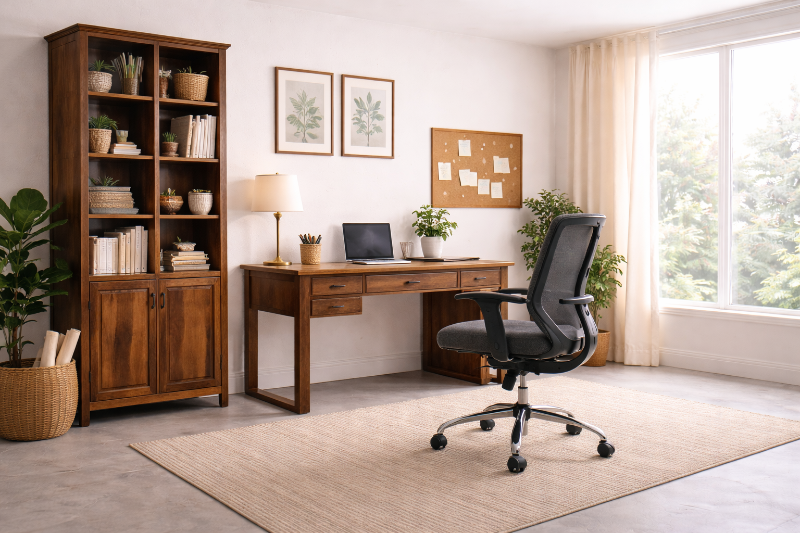 | 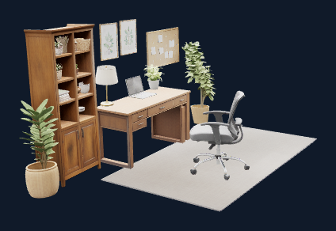 |

## 전체 파이프라인

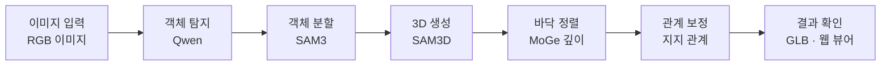

| 단계 | 역할 |
|---|---|
| 이미지 입력 | RGB 이미지 한 장을 입력 |
| 객체 탐지 | Qwen이 이미지에 보이는 객체 이름을 반환 |
| 객체 분할 | SAM3가 객체 이름에 대응하는 영역을 마스크로 분리 |
| 3D 생성 | SAM3D가 객체 메시와 위치·회전·크기인 pose를 생성 |
| 바닥 정렬 | MoGe 깊이에서 바닥 평면을 추정하고 장면의 방향·높이를 정렬 |
| 관계 보정 | 받침을 찾고 연결된 물체를 함께 이동해 작은 틈을 보정 |
| 결과 확인 | 웹 뷰어에서 장면을 확인하고 GLB로 활용 |

## 객체 생성 흐름

객체 이름, 마스크, 3D 메시를 순서대로 연결합니다. 예를 들어 Qwen이 찾은 의자를 SAM3가 이미지에서 분리하고, SAM3D가 그 영역의 3D 형상과 pose를 추정합니다. 오른쪽 이미지는 생성된 객체들을 pose에 따라 조립한 **배치 보정 전 SAM3D 결과**입니다.

| Qwen · 객체 태그 | SAM3 · 객체 마스크 | SAM3D · 메시와 pose |
|---|---|---|
| 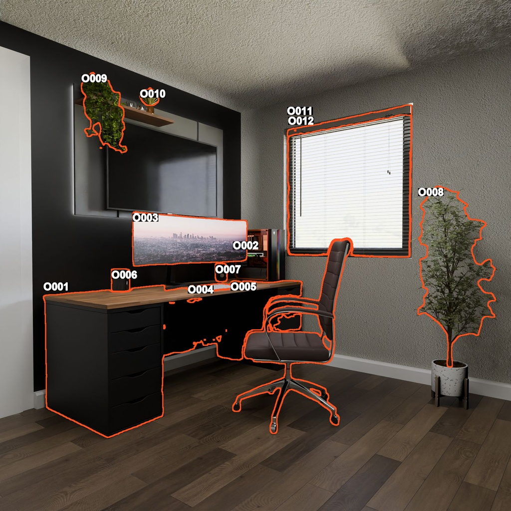 | 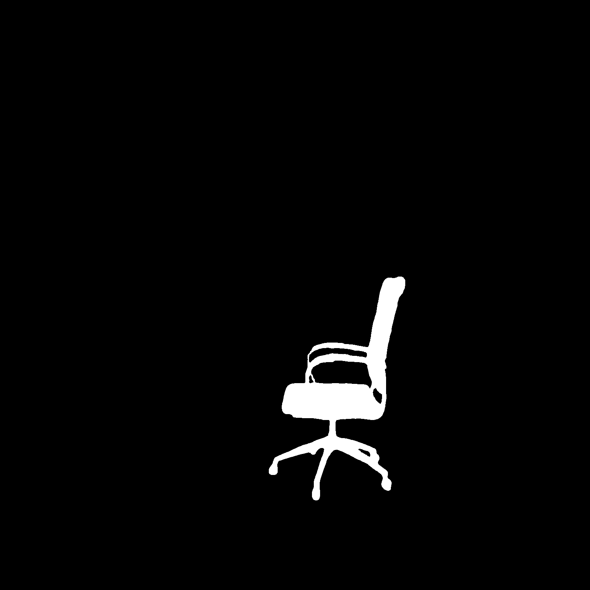 | 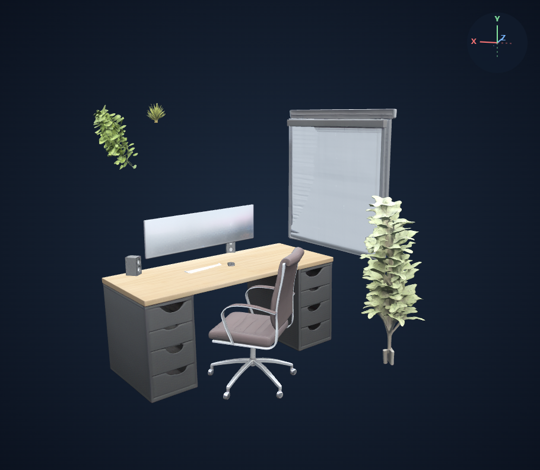 |

## RAM++와 Qwen 객체 목록

작업 공간 이미지에서 RAM++는 23개, Qwen은 10개의 태그를 반환했습니다.

| RAM++ · 23개 태그 | Qwen · 10개 태그 |
|---|---|
| black, lamp, bureau, ceiling, chair, computer, computer desk, table, drawer, floor, hardwood, hardwood floor, home office, modern, office, office chair, office desk, office supply, plant, room, swivel chair, window, wood floor | desk, chair, computer_monitor, keyboard, mouse, speaker, cabinet, plant, window, blinds |

RAM++ 목록에는 배경·재질·장면 이름과 비슷한 객체 이름이 함께 들어 있습니다. 이런 태그를 모두 생성에 사용하면 넓은 배경 메시가 가구를 가리거나 같은 물체가 중복 생성됩니다. 필요한 가구를 남기기 위해 Qwen의 입력과 프롬프트를 단계적으로 바꿨습니다.

## Qwen 프롬프트 변화

### 1. RAM++ 단독

프롬프트 없이 이미지에서 태그를 추출했습니다. 방·바닥 태그로 생성한 넓은 메시가 가구를 가렸습니다.

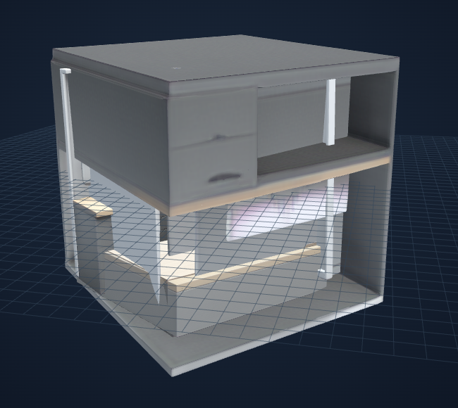

### 2. 배경 예시 추가

RAM++가 만든 태그 목록을 Qwen에 전달하고 벽·바닥·천장 같은 배경 이름을 제거하도록 했습니다.

```text
Remove tags that refer to scene backgrounds, such as walls, floors,
and ceilings, from the following list.
Return the remaining tags as a JSON array.
Do not add or rename tags.
```

벽, 바닥, 천장처럼 장면 배경인 태그를 제거하고 남은 태그를 JSON 배열로 반환하도록 요청했습니다. 태그 추가와 이름 변경은 허용하지 않았습니다. 바닥 태그는 제거됐지만 `home office`, `office`, `room`은 남았습니다.

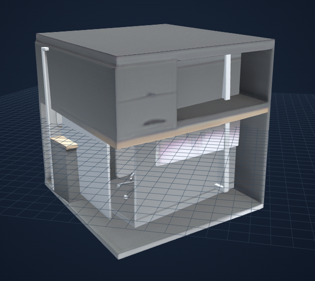

### 3. 이동 가능한 물체

배경을 제거하는 대신 이동 가능한 물체만 남기도록 조건을 바꿨습니다.

```text
Keep only tags that refer to movable objects from the following list.
Return the remaining tags as a JSON array.
Do not add or rename tags.
```

이 조건에서는 `computer` 태그까지 제거되어 생성 결과에서 화면이 사라졌습니다.

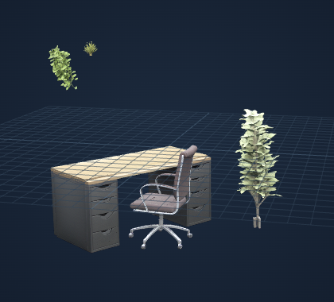

### 4. 비전 입력

기존 태그 목록을 필터링하는 방식에서, Qwen이 원본 이미지를 보고 객체 이름을 직접 생성하는 방식으로 바꿨습니다.

```text
List tags that refer to movable objects visible in this image.
Return only a JSON array of strings.
```

이미지에 보이는 물체를 직접 찾지만 `computer`와 `monitor`처럼 같은 대상을 가리키는 이름이 겹쳤습니다.

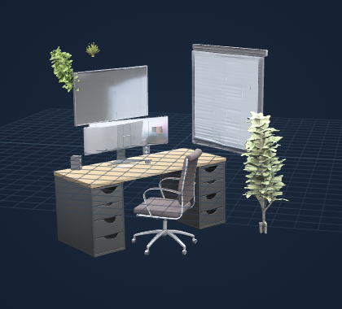

### 5. 가구 명시

가구를 포함한다는 조건을 명시하고, 구체적이고 흔한 이름을 객체 종류마다 하나씩 반환하도록 했습니다. 최종 객체 선택에는 이 프롬프트를 사용합니다.

```text
List the furniture and other movable physical objects visible in this image.
Use specific, common object names, with one tag per object category.
Return only a JSON array of strings.
```

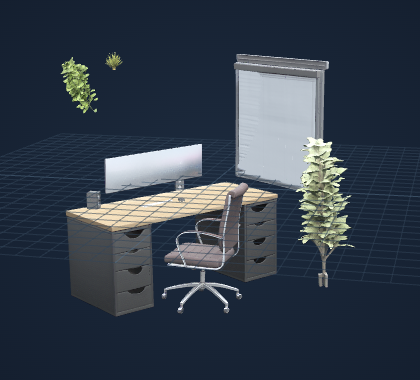

텍스트 필터 조건은 기존 태그를 제거하고 RAM++로 생성해 둔 메시를 선별·재사용했습니다. 비전 조건은 이미지에서 태그를 새로 생성한 뒤 SAM3·SAM3D를 다시 실행했습니다. 태그 수, 분할 마스크 수, 생성 메시 수는 서로 다르며 태그 수 감소 자체가 품질 점수는 아닙니다.

## 바닥 정렬

생성 결과의 최저점만 `Y=0`으로 옮기면 바닥의 기울기는 남습니다. 바닥 평면의 방향까지 정렬해 장면의 기준 바닥을 맞춥니다.

| 최저점만 Y=0으로 이동 | 바닥 평면의 방향까지 정렬 |
|---|---|
| 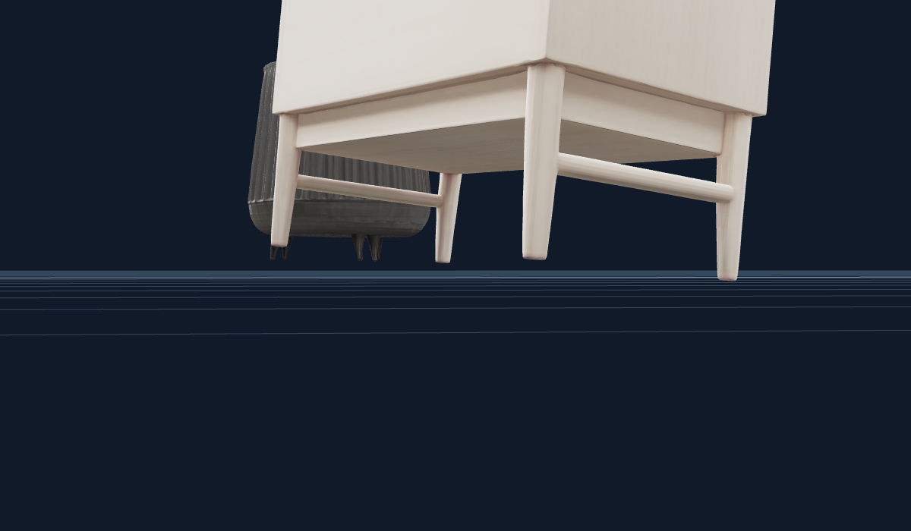 | 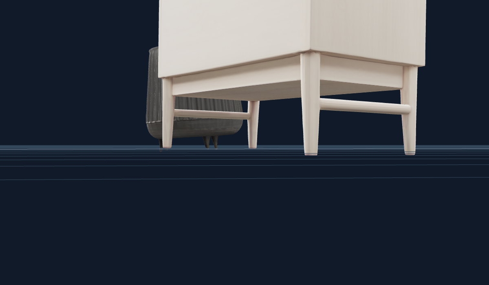 |

### 바닥 정렬 구현

1. **깊이를 3D 점으로 변환:** MoGe 깊이를 이용해 장면의 3D 점을 구합니다.
2. **배경에서 바닥 추정:** MoGe 점군에서 객체 마스크를 제외하고, RANSAC으로 평면 후보를 추출해 화면 하단의 넓은 평면을 선택합니다.
3. **공통 좌표계 변환:** 바닥 법선은 `+Y`, 바닥 높이는 `0`이 되도록 모든 객체에 같은 변환을 적용합니다. 객체 사이의 상대 배치는 유지합니다.

| MoGe 깊이 시각화 | 바닥 후보 영역 |
|---|---|
| 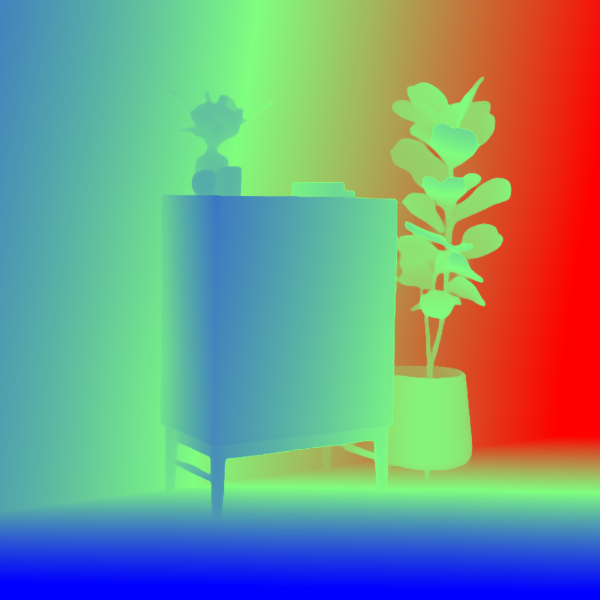 | 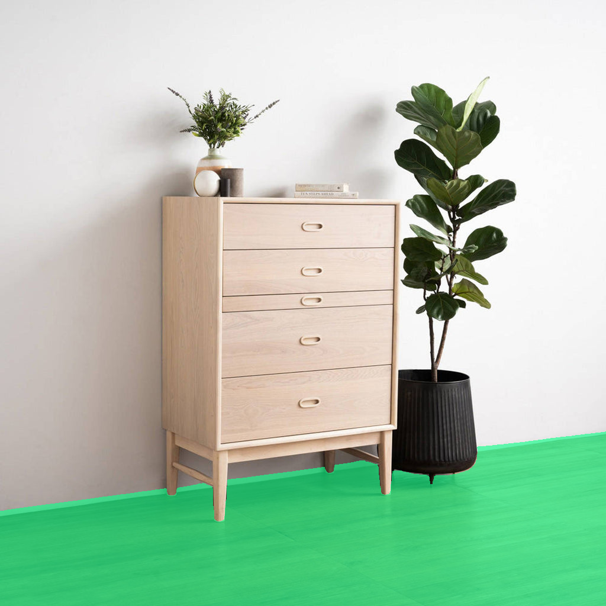 |

바닥은 이미지 깊이에서 추정한 기준이며 실측 정답은 아닙니다. 공통 정렬 이후에도 개별 물체와 받침 사이의 틈은 남을 수 있습니다.

## 관계 보정

화병만 내리면 안의 식물이 그대로 남을 수 있습니다. 받침 관계를 따라 연결된 물체를 함께 이동해 화병과 상판의 틈을 줄입니다.

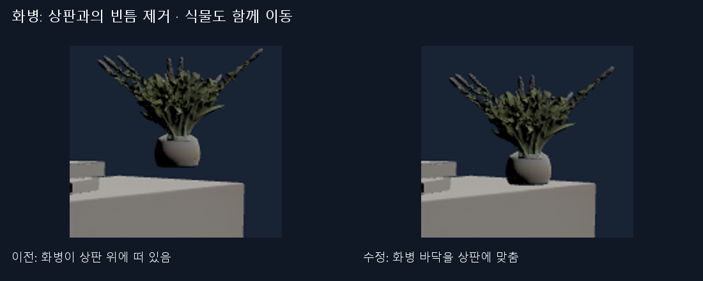

### 관계 보정 구현

| 단계 | 처리 |
|---|---|
| 1. 받침 찾기 | 물체 밑면의 대부분을 받치는 아래쪽 가구를 찾음 |
| 2. 함께 이동 | 가구가 움직인 만큼 그 위 물체도 같이 이동 |
| 3. 작은 틈 보정 | 받침과 조금 떨어져 있으면 그 간격만큼 내려서 붙임 |

받침이 불확실하거나 틈이 크면 보류하며, 중간 받침이 관측되면 그 아래로 내리지 않습니다. 보정으로 새 관통이나 지지 상실이 생기면 연결된 그룹의 이동을 되돌립니다. 이는 완전한 충돌 검사는 아닙니다. Qwen은 객체 목록 생성에 사용하고, 이 후단 보정은 깊이와 메시의 지지 관계를 이용합니다.

## 결과물

아래는 최종 발표에 사용한 원본 이미지와 생성 결과의 360도 턴테이블입니다. 저장된 최종 GLB를 카메라만 회전해 렌더링했으며, 각 GIF는 약 6.4초 동안 한 바퀴 돌며 반복됩니다. 세 장면은 같은 가구 명시 프롬프트를 사용했습니다.

### 원목 서재

| 원본 이미지 | 생성 결과 |
|---|---|
|  | 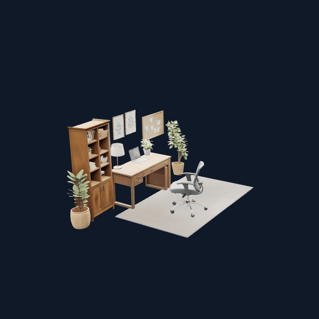 |

### 작업 공간

| 원본 이미지 | 생성 결과 |
|---|---|
| 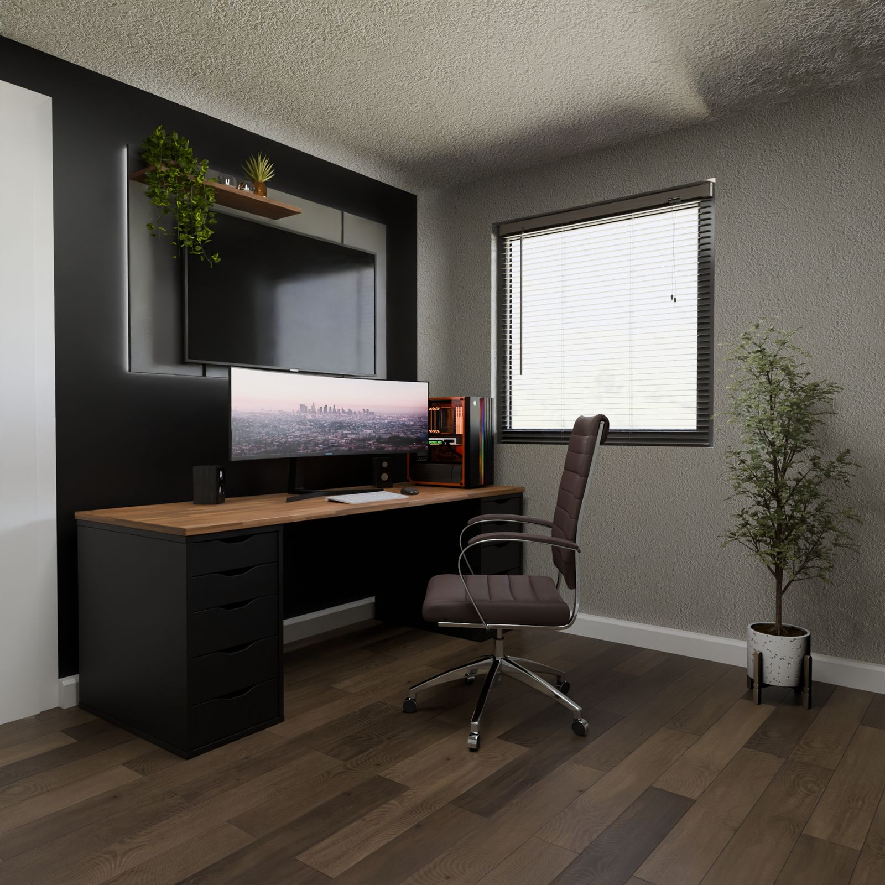 | 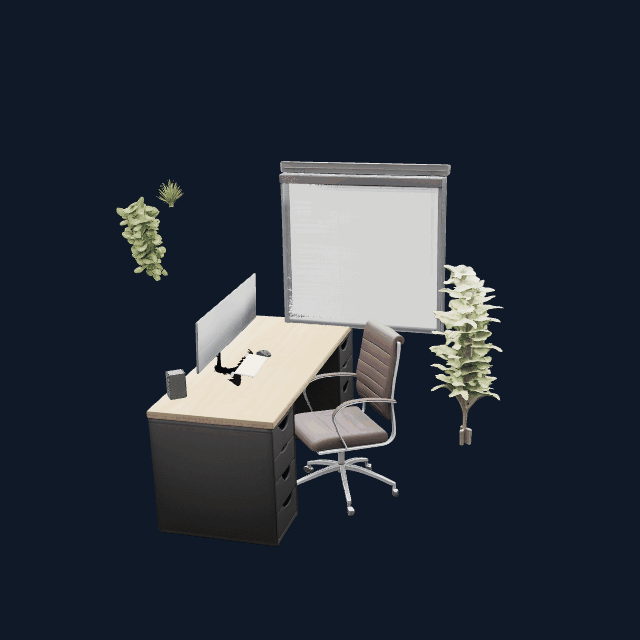 |

### 서랍장

| 원본 이미지 | 생성 결과 |
|---|---|
| 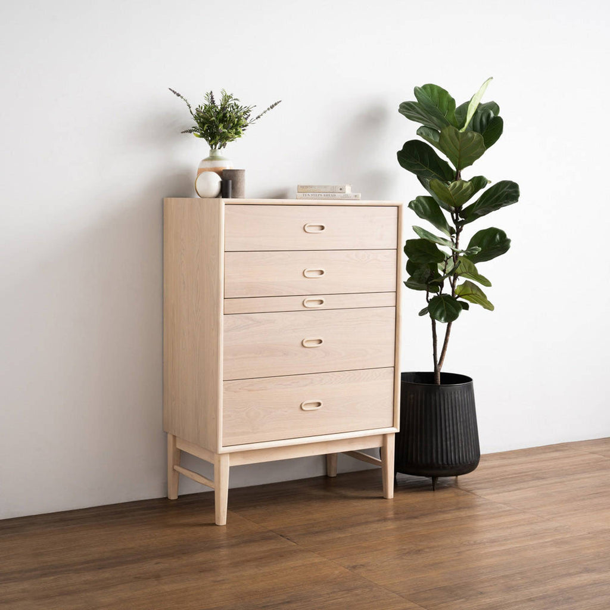 | 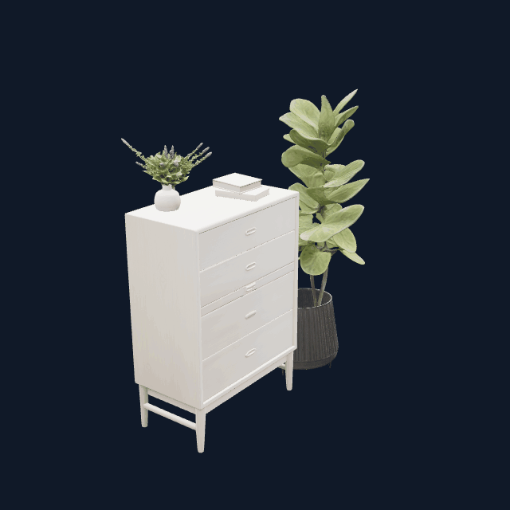 |

선정한 사례의 결과이며 모든 입력에 대한 성공률을 뜻하지 않습니다. 얇은 다리·소품·가려진 면의 형상 오류와 일부 부유·중복은 남습니다.

## 남은 과제

- **처리 속도:** 약 25분은 과거 서비스 1회 측정의 대기·실행 시간을 합친 값이며, 최신 깊이 후처리까지 포함한 시간은 아닙니다. 대기 시간과 처리 시간을 줄이는 것이 과제입니다.
- **외부 접속과 시연:** 발표 당시 공개 루트 주소는 있었지만 인증·파일 전달 오류로 안정적인 결과 공유 링크를 제공하지 못했습니다. 이를 해결하고 입력부터 결과 확인까지 이어지는 시연을 준비해야 합니다.

위 두 항목은 최종 발표의 과제입니다. 처리 시간은 최신 벤치마크가 아니며, 저장소의 배포 설정만으로 현재 외부 접속이나 전체 시연이 검증됐다고 보지는 않습니다.

## 실행 방법

Python 3.11, Node.js, uv를 기준으로 합니다. 실제 생성에는 GPU 모델 환경 또는 Runpod endpoint와 S3 설정이 필요합니다. 모델 가중치와 인증 정보는 저장소에 포함하지 않습니다.

```sh
uv sync --frozen --extra remote --extra geometry
npm ci --prefix web

# Qwen 비전 → SAM3 → SAM3D
uv run python scripts/run_presentation.py samples/living_room.jpg

# RAM++ 베이스라인
uv run python scripts/run_presentation.py samples/living_room.jpg --baseline

# 저장된 실행 결과 목록과 3D 뷰어
uv run mapmaker review

# 업로드·생성 웹/API
uv run mapmaker serve
```

저장 결과 목록은 [로컬 결과 뷰어](http://127.0.0.1:8118)에서 엽니다. `viewers.json`에 연결된 원본 GLB는 로컬 `.runtime/`에 있어 저장소를 clone하는 것만으로 포함되지 않습니다. 목록에서 여는 객체 선택 결과와 아래 최종 보정 결과는 구분합니다.

바닥·관계 보정은 저장된 생성 결과에 별도 스크립트로 적용하며, 아직 일반 웹 생성의 기본 경로에 통합하지 않았습니다. 처리 순서는 `depth_floor_placement.py init` → `infer_scene_depth.py` → `analyze` → `correct` → `group_depth_placement.py`입니다. 누락된 받침의 관측 표면 복원은 별도 `complete_depth_support.py` 실험에 해당합니다.

최종 발표 결과 GLB는 `.runtime/depth-support-fitted/<scene>/final.glb`에 보존합니다. 저장소 루트를 제공하는 로컬 HTTP 서버에서 `web/result-viewer.html?scene=present-office-c`로 열 수 있습니다. 다른 장면 ID는 `new-office`, `present-cabinet`입니다. 이 뷰어는 로컬 GLB와 `web/node_modules`가 필요합니다.

| 구성 | 위치 |
|---|---|
| 객체 선택 프롬프트 | [qwen_tags.py](mapmaker/qwen_tags.py) |
| 깊이와 바닥 정렬 | [depth_floor.py](mapmaker/depth_floor.py) |
| 지지 관계와 그룹 이동 | [group_placement.py](mapmaker/group_placement.py) |
| 바닥·관계 보정 실행 | [depth_floor_placement.py](scripts/depth_floor_placement.py), [group_depth_placement.py](scripts/group_depth_placement.py) |
| 배포 설정·이미지 | `configs/cloud-deployment.json`, `deploy/runpod/` |
| 웹 앱과 결과 뷰어 | `web/` |
| 모델 의존성·고정 버전 | `configs/`의 TXT·JSON 설정 |
| 이미지와 검증 근거 | `artifacts/assets/` |

## 입력 이미지 출처

| 장면 | 출처 |
|---|---|
| 원목 서재 | [ZIOR study room](https://zior.in/collections/study-room) — 상품 연출 이미지, 원본 파일명 기준 AI 생성 추정 |
| 작업 공간 | [Pexels](https://www.pexels.com/photo/minimalist-setup-office-27920699/) |
| 서랍장 | [Modern Furniture HAYTON](https://www.modernfurniture.com.au/products/hayton-tall-ideboard-70cm-white-oak) |

README의 정지 이미지는 최종 발표 PPT v23에 포함된 원본을 추출해 사용했고, 턴테이블 GIF는 저장된 최종 GLB에서 렌더링했습니다. 이미지 재사용 시 원출처와 이용 조건을 확인합니다. 프로젝트 설명 문서는 이 README로 통일하며, PPT 원본은 내용 대조와 확인을 위해 임시 보존합니다.
