# MapMaker

**사진 한 장에서 객체를 생성하고, 바닥과 물체 사이의 관계를 고려해 배치를 보정하는 3D 장면 구성 프로젝트**

Qwen 비전 → SAM3 → SAM3D로 객체를 생성하고, **깊이·지지 관계로 배치를 보정**합니다. 위치만으로 해결되지 않는 받침 누락은 원본 RGBD의 관측 표면을 복원합니다.

| 객체 선택 | 관계 기반 배치 | 결과 활용 |
|---|---|---|
| 배경·가구 누락을 줄이기 위한 프롬프트 비교 | 바닥 접촉, 그룹 이동, 누락 받침 정합 | 객체별 GLB, 웹 뷰어, 전후 검증 기록 |

## 목차

- [처리 과정](#처리-과정)
- [문제를 해결하며 바뀐 설계](#문제를-해결하며-바뀐-설계)
- [배치 보정 상세 구현](#배치-보정과-관측-받침-복원)
- [모델 연결과 실행 경로](#모델-연결과-기존-실행-경로)
- [검증과 현재 한계](#검증과-현재-한계)
- [실행 방법](#실행-방법) · [기술 구성](#기술-구성과-저장소)
- [배포와 운영](#runpod-배포와-운영)
- [Qwen 관계 실험 기록](#qwen-후단-관계-실험과-전환-근거) · [이미지 출처](#입력-이미지-출처)

## 처리 과정

객체 생성과 장면 보정을 포함한 전체 처리 구조입니다. 생성·뷰어는 기존 실행 경로로 동작하며, 최근 보정·받침 복원은 저장된 생성 결과에 실험 스크립트로 적용합니다. 보정 결과는 현재 비교 기준으로 보존하고 있으며 서비스 기본 경로 통합은 아직 하지 않았습니다.

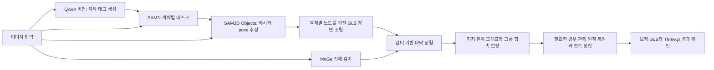

입력은 EXIF 방향을 반영한 RGB PNG로 정규화합니다. Qwen2.5-VL-7B-Instruct가 반환한 객체 태그를 SAM3에 전달하고, 각 인스턴스 마스크로 SAM3D Objects의 메시와 pose(위치·회전·크기)를 추정합니다. 공식 pose로 조립한 GLB는 보정 전 원본으로 보존합니다.

후처리는 전체 깊이의 바닥 평면과 객체 간 지지 관계를 이용합니다. 관측 근거가 있는 누락 받침은 별도로 복원하며, 최종 GLB와 동일 카메라의 전후 이미지·판정·해시를 저장합니다. Three.js 뷰어에서 장면 탐색, 객체 표시 전환, GLB 다운로드를 지원합니다.

## 문제를 해결하며 바뀐 설계

**태그를 줄이는 것 → 필요한 객체를 남기는 것 → 물체를 실제 받침 위에 놓는 것**으로 문제를 좁혀 갔습니다.

### 1. 배경을 지웠더니 필요한 물체도 사라졌다

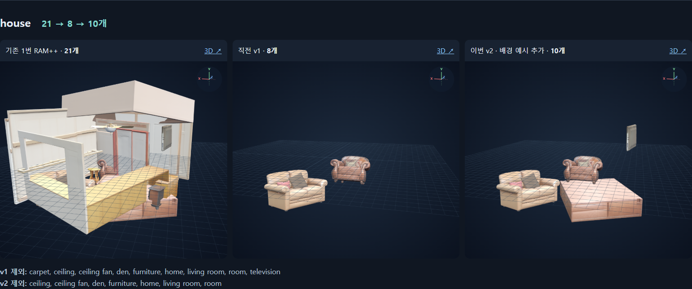

**왼쪽부터 RAM++ → 배경 제거 v1 → 벽·바닥·천장 예시를 추가한 v2.** 같은 카메라에서 기존 객체를 선별·재조립한 결과입니다.

| 시도 | 실제 결과 | 다음 판단 |
|---|---|---|
| RAM++ 태그를 모두 생성 | 방·배경 메시가 가구를 가리고 유사 태그가 중복 생성으로 이어짐 | 생성 대상부터 구분 |
| Qwen 텍스트로 배경 제거 | 집의 `television`, 다른 장면의 `bed`·`table`도 탈락 | “배경”의 범위가 모호함 |
| 벽·바닥·천장 예시 추가 | 같은 집에서도 남는 형상이 달라짐 | 제거 수보다 필요한 객체의 보존을 확인 |

<details>
<summary>텍스트 필터의 조건과 원문 지시</summary>

| 버전 | 핵심 지시 |
|---|---|
| v1 | `Remove tags that refer to scene backgrounds` |
| v2 | `Remove tags that refer to scene backgrounds, such as walls, floors, and ceilings` |

Qwen2.5-7B-Instruct에 RAM++ 태그 목록만 전달했습니다. 이미지는 입력하지 않았고 태그 추가·이름 변경도 금지했습니다. SAM3·SAM3D 재추론 없이 기존 메시·배치를 재사용했습니다. 10장의 유지 객체 수는 원래 420개 → v1 372개 → v2 396개였습니다. 이는 품질 점수가 아닙니다.

</details>

### 2. movable로 좁혔더니 장면이 비었다

| RAM++ 기본값 · sample-01 | 텍스트 movable 적용 |
|---|---|
| 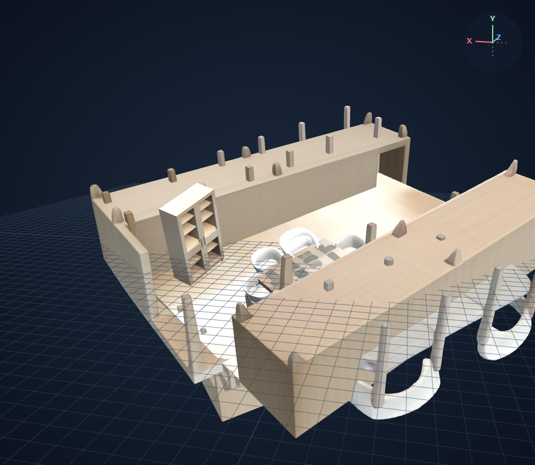 |  |

> **실패:** `chair`, `table`까지 제외됐고, 남은 태그에 대응하는 기존 생성 객체가 없어 결과가 0개가 됐습니다. sample-04에서도 같은 문제가 나타났습니다.

| 바꾼 점 | 확인한 한계 | 다음 시도 |
|---|---|---|
| 배경 제거 대신 `Keep only tags that refer to movable objects` | 책장·소파·TV도 탈락. RAM++가 놓친 물체는 텍스트 필터로 추가할 수 없음 | 원본 이미지를 보고 태그를 직접 생성 |

### 3. 비전 입력에 furniture를 명시해 가구를 다시 찾았다

| Qwen 비전 · movable | Qwen 비전 · furniture |
|---|---|
|  | 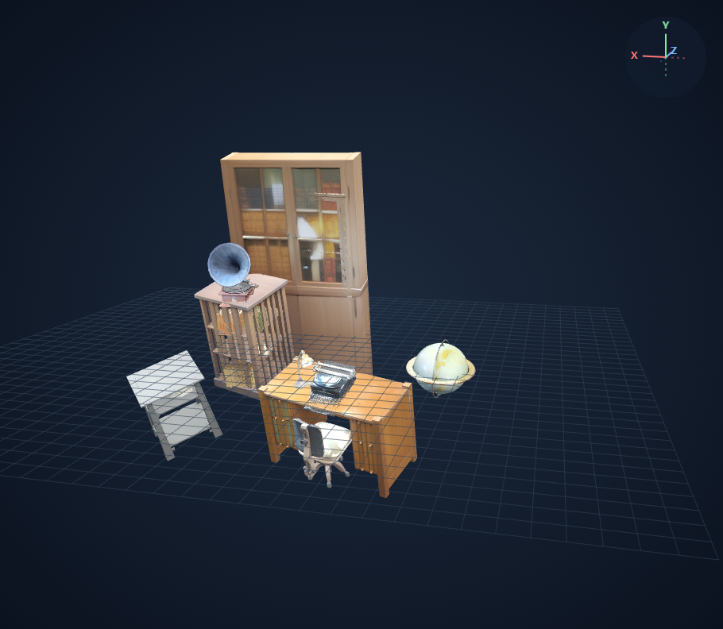 |
| `gramophone`, `typewriter`, `globe`, `chair`만 반환 | `desk`, `bookshelf`, `lamp`, `books` 등이 포함됨 |

**같은 사무실·같은 카메라.** 두 버전 모두 이미지에서 태그를 받아 SAM3·SAM3D를 새로 실행했습니다. 가구는 다시 드러났지만 소품의 부유와 형상 오류는 남았습니다.

| 문제 | 프롬프트 변경 | 남은 한계 |
|---|---|---|
| movable에서 주요 가구 누락 | `furniture and other movable physical objects` 명시 | 문·창문까지 포함되는 사례 |
| 넓거나 겹치는 이름 반환 | 구체적이고 흔한 이름, 종류당 태그 하나 요청 | 중복이 완전히 제거되지는 않음 |
| 태그는 있지만 결과에서 물체가 없음 | 태그 → 마스크 → 메시를 나눠 확인 | 거실 의자·독서 코너 협탁은 마스크 생성 단계에서 누락 |

<details>
<summary>채택한 프롬프트와 비교 조건</summary>

```text
List the furniture and other movable physical objects visible in this image.

Use specific, common object names, with one tag per object category.
Return only a JSON array of strings.
```

| 항목 | 조건 |
|---|---|
| 비교 범위 | 기존 5장 + 새 6장, RAM++·텍스트 필터 4종·비전 2종 |
| 텍스트 furniture | 가구 누락은 줄었지만 `dining room` 같은 태그가 남음 |
| 비전 furniture | 현재 객체 선택 기준인 `furniture_v1`로 채택 |
| 공통 생성 조건 | SAM3 기본값, SAM3D seed 42, 공식 pose, 추가 배치 보정 없음 |
| 결과 선정 | 식사 공간은 테이블 형상 문제로 제외. 장면별로 유리한 프롬프트를 섞지 않음 |

새 6장에는 기존 프롬프트·설정을 유지했습니다. 식사 공간은 비전이, 독서 코너는 텍스트 v1이 상대적으로 나았으므로 모든 입력에서의 우월성을 주장하지 않습니다.

</details>

### 객체 선택 전후 결과

각 행의 베이스라인과 최종 결과는 **동일한 카메라와 시선**으로 촬영했습니다. 비교 HTML의 확대 이미지는 최종 장면에 맞춘 별도 시점입니다.

| 장면 | 원본 이미지 | RAM++ 베이스라인 | Qwen 비전 적용 |
|---|---|---|---|
| 원목 서재 |  |  | 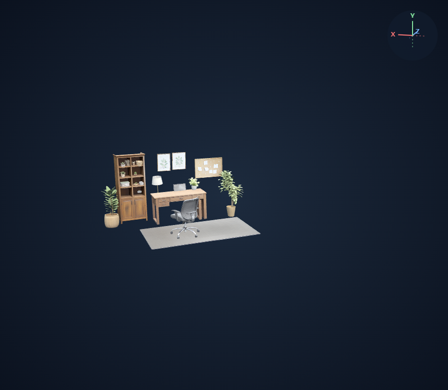 |
| 수납장과 식물 |  | 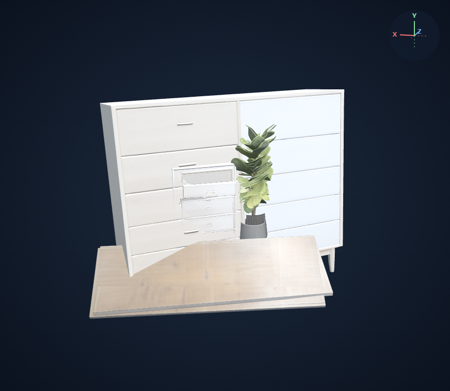 | 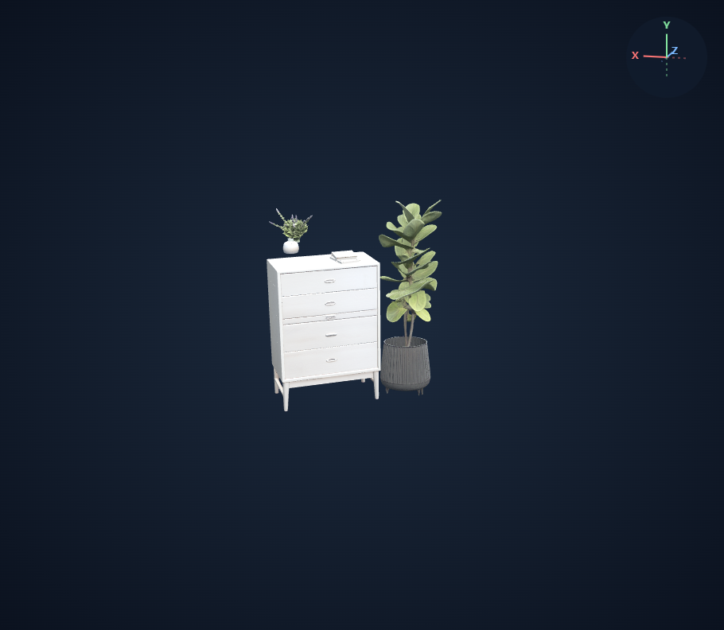 |
| 작업 공간 | 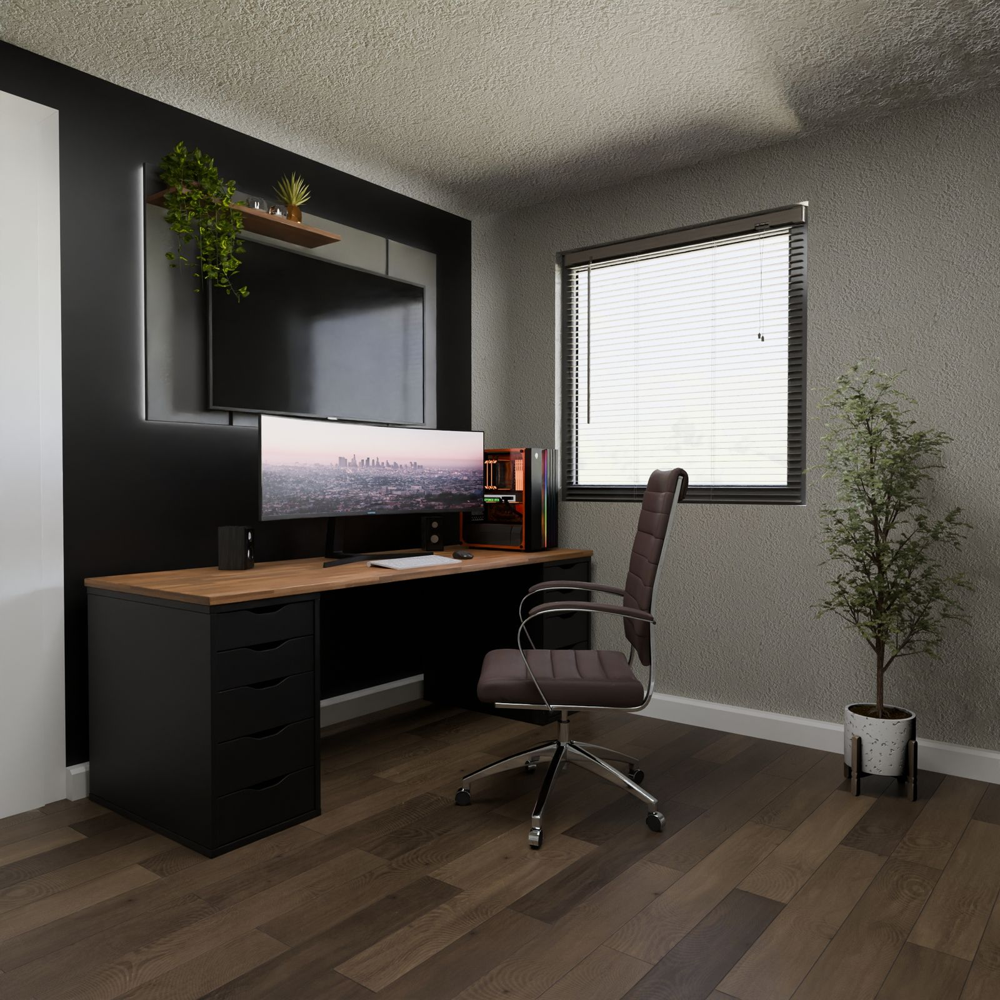 | 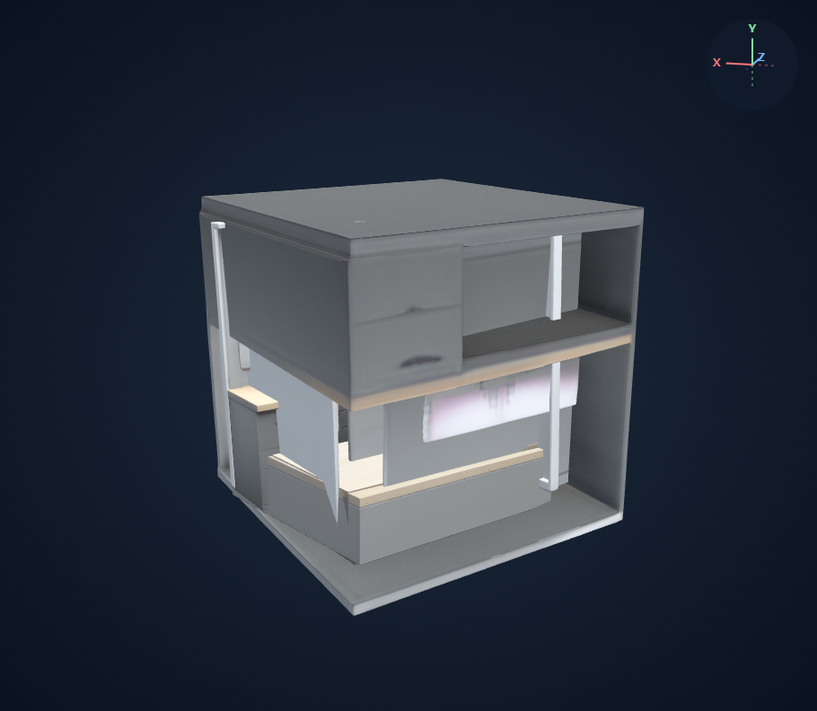 |  |

| 장면 | 확인한 변화 | 남은 한계 |
|---|---|---|
| 원목 서재 | 전체 생성 객체 44→22개. 책상·의자·책장이 각각 1개로 생성되어 주요 가구 구성이 드러남 | 책상 다리 일부가 판형으로 변형되고 화분·소품 높이 오차가 남음 |
| 수납장과 식물 | 19→8개. 여러 이름으로 중복 생성되던 주요 수납장이 dresser 1개로 정리됨 | 작은 화병의 부유, 소품 중복, 원본보다 밝은 색상 |
| 작업 공간 | 37→12개. 방 메시가 가리던 책상·의자·모니터를 확인하기 쉬워짐 | 창·블라인드가 남고 일부 서랍장 형상이 확장됨 |

객체 수는 생성된 메시 수이며 품질 점수가 아닙니다. 위 세 장면은 기존 실행 결과에서 선정한 사례로, 전체 입력에 대한 성공률을 뜻하지 않습니다. 원목 서재 입력은 상품 연출 이미지로, 원본 파일명에 근거해 AI 생성 이미지로 추정하고 있습니다.

원본 출처, 선정 이유, 다각도 이미지와 상세 한계는 [객체 선택 비교 페이지](artifacts/RAM_QWEN_FILTER_THREE_WAY.html) 및 [로컬 비교 페이지](http://127.0.0.1:8118)에서 확인할 수 있습니다. 로컬 페이지는 아래의 `mapmaker review` 실행 후 열립니다.

### 4. 관계를 물어봐도 올바른 배치가 보장되지는 않았다

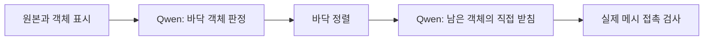

| 시도 | 실패 사례 | 얻은 기준 |
|---|---|---|
| 바닥 판정 후 나머지 받침 질문 | 서랍장 위 책·화병까지 바닥으로 내림 | 공중 객체 수 감소는 성공 지표가 아님 |
| 마스크 추가·JSON·스키마 강제 | “서랍장 위 책”이라고 설명하면서 `floor`로 분류 | 형식 통과와 의미 정확도를 분리 |
| 직접 받침 재질문·쌍별 후보·32B 모델 | 같은 화분 마스크끼리 쌓기, 잎·줄기를 화병 대신 가구에 붙이기 | 반복 응답과 접촉만으로 오판을 막을 수 없음 |

**전환:** 후단 관계 추론과 평균 업벡터 정렬까지 되돌리고, 원래 SAM3D 결과에서 깊이·기하 기반 보정을 시작했습니다. Qwen은 앞단 객체 선택에 유지합니다. [실험별 수치와 원문 기록](#qwen-후단-관계-실험과-전환-근거)

### 5. 바닥 접촉은 개선됐지만, 책상만 움직이면 안 됐다

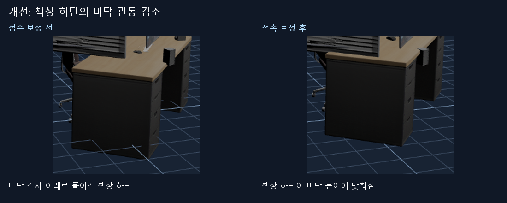

**왼쪽: 공통 바닥 정렬만 적용 / 오른쪽: 개별 접촉 보정.** 격자는 깊이에서 추정한 바닥이며 실측 정답은 아닙니다.

| 바꾼 점 | 확인한 개선 | 이어서 발견한 문제 |
|---|---|---|
| 평균 업벡터 대신 MoGe 깊이의 바닥 평면 사용 | 책상 하단의 추정 바닥 관통 감소 | 책상이 올라가면 위 물체에도 이동을 전달해야 함 |

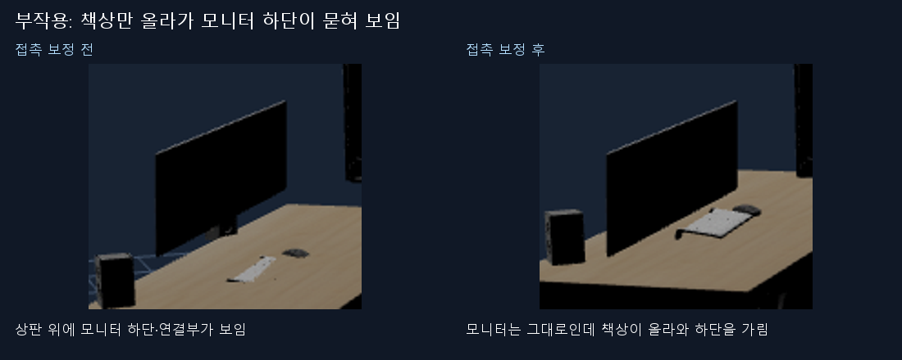

> **부작용:** 책상은 올라갔지만 모니터는 보류돼 그대로 남았습니다. 가구 하나의 접촉을 고치면서 다른 물체와의 관계를 망가뜨렸습니다.

### 6. 화병과 식물은 지지 관계를 따라 함께 움직였다

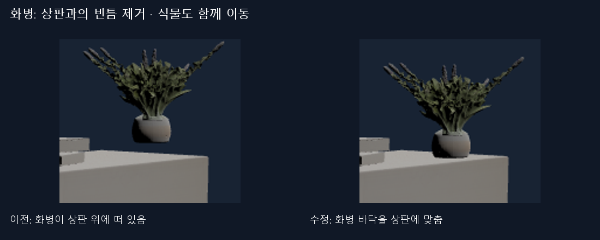

**왼쪽: 그룹 보정 전 / 오른쪽: 그룹 보정 후.** 화병의 상판 간격을 닫으면서 식물도 함께 이동했습니다.

| 변경 | 적용 기준 |
|---|---|
| 개별 이동 → 지지 그래프의 부모·자식 이동 | 가구 → 위 물체 → 그 위 물체 순으로 이동 전달 |
| 중간 받침 보존 | 깊이에서 책 더미 등이 보이면 아래 선반까지 내리지 않음 |
| 부작용 검사 | 새 관통·받침 이탈이 생기면 연결된 그룹의 이동을 되돌림 |

<details>
<summary>추가 사례: 서랍장 위 책의 접촉</summary>

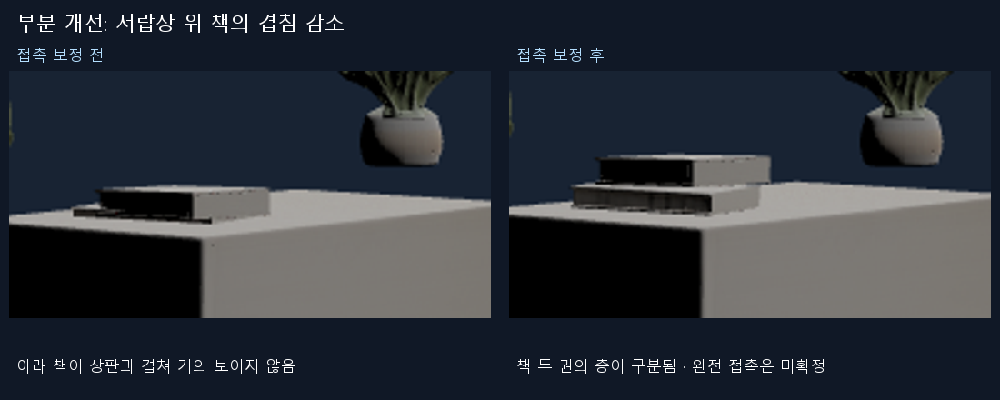

왼쪽은 공통 바닥 정렬 후, 오른쪽은 개별 접촉 보정 후입니다. 같은 카메라·영역을 사용했습니다.

</details>

### 7. 모니터는 높이보다 빠진 스탠드가 문제였다

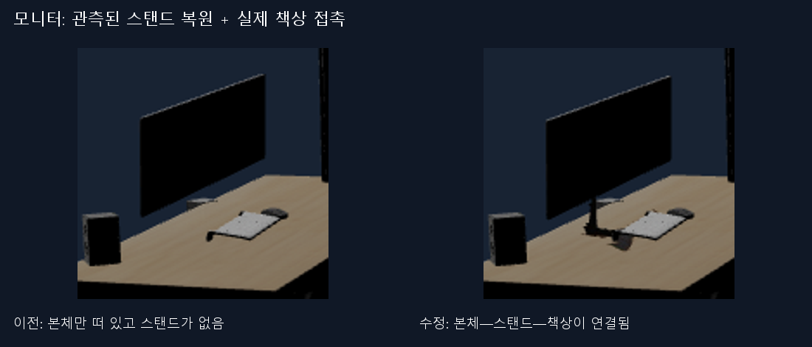

**왼쪽: 그룹 이동 후에도 떠 있는 본체 / 오른쪽: 관측 받침 복원·접촉 정합 후.**

| 확인한 원인 | 실패한 시도 | 최종 변경 |
|---|---|---|
| 원본 마스크에 화면만 포함돼 스탠드가 누락됨 | 원래 높이를 유지해도 부유. 화면을 내리면 모서리로 서게 됨 | 원본 RGBD에서 빠진 연결 표면을 추출 |
| 주변 상판 혼입·깊이 불연속 | 복원 표면이 조각나거나 본체와 어긋남 | 다른 객체 마스크·색상·연결성으로 후보 정제 |
| 본체 연결과 하단 접촉을 동시에 만족해야 함 | 강체 이동·8도 이내 기울기 탐색에서도 탈락한 후보 발생 | 상단 접합을 유지하며 불확실한 하단을 제한적으로 맞춤 |

**결과:** 본체—스탠드—책상 연결. 하부 표본 16개가 받침 범위 안에 있고 10개가 접촉 허용 범위에 있으며, 재검사 추가 수직 이동은 0입니다. 복원 부분은 관측 표면으로 거칠고 뒷면까지 완성한 형상은 아닙니다.

이름별 좌표나 모니터 전용 받침 템플릿은 사용하지 않았습니다. 네 개발 장면에서 확인한 결과이며, 독립 평가·물리 안정성 보증과는 구분합니다. [상세 검증과 한계](#검증과-현재-한계)

## 배치 보정과 관측 받침 복원

기준 결과는 `.runtime/depth-support-fitted/<scene>/final.glb`입니다. 원래 49개 객체를 유지하며, 현재 비교 기준은 결과·행렬·이미지·해시를 보존한 상태를 뜻합니다. Git release/tag 또는 서비스 기본 적용을 뜻하지 않습니다.

### 깊이와 바닥 평면

SAM3D 설정과 맞춘 MoGe-1 pointmap을 사용합니다. OpenCV 좌표를 SAM3D 카메라 좌표로 변환하고, 관측점과 메시 정점 사이 거리로 좌표 일치를 점검합니다. 이는 정확한 렌더 깊이 오차나 실제 단위 보정이 아닌 근사 검사입니다.

객체 마스크 바깥의 유효 깊이에서 RANSAC으로 여러 평면을 구하고, 영상 하단 분포·수평 범위·카메라 위치·장면 점들의 위아래 분포로 바닥 후보를 선택합니다. 선택한 평면을 `Y=0`, 법선을 `+Y`로 보내는 공통 변환을 적용합니다. 객체의 평균 업벡터는 사용하지 않습니다. 카메라의 대략적인 위 방향을 활용하므로 임의의 큰 카메라 회전까지 처리하는 방법은 아닙니다.

### 지지 관계와 그룹 이동

객체 하단의 관측 깊이, 주변 수평면, 실제 메시의 발 부분과 받침 범위를 이용합니다. 모호한 후보와 순환 관계를 처리하고 부모부터 이동량을 계산합니다. 가구가 움직이면 위 물체와 그 위 물체까지 관계를 따라 이동합니다.

깊이맵에 중간 받침이 보이면 생성된 메시가 없더라도 그 아래 선반까지 물체를 내리지 않습니다. 새 받침면 관통이나 받침 범위 이탈을 감지하면 연결된 그룹의 이동을 되돌립니다. 이 검사는 모든 삼각형 사이의 전역 충돌 검사가 아닙니다.

### 누락 받침의 관측 표면 복원

현재 구현은 그룹 보정에서 받침과의 간격을 유지한 일부 후보에 적용합니다. 원래 물체 마스크와 접하는 RGBD 영역을 아래쪽으로 탐색하고, 다른 객체 마스크·깊이 불연속·가구 표면의 혼입을 제외합니다. 연결 부위와 가구의 색상 차이도 사용하며, 실제로 연결된 관측 삼각형 성분을 남깁니다.

그 표면을 그대로 정답으로 취급하지 않습니다. 깊이 편차가 있는 부분은 제한된 이동으로 기존 본체에 정합하고, 상단 접합을 유지하면서 하단 접촉을 함께 맞춥니다. 실제 기하에서 얻은 접촉 다각형과 본체 중심 추정값을 검사합니다. 최종 모니터 후보에는 추가 회전을 적용하지 않았습니다.

복원한 부분은 본체의 하위 노드로 추가합니다. 따라서 본체를 나중에 이동해도 받침이 따로 남지 않습니다. 원래 메시·텍스처 바이너리 구간은 보존하지만 **최종 GLB 전체는 새 형상이 추가되어 변경됩니다.**

장면 ID나 `monitor`, `vase` 같은 이름별 보정 분기는 없습니다. 다만 장면·객체 크기에 대한 비율, 색상 거리, 접촉 허용 범위 등의 휴리스틱은 존재합니다. 이것이 모든 장면에 대한 일반화 성능을 보장하지는 않습니다.

### 구현 파일

| 역할 | 코드 |
|---|---|
| 바닥 평면과 깊이 기반 관계 | [depth_floor.py](mapmaker/depth_floor.py) |
| 지지 그래프와 그룹 이동 | [group_placement.py](mapmaker/group_placement.py) |
| 누락 연결 표면과 접촉 정합 | [depth_attachment.py](mapmaker/depth_attachment.py) |
| 실제 받침면과 접촉 다각형 | [scene_geometry.py](mapmaker/scene_geometry.py), [pair_support.py](mapmaker/pair_support.py) |
| 실행 | [depth_floor_placement.py](scripts/depth_floor_placement.py), [group_depth_placement.py](scripts/group_depth_placement.py), [complete_depth_support.py](scripts/complete_depth_support.py) |
| 최종 비교와 보존 감사 | [report_depth_completion.py](scripts/report_depth_completion.py) |

## 모델 연결과 기존 실행 경로

<details>
<summary>실행 모드·장면 조립·원본 재사용 상세</summary>

이 절의 `finish_scene`은 기존 worker 경로이며 위 최신 깊이 후처리는 아직 서비스 기본값에 연결하지 않았습니다.

### 실행 모드

| 모드 | 생성 방식 | 배치 보정 | 공간 표시 |
|---|---|---|---|
| 1 | 기본 모델 출력 | 없음 | 없음 |
| 2 | 확장 탐색·공유 pointmap·생성 후보 검토 | 없음 | 없음 |
| 3 | 2번 결과 재사용 가능 | 적용 | 없음 |
| 4 | 2번 결과 재사용 가능 | 적용 | 포함 |

객체 선택 비교에는 **mode 1의 태그 생성기를 Qwen 비전으로 교체한 경로**를 사용했습니다. 최신 깊이 기반 후처리는 그 생성 결과에 별도 스크립트로 적용하며, 기존 3·4번 보정과 구분합니다.

### 공통 경로

`create_run`은 이미지를 EXIF 보정·RGB PNG로 저장하고 메타데이터에 `execution.mode`를 기록합니다. CLI와 원격 전송은 같은 입력 형식을 사용합니다.

`Pipeline`은 비전 subprocess와 상주 SAM3D worker를 연결합니다. 비전 진입점은 1번을 초기 구현으로, 나머지를 확장 구현으로 전달합니다. 1번은 RAM++ 기본 임계값과 출력 순서·반복 태그를 유지하는 별도 호출을 사용합니다. SAM3 기본 processor가 반환한 모든 마스크를 면적·점수·중복·개수 필터 없이 저장하고 각각 SAM3D에 전달합니다. 2~4번의 확장 탐색 정책은 유지합니다.

SAM3D worker는 1번의 객체별 추론과 2~4번의 공유 pointmap·후보 검토를 구분합니다. 조립, Gaussian 미리보기, 모델 출처 및 GPU 정보 기록은 `reconstruction_output.export_inference`를 공유합니다.

### 장면 조립과 원본 보존

149개 마스크의 식당 실행이 조립 중 컨테이너 메모리 제한으로 종료된 뒤, 최소 베이스라인은 객체별 GLB 버퍼를 순차 복사하고 공식 pose를 부모 노드에 적용하는 방식으로 바꿨습니다. 이 경로에서는 Gaussian 통합·CPU 메시 미리보기를 생략하고 실제 GLB를 웹에서 확인합니다. 확장 모드의 조립 경로는 유지합니다.

보정은 원래 생성 결과를 덮어쓰지 않고 단계별 GLB·행렬·판정 기록을 남깁니다. 메시·텍스처의 원래 바이너리 구간과 객체 노드 연결을 검사하고, 실패 결과도 동일 카메라로 비교할 수 있게 보존합니다.

### 보정과 내보내기

보정 소유자는 worker의 `finish_scene` 한 곳입니다. 원격 추론 체크포인트 업로드가 설정되면 보정 전에 원본을 저장합니다. 컨트롤러는 보정을 다시 호출하지 않습니다.

3·4번 모드는 `finalize_scene(render=False, supported_repair=True, overlap_repair=True)`를 호출합니다. 3번의 공간 제거는 노드에만 적용하고 객체와 공유하는 메시 리소스는 보존합니다.

`execution.completed_mode`는 해당 모드 처리가 끝난 후 기록합니다. 원격 클라이언트는 요청 모드와 완료 모드가 다르면 실패로 처리합니다. 모드 정보가 없는 기존 입력은 기존 기본 설정을 따릅니다.

### 비교 실행과 원본 재사용

`compare`는 입력당 1번과 2번만 모델 추론합니다. `derive`는 2번의 저장 메시·pose·마스크·깊이와 해시를 검증해 원본 장면을 재구성합니다. 한 번 보정해 4번을 만들고 같은 장면에서 객체만 내보내 3번을 만듭니다. 원본 GLB와 메타데이터 해시가 바뀌지 않았는지 확인합니다.

출력은 새로운 폴더에만 작성합니다. 자동 재제출이나 기존 결과를 다른 모드로 재분류하는 동작은 없습니다. 상태와 산출물 경로·GLB 해시는 `comparison.json`에 기록합니다. 현재 배치 재개 자동화는 없으며 실패한 실행의 산출물과 상태는 남습니다.

### 실행 환경

Runpod 전송·수집은 기존 `RemotePipeline`과 `ArtifactStore`를 공유합니다. 모드별 배포 ZIP을 만들거나 운영 endpoint를 교체하는 비교 전용 실행기는 제거했습니다. 기존 GPU worker와 웹 서비스 유지에 필요한 배포 코드는 남겼습니다.

로컬 후처리에는 numpy/scipy/trimesh/rtree와 선택적 native geometry 환경이 필요합니다. 초기/확장 모델 환경은 별도 구성합니다.

### 객체 선택 비교와 실행 기록

`scripts/run_presentation.py`는 mode 1 경로의 태그 생성기를 선택합니다. Qwen 비전의 `furniture_v1` 프롬프트는 `mapmaker/qwen_tags.py`에 정의되어 있습니다.

`artifacts/RAM_QWEN_FILTER_THREE_WAY.html`은 `scripts/report_presentation_selection.py`로 생성합니다. 세 자산 폴더의 `selection.json`은 입력 출처, `responses.json`은 모델 응답, `scene-manifest.json`은 실행 결과·해시, `captures-clean.json`은 동일 카메라 비교 기록, `viewers.json`은 로컬 GLB 위치를 보존합니다. `ram-qwen-filter-new-scenes/presentation-selection.json`이 최종 선정 목록입니다.

`review_server`의 기본 페이지는 저장된 객체 선택 비교이며, `--batch`로 새로운 배치 실행의 결과도 확인할 수 있습니다.

</details>

## 검증과 현재 한계

### 검증 결과

| 기록 | 확인된 내용 | 해석하면 안 되는 내용 |
|---|---|---|
| 개발 장면 4개와 원래 객체 49개 | 벤치 7, 작업 공간 12, 수납장 8, 원목 서재 22 | 독립 테스트셋 성능 |
| 초기 깊이 보정 | 바닥 접촉 14, 받침면 보정 18, 동반 이동 2, 개별 이동 보류 15 | 최종 성공률 또는 개선된 객체의 정확한 수 |
| 그룹 보정 | 화병 간격 제거, 부모 이동에 따른 자식 동반 이동 | 누락된 스탠드까지 해결했다는 주장 |
| 마지막 형상 복원 단계 | 작업 공간의 한 객체에 2,312개 정점과 4,083개 삼각형 추가 | 원래 모든 객체 형상의 복원 정확도 |
| 모니터 최종 접촉 재검사 | 하부 표본 16개 모두 받침면 범위 내, 10개가 접촉 허용 범위 내, 추가 수직 이동량 0 | 받침 발 전체가 완벽히 밀착하거나 물리적으로 전도되지 않는다는 보증 |
| 최신 기록된 전체 테스트 | `488 passed, 5 skipped` | 시각 품질 점수나 모든 입력의 성공률 |

접촉 허용값은 모니터 사례에서 약 `0.00334`의 장면 상대 단위입니다. 깊이의 실제 길이 척도를 검증하지 않았으므로 이를 mm·cm로 환산하지 않습니다. 중심 검사는 본체를 균일 밀도로 가정한 값이며 받침 질량과 실제 재질 분포는 알 수 없습니다.

원본 GLB 해시, 원래 바이너리 구간, 객체 목록, 추가 노드의 부모 연결, 최종 pose를 검사했습니다. 합성 테스트에는 이름·크기 변경, 부모·자식 이동, 모호한 관계, 중간 받침, 깊이 불연속, 없는 연결을 만들지 않는 경우, 상단 접합·하단 접촉, GLB 하위 노드 연결 검증이 포함됩니다.

`holdout-bench`라는 기존 폴더 이름과 달리 벤치 장면도 개발에 사용됐습니다. 이번 네 장면은 모두 독립 홀드아웃으로 취급하지 않습니다.

```sh
uv run pytest tests -q
```

회귀 테스트 수치는 2026-10-27에 기록한 전체 실행 결과입니다. 모델·클라우드를 모의 처리하는 테스트도 포함하므로 실제 서비스 동작이나 시각 품질 평가를 대신하지 않습니다. 비교 보고서는 이미지·링크 로딩, 모바일 레이아웃, 네 시점 전환도 확인했습니다.

### 남은 한계와 다음 검증

배경·중복 객체가 줄어든 사례를 확인했지만 모두 제거한 것은 아닙니다. 얇은 다리, 작은 소품, 가려진 면에는 형상 오류와 부유·겹침이 남습니다. 관측 표면 복원도 보이지 않는 뒷면이나 방 전체의 정확한 구조를 완성하지는 않습니다.

1. 개발에 사용하지 않은 새 이미지 목록을 먼저 확정하고 변경 없이 평가합니다.
2. 위치 보정만 적용한 결과와 받침 복원을 추가한 결과를 분리해 비교합니다.
3. 정상 배치의 악화, 관통, 잔여 부유, 잘못된 관계, 잘못 추가된 형상을 같은 기준으로 기록합니다.
4. 사람 검토에서 부유·관통이 감소했는지와 새 형상이 자연스러운지를 따로 평가합니다.
5. 실패 시 보류·그룹 롤백 동작과 실행 비용을 확인한 뒤 서비스 통합 여부를 결정합니다.

위치는 맞아도 형상이 틀릴 수 있고, 관측 표면이 연결돼도 완전한 물체가 아닐 수 있습니다. 특히 검은 표면의 깊이 오차, 가려진 받침, 다색 연결 부품, 잘못된 바닥 평면, 벽 부착·매달린 물체는 추가 검증 대상입니다.

### 태그 실험 기록의 출처

추가한 과거 캡처 5장은 Git에서 원본 바이트로 복구했습니다. [원본 경로·커밋·해시](artifacts/assets/prompt-evolution/provenance.json)를 함께 보존합니다.

위 프롬프트 변경 과정은 저장된 모델 응답과 Git 커밋 `ed75c32466fa422e28d081721493c32f260c0e2e`의 실험 기록을 대조해 정리했습니다. 당시 문서는 현재 파일 목록에서 제거했지만 다음 명령으로 확인할 수 있습니다.

```sh
git show ed75c32:docs/RAM_QWEN_FILTER_V1.md
git show ed75c32:docs/RAM_QWEN_FILTER_SCENES.md
git show ed75c32:docs/RAM_QWEN_FILTER_FULL_COMPARISON.md
```

텍스트 필터의 제약과 파싱은 [qwen_background_filter.py](mapmaker/qwen_background_filter.py), 비전 프롬프트의 실제 선택은 [qwen_tags.py](mapmaker/qwen_tags.py)에 있습니다. 대표 장면의 [RAM++·Qwen 원문 응답](artifacts/assets/ram-qwen-filter-complex/responses.json)과 [생성 기록](artifacts/assets/ram-qwen-filter-complex/scene-manifest.json)도 보존합니다. 태그 수, 마스크 수, 최종 객체 수는 서로 다른 값으로 구분합니다.

### 보존한 근거 자료

- [스냅샷과 코드·자산 해시](artifacts/assets/placement-2026-10-27/snapshot.json)
- [깊이 보정 감사](artifacts/assets/placement-2026-10-27/floor-audit.json)
- [그룹 보정 감사](artifacts/assets/placement-2026-10-27/group-audit.json)
- [마지막 단계 보존 감사](artifacts/assets/placement-2026-10-27/completion-audit.json)
- [모니터 복원과 접촉 판정](artifacts/assets/placement-2026-10-27/monitor-completion.json)

`artifacts/assets/placement-2026-10-27`에는 핵심 이미지와 작은 검증 기록을 보존했습니다. 큰 GLB·원본 실행 데이터·pointmap·모델 가중치는 포함하지 않았습니다. `.runtime`은 Git 제외 대상이므로 별도 백업 없이 지우면 완전한 재실행 입력을 잃을 수 있습니다.

## 실행 방법

Python 3.11, Node.js, uv를 기준으로 사용합니다. 실제 생성에는 준비된 GPU 모델 환경 또는 배포된 Runpod endpoint와 S3 접근 설정이 필요합니다. 모델 가중치와 인증 정보는 저장소에 포함하지 않습니다.

### 설치

```sh
uv sync --frozen --extra remote --extra geometry
npm ci --prefix web
```

Windows에서는 기본적으로 Runpod backend를, Linux에서는 local backend를 사용합니다. `MAPMAKER_BACKEND`로 변경할 수 있습니다. 원격 인증·스토리지 설정 및 worker 배포는 [Runpod 배포 절차](#runpod-배포와-운영)를 참고하세요.

### 현재 방식과 베이스라인 실행

```sh
# Qwen 비전 → SAM3 → SAM3D
uv run python scripts/run_presentation.py samples/living_room.jpg

# RAM++ 기본값 → SAM3 → SAM3D
uv run python scripts/run_presentation.py samples/living_room.jpg --baseline
```

각 명령은 새 추론을 수행하고 결과 GLB 경로를 출력합니다. 실행에 사용하는 worker도 해당 태그 생성 방식과 모델 환경을 지원해야 합니다.

### 저장된 결과 확인

```sh
uv run mapmaker review
```

[http://127.0.0.1:8118](http://127.0.0.1:8118)에서 대표 세 사례와 연결된 3D 뷰어를 엽니다. 비교 이미지와 실행 기록은 저장소에 포함되어 있습니다. 기존 GLB는 `artifacts/assets/` 아래 각 사례 폴더의 `viewers.json`이 가리키는 로컬 `.runtime/`에 있으므로, 저장소를 clone하는 것만으로 기존 3D 결과까지 내려받아지지는 않습니다.

일반 업로드·생성 웹/API는 `uv run mapmaker serve`로 실행할 수 있습니다. 이는 기존 웹 생성 경로이며, 위 Qwen 대표 결과를 재현할 때는 `run_presentation.py`를 사용합니다.

### 배치 보정과 받침 복원 실행

MoGe는 `Ruicheng/moge-vitl`, 모델 revision `ad326bfb61facd6c52b5a825bc1e34d7c97d9672`, 소스 revision `a8c37341bc0325ca99b9d57981cc3bb2bd3e255b`를 사용했습니다. `force_projection=False`, resolution level 9, FP16으로 로컬 RTX 3070 Ti에서 추론했습니다. 실제 실행별 조건은 [보존한 provenance](artifacts/assets/placement-2026-10-27/evidence/new-office/depth-provenance.json)에 있습니다. 이는 전체 SAM3D 파이프라인을 해당 GPU에서 실행했다는 뜻은 아닙니다.

최종 결과의 입력은 저장된 `.runtime/depth-floor-v3` 그룹 보정 결과입니다. 메인 `.venv`와 깊이 추론용 `.runtime/depth-env`가 분리되어 있습니다. 다음은 저장된 중간 결과가 있는 환경에서 **새 폴더**로 마지막 단계를 다시 실행하는 예시입니다.

```powershell
& .venv/Scripts/python.exe scripts/complete_depth_support.py `
  .runtime/depth-floor-v3/new-office .runtime/recheck-support/new-office
```

새 이미지부터 재실행하려면 정규화된 입력·객체 마스크·원래 SAM3D 결과를 먼저 생성해야 합니다. `depth_floor_placement.py init` → `infer_scene_depth.py` → `analyze` → `correct` → `group_depth_placement.py` → `complete_depth_support.py` 순서입니다. 카메라 기록과 비교 이미지에는 `capture_staged_placement.mjs` 및 로컬 HTTP 서버가 필요합니다.

이전 단계 실행 후 공통 기하 helper도 개선됐으므로 **현재 코드로 처음부터 다시 실행하면 저장된 중간 결과와 달라질 수 있습니다.** 기존 결과 비교와 새로운 재실행 결과를 같은 버전으로 섞지 않습니다.

### 기존 모드 비교와 결과 재사용

[실행 모드](#실행-모드)에 따른 비교와 파생 결과 생성 명령입니다. 저장된 2번 결과에서 3·4번을 만들 때는 새 GPU 추론을 하지 않습니다.

```sh
uv run mapmaker run samples/living_room.jpg --mode 1
uv run mapmaker compare samples --output output/comparison
uv run mapmaker derive PATH_TO_MODE_2 --output output/derived
uv run mapmaker review --batch output/comparison/comparison.json
```

## 기술 구성과 저장소

| 구분 | 기술 |
|---|---|
| 객체 선택·분할·생성 | Qwen2.5-VL-7B-Instruct, RAM++, SAM3, SAM3D Objects, PyTorch |
| 파이프라인·장면 처리 | Python, NumPy, Pillow, trimesh |
| 깊이·배치·접촉 보정 | MoGe, SciPy, RANSAC 평면 추정, 지지 그래프, 유한 삼각형 받침면·접촉 다각형 |
| 누락 받침 후처리 | RGBD 연결 표면 추출, 본체 정합, 상단 접합·하단 접촉 검사 |
| 원격 실행·저장 | Runpod, S3, Docker |
| 웹 시각화 | JavaScript, Three.js |
| 검증 | pytest, Playwright, 입력·산출물 해시 검사 |

```text
mapmaker/       모델 연결, 장면 조립, 원격 처리, 웹/API
web/            Three.js 뷰어
configs/        모델·런타임 설정과 고정 소스 버전
deploy/runpod/  GPU worker와 웹 서비스 배포
scripts/        실행, 문서 생성, 환경 구성, 검증 도구
tests/          유지 중인 기능의 회귀 테스트
samples/        입력 예시
artifacts/      전후 이미지, 검증 JSON, 비교 HTML
README.md       프로젝트 설명·문제 해결 과정·상세 구현·재현·배포
```

## Runpod 배포와 운영

<details>
<summary>배포 구성·환경 변수·인증·운영 절차</summary>

아래는 기록된 배포 구성과 운영 절차입니다. 서비스 상태와 가격은 실시간 정보가 아니므로 적용 시 설정과 실행 상태를 확인합니다. 이 절은 기존 웹·GPU 서비스에 해당하며, 최신 깊이 기반 후처리의 배포 절차는 아닙니다.

웹 UI와 HTTP API는 `Dockerfile.web`을 사용하는 **Load Balancer endpoint**, 추론·조립·기존 보정·미리보기·결과 게시는 `Dockerfile`을 사용하는 **Queue endpoint**에서 실행합니다. 이 배포 구성에는 로컬 Python 서버가 필요하지 않으며 Three.js 렌더링은 사용자 브라우저가 담당합니다.

```text
브라우저 → 인증 게이트웨이 → Runpod 웹/API
                                  ↓ 작업 제출·상태 조회
                            Runpod GPU 작업 큐
                                  ↓ 추론·결과 업로드
                              비공개 S3
브라우저 ← 범위 요청으로 결과 수신 ← 웹/API ← S3
```

### 이미지 빌드와 애플리케이션 갱신

배포 설정은 `configs/cloud-deployment.json`에 기록합니다. 웹 이미지와 GPU GitHub 연동은 `main`을 사용하며, GPU 런타임 빌드는 `deploy/runpod/Dockerfile.release`를 사용합니다. 다만 GPU의 애플리케이션 ZIP은 별도로 버전과 해시를 고정하므로 `main`에 push하는 것만으로 갱신되지 않습니다.

GitHub builder가 비공개 registry 이미지를 기반 이미지로 가져오지 못하는 401 오류가 있어, 애플리케이션 변경과 런타임 빌드를 분리했습니다. 애플리케이션만 수정할 때는 `mapmaker`, `scripts`, `configs`의 파일을 ZIP으로 배포하고 기존 CUDA·모델 런타임을 재사용합니다. `scripts/bootstrap_release.py`가 시작 시 비공개 S3의 ZIP을 검증·적용합니다. 의존성이나 모델 환경 변경에는 전체 이미지 빌드가 필요합니다.

| 설정 | 역할 |
|---|---|
| `MAPMAKER_RELEASE_KEY` | S3에 저장한 애플리케이션 ZIP 선택 |
| `MAPMAKER_RELEASE_SHA256` | 적용할 ZIP의 SHA-256 고정 |
| `MAPMAKER_BOOTSTRAP` | 시작 시 실행할 bootstrap 스크립트 내용 |
| `metadata.deployment.application_sha256` | 실행 결과에 기록되는 애플리케이션 해시 |

GPU entrypoint는 `/bin/bash`, 인자는 `-c`와 `exec /opt/mapmaker/.venv/bin/python -c "$MAPMAKER_BOOTSTRAP"`입니다. 마지막 실행에서도 가상환경 Python의 절대 경로를 유지해야 패키지를 올바르게 찾습니다. 새 애플리케이션을 적용할 때 ZIP 경로와 해시를 함께 갱신·검증합니다.

전체 이미지는 저장소 루트에서 빌드합니다. `REGISTRY`는 사용하는 registry로 바꿉니다.

```sh
docker build --platform linux/amd64 -f deploy/runpod/Dockerfile -t REGISTRY/mapmaker-gpu:cloud-v1 .
docker build --platform linux/amd64 -f deploy/runpod/Dockerfile.web -t REGISTRY/mapmaker-web:cloud-v1 .
docker push REGISTRY/mapmaker-gpu:cloud-v1
docker push REGISTRY/mapmaker-web:cloud-v1
```

### 엔드포인트 설정

1. GPU Queue endpoint에 `mapmaker-gpu:cloud-v1`을 적용합니다. 모델 저장소, 호환 GPU, 디스크와 인증 설정을 유지합니다. worker 하나는 장면 단위 작업을 순차 처리하며, 웹 결과 게시를 지원하는 worker 버전이 필요합니다.
2. 별도의 Load Balancer endpoint에 `mapmaker-web:cloud-v1`을 적용합니다. `8080/http`, `8081/http`를 노출하고 `PORT=8080`, `PORT_HEALTH=8081`로 설정합니다. 상태 확인 경로는 `/ping`이며 웹 프로세스는 GPU 모델을 로드하지 않습니다. 계정에서 해당 endpoint 유형을 지원하는 컴퓨팅 자원을 선택합니다.
3. 웹 endpoint의 `MAPMAKER_GPU_ENDPOINT_ID`에는 **GPU Queue endpoint ID**를 지정합니다. 자동 주입되는 `RUNPOD_ENDPOINT_ID`는 웹 endpoint 자신의 ID이므로 대신 사용할 수 없습니다. `RUNPOD_API_KEY`는 비밀 환경 변수로 설정합니다.
4. 양쪽에 `MAPMAKER_S3_BUCKET`, `MAPMAKER_S3_ENDPOINT`, `AWS_DEFAULT_REGION`, `AWS_ACCESS_KEY_ID`, `AWS_SECRET_ACCESS_KEY`를 설정합니다. GPU에는 기존 모델 저장소 읽기 권한도 필요합니다. 인증 정보를 이미지·빌드 인자·프런트엔드에 넣지 않습니다.
5. 웹의 `MAPMAKER_JOB_TIMEOUT`은 60–21600초 범위이며 기본값은 7200초입니다. 최소 worker 수 0을 지원하고, 어느 웹 worker에서든 저장된 작업 상태를 조회할 수 있습니다.

### 브라우저 인증과 결과 접근

일반 브라우저 탐색은 Runpod Load Balancer가 요구하는 `Authorization: Bearer <Runpod API key>` 헤더를 제공하지 않습니다. 따라서 원래 endpoint URL만으로 공개 웹사이트처럼 접근할 수는 없습니다. 기록된 구성에서는 인증 게이트웨이가 모듈·다운로드를 포함한 요청을 중계하고, 서버에서 인증 헤더를 추가합니다. 관련 규약은 [Runpod Load Balancer worker 문서](https://docs.runpod.io/serverless/load-balancing/build-a-worker)에 있습니다.

기록된 게이트웨이는 `zlkpn4g5odgrqq`이며 주소는 `https://zlkpn4g5odgrqq-8080.proxy.runpod.net`입니다. 비공개 접근 링크는 Git에서 제외한 `.runtime/cloud-browser-access.json`에 있습니다. URL fragment로 인증한 직후 fragment를 제거하고 Secure/HttpOnly 쿠키를 설정합니다. 이후 같은 브라우저에서는 루트 주소로 접근할 수 있습니다. 이 링크는 유료 생성도 허용하는 접근 권한이므로 비공개로 관리합니다.

`scripts/cloud_browser_gateway.py`는 인증과 HTTP 전달만 담당하며 UI/API와 추론은 serverless endpoint에 남습니다. 게이트웨이는 상시 실행 CPU Pod(cpu3c, 2 vCPU, EU-RO-1)로, 배포 당시 컴퓨팅 단가는 시간당 $0.06이고 디스크 비용은 별도였습니다. Pod를 중지하면 이 경로의 브라우저 접근도 중단됩니다.

| 게이트웨이 설정 | 기록된 값 또는 역할 |
|---|---|
| 웹 런타임 이미지 | `1768aaebe`로 고정 |
| `MAPMAKER_GATEWAY_SOURCE` | 게이트웨이 스크립트 내용 |
| entrypoint와 실행 인자 | `/bin/sh`, `-c`, `exec /opt/mapmaker/.venv/bin/python -c "$MAPMAKER_GATEWAY_SOURCE"` |
| 비밀 환경 변수 | `MAPMAKER_WEB_ORIGIN`, `MAPMAKER_GATEWAY_API_KEY`, `MAPMAKER_ACCESS_TOKEN` |
| 오류 처리 | GET 콜드 스타트 실패에는 재시도 페이지 표시, POST 제출은 자동 재시도하지 않음 |

배포 테스트에서 저장소의 presigned GET이 거부된 뒤, 웹 서버를 통한 결과 전달 경로를 사용했습니다. 게이트웨이에는 저장소 인증 정보를 주지 않습니다. 웹 worker가 비공개 S3를 읽어 같은 출처의 HTTP 범위 요청으로 결과를 제공합니다. 요청당 서버 상한은 16 MiB이며 브라우저는 8 MiB씩 받아 Blob으로 조립합니다. S3 공개 설정, presigned URL, S3 CORS 없이 결과를 열고 내려받을 수 있습니다.

게이트웨이 없이 운영자가 접근하려면 인증 헤더를 넣는 Chrome 실행기를 사용할 수 있습니다.

```powershell
npm.cmd ci --prefix web
node scripts/open_cloud_web.mjs
```

설치된 Chrome과 `.runtime/runpod-api.key` 또는 `RUNPOD_API_KEY`를 사용합니다. 로컬 웹 서버를 시작하지 않으며, 지정된 Runpod 호스트의 요청에만 키를 추가합니다. 키를 앱·URL에 넣지 않고, 열린 브라우저를 닫으면 실행기도 종료됩니다.

### 작업 상태와 보존 정책

| 저장 기록 | 역할 |
|---|---|
| `mapmaker-jobs/<run_id>/request.json` | 제출한 작업의 식별 정보 보존 |
| `files/` | 검증한 결과 압축 파일과 개별 산출물 저장 |
| `completion.json` | 모든 결과 업로드 후 마지막으로 기록하는 완료 근거 |
| `terminal.json` | 관측한 GPU 실패·취소 상태 보존 |

중간 진행 메시지의 `done`만으로 완료 처리하지 않습니다. 결과와 실행 기록이 남아 있으면 worker 재시작과 Runpod 작업 상태 보존 기간 이후에도 `/?run=<run_id>` 링크로 결과를 열 수 있습니다.

웹 worker 재시작은 GPU 작업을 취소하지 않습니다. 조회 요청이 없어도 Queue의 실행 제한 시간과 TTL이 작업 수명을 제한합니다. 제출 응답을 잃으면 UI는 실행 ID를 유지하고 완료 또는 제한 시간까지 기다립니다. 저장소의 실행 기록·산출물을 삭제하면 결과 링크도 무효화되므로 보존 정책을 함께 설정해야 합니다. 입력·결과 ZIP과 개별 파일은 각각 저장 공간을 사용합니다.

### 배포 후 확인

인증된 브라우저에서 `/`를 열고 작은 이미지를 업로드한 뒤 반환된 실행 ID로 완료까지 확인합니다.

- 설정한 두 포트의 `/ping`이 200을 반환하는지 확인합니다.
- 웹 worker만 재시작해도 GPU 작업이 계속되는지 확인합니다.
- 다른 웹 worker에서도 `/api/runs/<run_id>`와 완료 메타데이터를 읽을 수 있는지 확인합니다.
- CORS 오류 없이 GLB를 열고 최종 장면을 내려받을 수 있는지 확인합니다.
- GPU worker가 축소된 뒤에도 `/?run=<run_id>`를 다시 열 수 있는지 확인합니다.

실제 배포 확인은 [로컬 회귀 테스트](#검증과-현재-한계)와 별도로 수행합니다.

</details>

## Qwen 후단 관계 실험과 전환 근거

<details>
<summary>실험 조건·평가 수치·재현 명령</summary>

Qwen을 앞단 태그 생성에 사용하는 것과 후단의 직접 받침 관계를 추론시키는 것은 별도 실험입니다. 아래는 현재 경로에 채택하지 않은 접근의 설계 근거입니다. 모든 관계 참조·사후 판단은 **사람 검증 전 에이전트 예비 평가**이며, 장면도 독립 평가셋이 아닙니다.

| 실험 | 조건과 규모 | 관찰과 설계 결정 | 보존 산출물 |
|---|---|---|---|
| 전체 관계 추출 | 8B, 3장면 42객체, 정·역방향 22요청 | 6묶음 중 구조 검증 2개 통과. 유효 묶음 precision/recall은 16.7/16.7%, 25.0/27.3%. ID 대신 이름·누락·설명 모순이 있어 자동 보정 미연결 | `.runtime/support-relations-v1` |
| 평균 업 정렬 + 두 단계 질문 | 8B, 총 66응답 | 서랍장의 책·화병까지 바닥으로 내리는 실패. 다른 질문에서는 42객체 모두 other. 공중 후보 0개를 성공으로 취급할 수 없었음 | `.runtime/staged-placement-v1`, `-v2` |
| 입력·출력 형식 대조 | 8B, 전체 질문 6회 + 9객체×4조건 = 42회 | 번호 이미지 한 장 9/9, 마스크 추가 8/9, JSON 요청 7/9, 스키마 강제 6/9로 바닥 여부 일치. 대상 식별·직접 받침 정확도와는 다름 | `.runtime/qwen-input-control-v1` |
| 직접 받침과 재질문 | 8B, 주 실행 94응답; 별도 탐색 53응답 | 28후보 중 9이동, 사후 관계 검토 7타당·2오류. 같은 오답의 반복과 기하 접촉만으로 오보정을 막지 못함 | `.runtime/direct-support-v2`, 탐색 `-v1` |
| 쌍별 후보와 직접 받침 검증 | 32B, 4장면 49객체, 탐색 포함 680응답 | 바닥 11개·추가 이동 19개(표면 접촉 16, 용기 동반 3). 중간 책·누락 스탠드를 건너뛰는 이동은 제외. 형상 누락은 여전히 해결되지 않음 | `.runtime/pair-support-32b`; 8B 비교 `pair-support-v1` |

8B 모델은 `Qwen/Qwen3-VL-8B-Instruct` revision `0c351dd01ed87e9c1b53cbc748cba10e6187ff3b`, 32B는 `Qwen/Qwen3-VL-32B-Instruct` revision `0cfaf48183f594c314753d30a4c4974bc75f3ccb`였습니다. vLLM worker `b7212acc6`, bf16, temperature 0, seed 42를 사용했습니다. 8B는 A40, 32B는 A100 80GB에서 실행했습니다. 토큰 상한은 첫 관계 실험 2048, 입력 대조 1024, 직접 받침 주 실행 384였으며 여러 실험의 프롬프트와 입력도 달라 모델 규모만의 효과로 해석하지 않습니다.

입력 대조에서는 같은 메시지에 스키마 제약만 추가해도 노트북·모니터의 분류가 바뀌고 설명과 모순되는 사례가 있었습니다. 번호·객체 대응 오류도 남았습니다. 이는 Qwen 자체가 공간 관계를 이해하지 못한다는 증거도, JSON이 항상 나쁘다는 증거도 아닙니다. 반복 추론·별도 장면·사람 정답 비교는 완료하지 않았습니다.

직접 받침 실험에서는 IoU 0.996569인 거의 동일한 화분 마스크끼리 위아래 관계를 만들어 화분 두 개가 쌓였고, 잎·줄기를 화병 대신 서랍장에 붙였습니다. 쌍별 단계는 IoU ≥ 0.95 중복 대표 처리, 후보별 표시와 직접 받침 일치, 순환·다중 후보 보류를 적용했습니다. 현재 깊이 기반 최종 결과는 이 실험의 행렬이나 중복 제거 결과를 이어받지 않고 원래 49객체에서 다시 시작했습니다.

### 실험 도구와 재현

`mapmaker.scene_relations`는 ID 연결·응답 그래프를 검증합니다. `mapmaker.relation_experiment`는 입력·정답 동결, 추론, 응답 가져오기, 평가, 순서 비교를 제공합니다.

```sh
python -m mapmaker.relation_experiment prepare SOURCE_RUN BUNDLE
python -m mapmaker.relation_experiment prepare SOURCE_RUN REVERSE_BUNDLE --reverse
python -m mapmaker.relation_experiment import-responses BUNDLE RESPONSES_JSON RESULT_JSON
python -m mapmaker.relation_experiment evaluate RELATIONS_JSON LABELS_JSON REPORT_JSON
python -m mapmaker.relation_experiment compare-order FORWARD_JSON REVERSE_JSON REPORT_JSON
```

`inputs.json`에 프롬프트와 해시를 보존합니다. 예비 정답은 추론 전에 동결하며 `review_kind=agent_preliminary`로 사람 정답과 구분합니다. `supported_by`, `attached_to`, `inside`를 구분하고 inside를 지지로 간주하지 않습니다. 누락·알 수 없는 ID·자기 관계·중복·순환을 검사하며 구조 실패를 기권으로 바꿔 점수를 높이지 않습니다. 모호한 참조 객체는 precision/recall에서 제외하고 단정 수를 따로 기록합니다. 역순 입력은 ID·질의 순서도 함께 바뀌므로 단일 변수 실험이 아닙니다.

| 실행기 | 주요 단계 | 보고서 재생성 |
|---|---|---|
| `scripts/run_relation_pilot.py` | 전용 endpoint에 요청 제출·작업 ID 저장·조회 복구 | `scripts/report_relation_pilot.py` |
| `scripts/staged_placement.py` | init → floor-inputs → 응답 저장 → apply-floor → 렌더 → support-inputs → 응답 저장 → finalize | 저장된 단계 GLB와 렌더 사용 |
| `scripts/prepare_qwen_input_control.py` | 새 폴더에 대조 입력 준비 | `scripts/report_qwen_input_control.py` |
| `scripts/direct_support_placement.py` | init → floor-check → floor-retry → apply-floor → 렌더 → support → support-retry → finalize; 질의 사이 응답 저장 | `scripts/report_direct_support.py` |
| `scripts/pair_support_placement.py` | init → floor-surface → floor → 렌더 → pairs → facts → object-names → support-name-match → final; 질의 사이 응답 저장 | `scripts/report_pair_support.py` |

원격 요청은 별도 제출이 필요하며 위 단계 이름이 곧 모델 호출을 뜻하지 않습니다. 기존 요청의 제출 여부가 불확실하면 자동 중복 제출하지 않습니다. 원시 응답·실제 전송 이미지와 보고서용 재렌더링을 구분합니다. 실험 endpoint `8pommq3bm2g1p0`, `fnd2590aabacfn`, `3e7c7h64saymcy`, `0icnwd5yjsypf8`, `vgbcn5vj519976`는 각 결과 저장 후 삭제와 후속 404 확인을 기록했습니다. 새 실행에는 새 실행 환경이 필요합니다. 당시 실행 단가·executionTime은 실제 청구액이 아닙니다.

이전 실험 코드와 산출물은 비교·재현용으로 유지합니다.

</details>

## 입력 이미지 출처

| 장면 | 출처 | 비교 시 유의점 |
|---|---|---|
| 원목 서재 | [ZIOR study room](https://zior.in/collections/study-room) | 상품 연출 이미지이며 원본 파일명 기준 AI 생성 추정 |
| 수납장과 식물 | [Modern Furniture HAYTON](https://www.modernfurniture.com.au/products/hayton-tall-ideboard-70cm-white-oak) | 원본보다 밝은 색상과 소품 형상 오류는 남음 |
| 작업 공간 | [Pexels](https://www.pexels.com/photo/minimalist-setup-office-27920699/) | 창·블라인드, 확장된 서랍장 형상은 배치 개선과 별개 |

이미지를 재사용할 때 출처와 이용 조건을 확인합니다. 입력 선정 기록과 모델 응답·카메라·해시는 `artifacts/assets/ram-qwen-filter-*`에 보존합니다.
