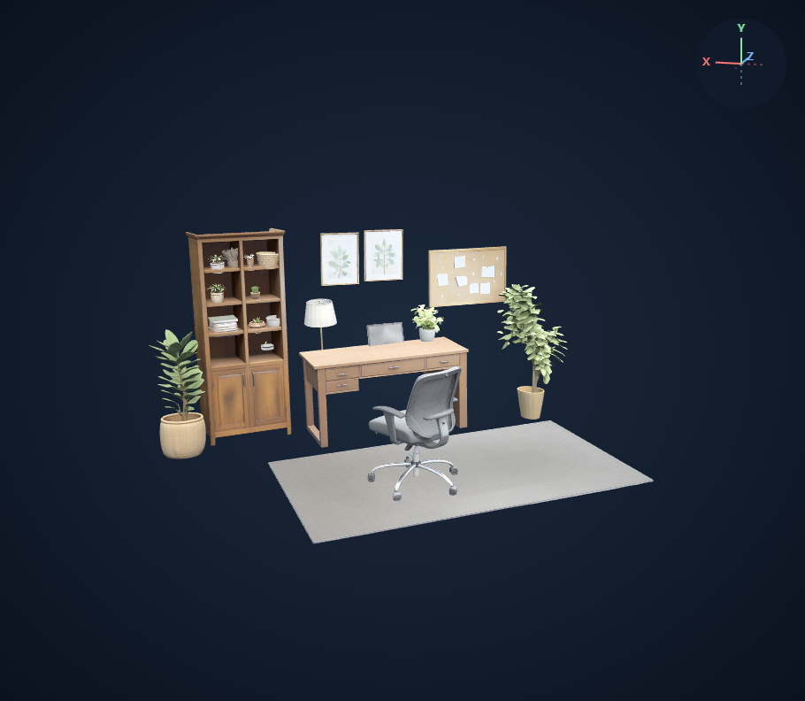
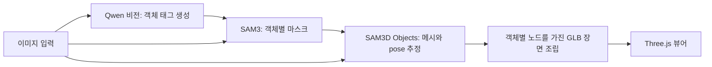

# MapMaker

**사진 한 장에서 주요 객체를 분리하고, 객체별 3D 모델을 하나의 장면으로 구성하는 졸업 프로젝트**

MapMaker는 실내 이미지에서 가구와 소품을 찾아 각각의 3D 형상과 배치를 추정하고, 웹에서 탐색할 수 있는 장면으로 내보냅니다. Qwen 비전 모델로 생성할 객체를 선택하고, SAM3로 영역을 분리한 뒤, SAM3D Objects로 개별 메시를 생성합니다. 객체는 독립된 노드로 유지되며 최종 결과를 GLB 파일로 저장합니다.

프로젝트의 목표는 **단일 이미지 기반 3D 생성 모델들을 실제로 사용할 수 있는 하나의 시스템으로 연결하는 것**입니다. 객체 선택부터 모델 실행, 장면 조립, 원격 GPU 처리, 웹 시각화까지 구현했습니다. 현재는 가구와 소품 중심의 장면 생성을 다루며, 공간 전체 복원과 정밀한 배치·편집은 후속 과제입니다.



## 주요 기능

| 기능 | 구현 내용 |
|---|---|
| 객체 선택 | 이미지와 프롬프트를 Qwen 비전 모델에 전달해 가구·소품의 태그 생성 |
| 객체 분리 | 태그를 SAM3의 텍스트 프롬프트로 사용해 인스턴스별 마스크 생성 |
| 3D 생성·조립 | SAM3D Objects의 메시와 위치·회전·크기 추정값으로 장면 구성 |
| 웹 시각화 | Three.js에서 회전·확대·이동, 객체 표시 전환, GLB 다운로드 |
| 원격 실행 | Runpod GPU worker와 S3를 통한 작업 제출·진행 조회·결과 수집 |
| 결과 추적 | 입력, 태그, 마스크, 객체별 모델, 실행 설정과 해시 기록 보존 |

## 처리 과정



1. 입력 이미지의 EXIF 방향을 반영하고 RGB PNG로 정규화합니다.
2. Qwen2.5-VL-7B-Instruct가 이미지에서 가구와 이동 가능한 물체의 이름을 JSON 배열로 반환합니다.
3. SAM3에 각 태그를 전달해 해당 객체의 마스크를 구합니다. 같은 종류의 객체가 여러 개면 여러 마스크가 생성될 수 있습니다.
4. SAM3D Objects에 이미지와 개별 마스크를 전달해 각 객체의 메시와 pose를 추정합니다.
5. 공식 pose를 적용해 하나의 GLB로 조립하고 웹 뷰어에서 확인합니다.

현재 대표 결과에 사용한 프롬프트는 다음과 같습니다. 세 장면 모두 같은 프롬프트와 생성 설정을 사용했습니다.

```text
List the furniture and other movable physical objects visible in this image.

Use specific, common object names, with one tag per object category.
Return only a JSON array of strings.
```

**아래 대표 결과에는 별도의 배치 보정을 적용하지 않았습니다.** SAM3D가 추정한 위치·회전·크기를 그대로 사용했으며, 수동 객체 삭제나 배치 수정도 하지 않았습니다.

## 무엇을 개선했는가

기본 RAM++ 태그에는 가구뿐 아니라 방·바닥 같은 배경 개념이나 같은 물체를 가리키는 여러 이름이 포함될 수 있습니다. 이 태그를 모두 분할·생성 단계로 넘기면 장면 전체를 가리는 큰 메시나 겹치는 가구가 생길 수 있습니다.

MapMaker에서는 **이미지를 보고 생성할 객체를 선택하는 단계**에 Qwen 비전 모델을 사용했습니다. 아래 비교는 태그 생성 방식을 바꾸었을 때, 가구 중심의 장면이 얼마나 잘 드러나는지 보여줍니다.

| 비교 조건 | 베이스라인 | 현재 선정 방식 |
|---|---|---|
| 태그 생성 | RAM++ 기본 출력 | Qwen 비전 + 위 프롬프트 |
| 객체 분할 | SAM3 기본값 | 동일 |
| 3D 생성 | SAM3D Objects, seed 42 | 동일 |
| 배치 | SAM3D 공식 pose | 동일 |
| 추가 배치 보정 | 없음 | 없음 |

개선 범위는 불필요한 배경·중복 객체 생성을 줄이는 것입니다. SAM3D의 형상 추정 모델을 학습하거나 변경한 것은 아니며, 물체의 형상·접촉·배치 오류는 여전히 남습니다.

## 대표 결과

각 행의 베이스라인과 최종 결과는 **동일한 카메라와 시선**으로 촬영했습니다. 위의 대표 확대 이미지는 최종 장면에 맞춘 별도 시점입니다.

| 장면 | 원본 이미지 | RAM++ 베이스라인 | Qwen 비전 적용 |
|---|---|---|---|
| 원목 서재 |  |  |  |
| 수납장과 식물 |  |  |  |
| 작업 공간 |  |  |  |

| 장면 | 확인한 변화 | 남은 한계 |
|---|---|---|
| 원목 서재 | 전체 생성 객체 44→22개. 책상·의자·책장이 각각 1개로 생성되어 주요 가구 구성이 드러남 | 책상 다리 일부가 판형으로 변형되고 화분·소품 높이 오차가 남음 |
| 수납장과 식물 | 19→8개. 여러 이름으로 중복 생성되던 주요 수납장이 dresser 1개로 정리됨 | 작은 화병의 부유, 소품 중복, 원본보다 밝은 색상 |
| 작업 공간 | 37→12개. 방 메시가 가리던 책상·의자·모니터를 확인하기 쉬워짐 | 창·블라인드가 남고 일부 서랍장 형상이 확장됨 |

객체 수는 생성된 메시 수이며 품질 점수가 아닙니다. 위 세 장면은 기존 실행 결과에서 선정한 사례로, 전체 입력에 대한 성공률을 뜻하지 않습니다. 원목 서재 입력은 상품 연출 이미지로, 원본 파일명에 근거해 AI 생성 이미지로 추정하고 있습니다.

원본 출처, 선정 이유, 다각도 이미지와 상세 한계는 [최종 비교 문서](docs/RAM_QWEN_FILTER_THREE_WAY.md) 및 [로컬 비교 페이지](http://127.0.0.1:8118)에서 확인할 수 있습니다. 로컬 페이지는 아래의 `mapmaker review` 실행 후 열립니다.

## 직접 구현한 부분

### 객체 선택과 모델 연결

RAM++ 기본값을 비교 기준으로 두고, 텍스트 태그 필터링과 이미지 기반 태그 생성을 실험해 현재의 Qwen 비전 프롬프트를 선정했습니다. 모델 응답을 SAM3의 입력으로 전달하고, 마스크별 SAM3D 추론까지 하나의 실행 단위로 연결했습니다. 비전 처리와 3D 생성의 Python 환경을 분리해 모델별 의존성을 관리합니다.

### 장면 조립과 결과 보존

객체별 메시의 바이너리 버퍼를 순차 복사하고 공식 pose를 부모 노드에 적용해 GLB를 조립합니다. 많은 객체를 한꺼번에 메모리에 펼치지 않도록 했으며, 생성된 객체는 독립 노드로 유지합니다. 입력·모델 응답·마스크·pose·해시를 기록해 어떤 설정으로 만들어진 결과인지 확인할 수 있습니다.

### 원격 실행과 웹 뷰어

Runpod의 웹/API와 GPU 추론 worker를 분리하고 S3로 입력과 결과를 주고받습니다. 작업 상태·오류·로그를 실행별로 관리하며 결과 수집 시 파일 해시와 입력 일치 여부를 검사합니다. Three.js 뷰어에서는 장면 탐색, 객체 표시 전환, 결과 다운로드를 지원합니다. 저장된 비교 결과를 추론 없이 확인하는 로컬 리뷰 서버도 제공합니다.

기존 모델은 인식·분할·3D 추정을 담당합니다. 이 프로젝트의 구현 기여는 객체 선택 정책, 모델 간 연결, 장면 조립, 실행 관리와 결과를 확인하는 시스템 구성에 있습니다.

## 실행 방법

Python 3.11, Node.js, uv를 기준으로 사용합니다. 실제 생성에는 준비된 GPU 모델 환경 또는 배포된 Runpod endpoint와 S3 접근 설정이 필요합니다. 모델 가중치와 인증 정보는 저장소에 포함하지 않습니다.

### 설치

```sh
uv sync --frozen --extra remote --extra geometry
npm ci --prefix web
```

Windows에서는 기본적으로 Runpod backend를, Linux에서는 local backend를 사용합니다. `MAPMAKER_BACKEND`로 변경할 수 있습니다. 원격 인증·스토리지 설정 및 worker 배포는 [Runpod 배포 문서](deploy/runpod/README.md)를 참고하세요.

### 현재 방식과 베이스라인 실행

```sh
# Qwen 비전 → SAM3 → SAM3D
uv run python scripts/run_presentation.py samples/living_room.jpg

# RAM++ 기본값 → SAM3 → SAM3D
uv run python scripts/run_presentation.py samples/living_room.jpg --baseline
```

각 명령은 새 추론을 수행하고 결과 GLB 경로를 출력합니다. 실행에 사용하는 worker도 해당 태그 생성 방식과 모델 환경을 지원해야 합니다.

### 저장된 결과 확인

```sh
uv run mapmaker review
```

[http://127.0.0.1:8118](http://127.0.0.1:8118)에서 대표 세 사례와 연결된 3D 뷰어를 엽니다. 비교 이미지와 실행 기록은 저장소에 포함되어 있습니다. 기존 GLB는 `docs/assets/` 아래 각 사례 폴더의 `viewers.json`이 가리키는 로컬 `.runtime/`에 있으므로, 저장소를 clone하는 것만으로 기존 3D 결과까지 내려받아지지는 않습니다.

일반 업로드·생성 웹/API는 `uv run mapmaker serve`로 실행할 수 있습니다. 이는 기존 웹 생성 경로이며, 위 Qwen 대표 결과를 재현할 때는 `run_presentation.py`를 사용합니다.

<details>
<summary>기존 실행 모드와 비교 도구</summary>

| 모드 | 생성 방식 | 배치 보정 | 공간 표시 |
|---|---|---|---|
| 1 | 기본 모델 출력 | 없음 | 없음 |
| 2 | 확장 탐색·공유 pointmap·생성 후보 검토 | 없음 | 없음 |
| 3 | 2번 결과 재사용 가능 | 적용 | 없음 |
| 4 | 2번 결과 재사용 가능 | 적용 | 포함 |

대표 결과는 **mode 1의 태그 생성기를 Qwen 비전으로 교체한 경로**입니다. 기존 3·4번의 보정은 대표 결과에 사용하지 않았습니다.

```sh
uv run mapmaker run samples/living_room.jpg --mode 1
uv run mapmaker compare samples --output output/comparison
uv run mapmaker derive PATH_TO_MODE_2 --output output/derived
uv run mapmaker review --batch output/comparison/comparison.json
```

`compare`는 입력당 1·2번을 추론하고 2번 결과에서 3·4번을 만듭니다. `derive`는 저장된 2번 결과를 사용하므로 새 GPU 추론을 하지 않습니다. 처리 구조는 [구현 문서](docs/IMPLEMENTATION.md)에 정리했습니다.

</details>

## 기술 구성과 저장소

| 구분 | 기술 |
|---|---|
| 객체 선택·분할·생성 | Qwen2.5-VL-7B-Instruct, RAM++, SAM3, SAM3D Objects, PyTorch |
| 파이프라인·장면 처리 | Python, NumPy, Pillow, trimesh |
| 원격 실행·저장 | Runpod, S3, Docker |
| 웹 시각화 | JavaScript, Three.js |
| 검증 | pytest, Playwright, 입력·산출물 해시 검사 |

```text
mapmaker/       모델 연결, 장면 조립, 원격 처리, 웹/API
web/            Three.js 뷰어
configs/        모델·런타임 설정과 고정 소스 버전
deploy/runpod/  GPU worker와 웹 서비스 배포
scripts/        실행, 문서 생성, 환경 구성, 검증 도구
tests/          유지 중인 기능의 회귀 테스트
samples/        입력 예시
docs/           구현 설명과 대표 결과·실행 기록
```

## 검증과 현재 한계

```sh
uv run pytest tests -q
```

최근 정리 후 회귀 테스트는 **430개 통과, 5개 건너뜀**입니다. 대표 결과의 입력·GLB 해시, 비교 카메라, 이미지·링크 로딩과 모바일 레이아웃도 확인했습니다. 이 검증은 코드와 저장된 산출물의 일관성 검사이며 복원 정확도의 정량 평가와는 구분됩니다.

- **형상:** 얇은 다리, 가려진 면, 작은 소품의 형상이 잘못 생성되거나 누락될 수 있습니다.
- **배치:** 바닥 접지, 소품의 지지 관계, 객체 간 충돌을 보장하지 않습니다. 현재 대표 결과에도 부유와 겹침이 남습니다.
- **객체 선택:** 배경 태그와 중복이 줄어든 사례를 확인했지만 모든 배경·중복을 제거하지는 못합니다.
- **복원 범위:** 한 장의 이미지로 추정한 객체 중심 장면입니다. 실제 치수, 보이지 않는 공간, 방 전체의 정확한 구조를 복원한 결과는 아닙니다.

다음 개선 과제는 주요 가구의 형상을 유지하면서 객체 간 접촉과 상대 배치를 보정하고, 더 다양한 입력에서 같은 기준으로 결과를 평가하는 것입니다.
