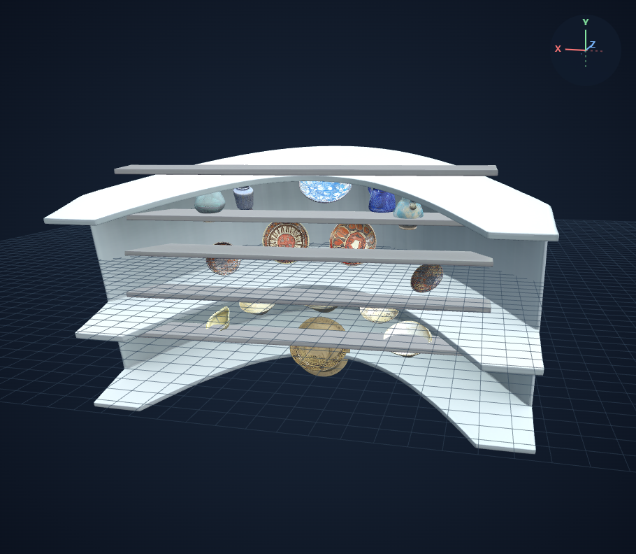
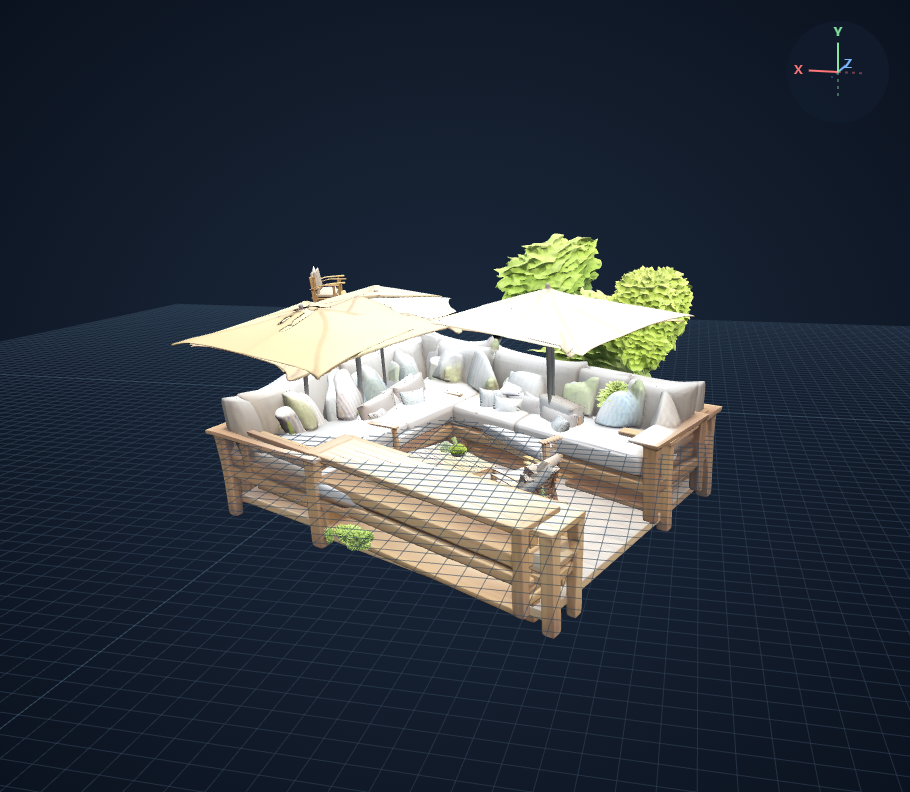
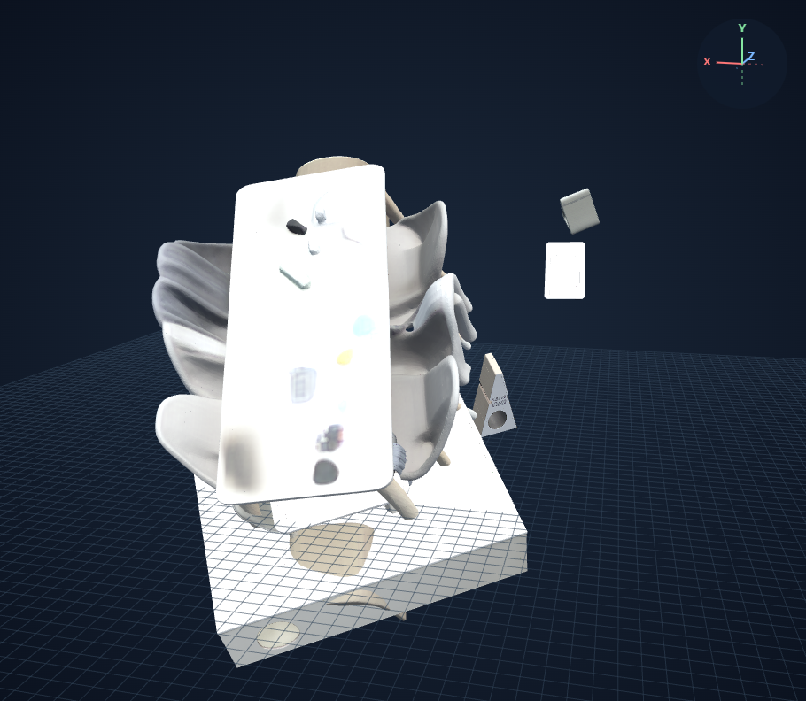
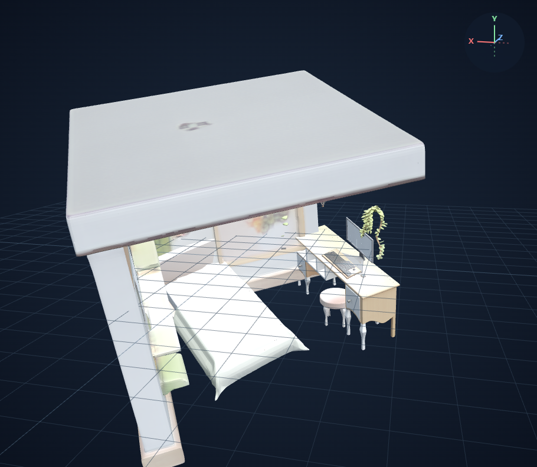

# Four Way Comparison V2 — RAM++·Qwen·배치 개선·배경 생성

작성 기준: 2026-10-23. 이 문서는 새 번호 체계를 사용한다. 기존 [FOUR_WAY_COMPARISON.md](FOUR_WAY_COMPARISON.md)는 과거 비교 자료로 보존하며, 그 문서의 2·3·4번 결과를 새 단계의 구현 결과로 사용하지 않는다.

## 단계 정의

| 번호 | 처리 방식 | 구현 상태 |
|---|---|---|
| **1번** | [BASELINE_COMPARISON.md](BASELINE_COMPARISON.md)의 수정 1번: RAM++ 기본 임계값 → 모든 반환 태그를 SAM3에 전달 → SAM3 기본 processor의 모든 반환 마스크를 SAM3D Objects로 생성 → 공식 pose 배치 | 구현됨 |
| **2번** | [QWEN_PROMPT_COMPARISON.md](QWEN_PROMPT_COMPARISON.md)의 개선 버전: 1번의 태그 생성기를 Qwen2.5-VL-7B-Instruct와 개선 프롬프트로 교체. 이후 마스크·3D 생성·공식 pose 배치는 동일 | 구현됨 |
| **3번** | 2번에 물체 배치 문제 개선을 추가 | **미구현 · 계획** |
| **4번** | 3번에 배경 생성을 추가 | **미구현 · 계획** |

3번의 배치 보정 알고리즘과 4번의 배경 생성 방법은 아직 정해지지 않았다. 3·4번의 성능·결과 이미지·웹뷰어는 아직 없다.

문서의 단계 번호와 코드의 실행 모드 번호는 구분한다. 새 1·2번은 모두 기존 코드의 mode=1 경로를 사용하며 태그 생성기만 다르다. 새 3·4번은 기존 코드의 같은 번호 모드를 재사용했다고 간주하지 않는다.

## 공통 조건과 1·2번의 차이

- 같은 샘플끼리 정규화된 입력 PNG의 SHA-256이 일치한다.
- SAM3의 모델 기본 임계값을 유지하며, 반환된 마스크에 별도의 점수·면적·중복 필터나 개수 제한을 적용하지 않는다.
- 모든 반환 마스크를 SAM3D Objects에 seed 42로 전달하고 공식 pose로 배치한다. 추가 배치 보정이나 배경 생성은 없다.
- 1번은 RAM++가 기본 임계값으로 반환한 태그를 그대로 사용한다.
- 2번은 Qwen 개선 프롬프트로 벽·바닥·천장 같은 배경을 제외하고 문·창문을 포함한 물체 종류를 요청한다. 같은 종류는 한 번만 나열하고 부착 부품·동의어 중복을 피하도록 지시한다. 이는 프롬프트 지시이며 반환 뒤 별도 의미 필터나 이름 치환은 없다.
- Qwen 모델·revision·원문 프롬프트는 [프롬프트 비교 문서](QWEN_PROMPT_COMPARISON.md)에 기록돼 있다.

## 결과 수집과 검증

1번의 집·사무실은 기존 완료 결과를 사용한다. 나머지 8장은 원격에 보존된 추론 체크포인트를 수집해 ZIP SHA-256, 입력, 모든 마스크·객체 파일의 SHA-256, 장면 내 객체 배치 행렬을 검증한 뒤 1번 최종화를 수행했다. 이 과정에서 원본 GLB·객체·배치 행렬을 바꾸지 않았으며 추가 GPU 추론을 하지 않았다. 2번은 직전에 완료한 10장 결과를 재사용한다.

실제 배포 코드와 복구 여부, 입력·장면 해시, 태그·객체 수, 캡처 카메라는 [검증 기록](assets/four-way-v2-comparison/manifest.json)에 샘플별로 남긴다. 생성 성공은 파일 생성과 검증 성공을 뜻하며 형태·배치의 정확도를 뜻하지 않는다.

웹뷰어는 `uv run mapmaker review`로 로컬 검토 서버를 실행한 뒤 연다. 원본 GLB는 로컬 `.runtime/`에 보관하며 Git에 포함되지 않는다. 각 샘플의 1·2번 캡처는 과거 비교에서 사용한 동일 카메라 위치와 시선을 적용한다. 물체가 화면 밖에 있을 수 있으므로 전체 결과는 웹뷰어에서도 확인한다.

## 10장 요약

| 입력 | 1번 RAM++ — 마스크 / 성공 / 실패 | 2번 Qwen — 마스크 / 성공 / 실패 |
|---|---|---|
| [집](#house) | 21 / 21 / 0 | 26 / 26 / 0 |
| [사무실](#office) | 26 / 26 / 0 | 35 / 35 / 0 |
| [식당](#restaurant) | 149 / 149 / 0 | 116 / 116 / 0 |
| [진열장](#displaycase) | 80 / 80 / 0 | 30 / 30 / 0 |
| [계단홀](#stairhall) | 27 / 27 / 0 | 22 / 22 / 0 |
| [sample-01](#sample-01) | 15 / 15 / 0 | 27 / 27 / 0 |
| [sample-02](#sample-02) | 44 / 44 / 0 | 40 / 40 / 0 |
| [sample-03](#sample-03) | 24 / 24 / 0 | 15 / 15 / 0 |
| [sample-04](#sample-04) | 17 / 17 / 0 | 17 / 17 / 0 |
| [sample-05](#sample-05) | 17 / 17 / 0 | 33 / 33 / 0 |

## house

| 1번 · RAM++ 기본값 베이스라인 | 2번 · Qwen 개선 프롬프트 | 3번 · 배치 개선 예정 | 4번 · 배경 생성 예정 |
|---|---|---|---|
|  [웹뷰어](http://127.0.0.1:8118/viewer?run=baseline-house-new) |  [웹뷰어](http://127.0.0.1:8118/viewer?run=qwen-v2-house-new) | 미구현 — 2번에 배치 개선 추가 | 미구현 — 3번에 배경 생성 추가 |

**1번:** 태그 14개 · 마스크 21개 · 생성 성공 21개 · 실패 0개.
**2번:** 태그 12개 · 마스크 26개 · 생성 성공 26개 · 실패 0개.

## office

| 1번 · RAM++ 기본값 베이스라인 | 2번 · Qwen 개선 프롬프트 | 3번 · 배치 개선 예정 | 4번 · 배경 생성 예정 |
|---|---|---|---|
|  [웹뷰어](http://127.0.0.1:8118/viewer?run=baseline-office-new) |  [웹뷰어](http://127.0.0.1:8118/viewer?run=qwen-v2-office-new) | 미구현 — 2번에 배치 개선 추가 | 미구현 — 3번에 배경 생성 추가 |

**1번:** 태그 14개 · 마스크 26개 · 생성 성공 26개 · 실패 0개.
**2번:** 태그 12개 · 마스크 35개 · 생성 성공 35개 · 실패 0개.

## restaurant

| 1번 · RAM++ 기본값 베이스라인 | 2번 · Qwen 개선 프롬프트 | 3번 · 배치 개선 예정 | 4번 · 배경 생성 예정 |
|---|---|---|---|
|  [웹뷰어](http://127.0.0.1:8118/viewer?run=baseline-restaurant-new) |  [웹뷰어](http://127.0.0.1:8118/viewer?run=qwen-v2-restaurant-new) | 미구현 — 2번에 배치 개선 추가 | 미구현 — 3번에 배경 생성 추가 |

**1번:** 태그 18개 · 마스크 149개 · 생성 성공 149개 · 실패 0개.
**2번:** 태그 7개 · 마스크 116개 · 생성 성공 116개 · 실패 0개.

## displaycase

| 1번 · RAM++ 기본값 베이스라인 | 2번 · Qwen 개선 프롬프트 | 3번 · 배치 개선 예정 | 4번 · 배경 생성 예정 |
|---|---|---|---|
|  [웹뷰어](http://127.0.0.1:8118/viewer?run=baseline-displaycase-new) |  [웹뷰어](http://127.0.0.1:8118/viewer?run=qwen-v2-displaycase-new) | 미구현 — 2번에 배치 개선 추가 | 미구현 — 3번에 배경 생성 추가 |

**1번:** 태그 10개 · 마스크 80개 · 생성 성공 80개 · 실패 0개.
**2번:** 태그 4개 · 마스크 30개 · 생성 성공 30개 · 실패 0개.

## stairhall

| 1번 · RAM++ 기본값 베이스라인 | 2번 · Qwen 개선 프롬프트 | 3번 · 배치 개선 예정 | 4번 · 배경 생성 예정 |
|---|---|---|---|
|  [웹뷰어](http://127.0.0.1:8118/viewer?run=baseline-stairhall-new) |  [웹뷰어](http://127.0.0.1:8118/viewer?run=qwen-v2-stairhall-new) | 미구현 — 2번에 배치 개선 추가 | 미구현 — 3번에 배경 생성 추가 |

**1번:** 태그 17개 · 마스크 27개 · 생성 성공 27개 · 실패 0개.
**2번:** 태그 6개 · 마스크 22개 · 생성 성공 22개 · 실패 0개.

## sample-01

| 1번 · RAM++ 기본값 베이스라인 | 2번 · Qwen 개선 프롬프트 | 3번 · 배치 개선 예정 | 4번 · 배경 생성 예정 |
|---|---|---|---|
|  [웹뷰어](http://127.0.0.1:8118/viewer?run=baseline-sample-01-new) |  [웹뷰어](http://127.0.0.1:8118/viewer?run=qwen-v2-sample-01-new) | 미구현 — 2번에 배치 개선 추가 | 미구현 — 3번에 배경 생성 추가 |

**1번:** 태그 10개 · 마스크 15개 · 생성 성공 15개 · 실패 0개.
**2번:** 태그 9개 · 마스크 27개 · 생성 성공 27개 · 실패 0개.

## sample-02

| 1번 · RAM++ 기본값 베이스라인 | 2번 · Qwen 개선 프롬프트 | 3번 · 배치 개선 예정 | 4번 · 배경 생성 예정 |
|---|---|---|---|
|  [웹뷰어](http://127.0.0.1:8118/viewer?run=baseline-sample-02-new) |  [웹뷰어](http://127.0.0.1:8118/viewer?run=qwen-v2-sample-02-new) | 미구현 — 2번에 배치 개선 추가 | 미구현 — 3번에 배경 생성 추가 |

**1번:** 태그 14개 · 마스크 44개 · 생성 성공 44개 · 실패 0개.
**2번:** 태그 7개 · 마스크 40개 · 생성 성공 40개 · 실패 0개.

## sample-03

| 1번 · RAM++ 기본값 베이스라인 | 2번 · Qwen 개선 프롬프트 | 3번 · 배치 개선 예정 | 4번 · 배경 생성 예정 |
|---|---|---|---|
|  [웹뷰어](http://127.0.0.1:8118/viewer?run=baseline-sample-03-new) |  [웹뷰어](http://127.0.0.1:8118/viewer?run=qwen-v2-sample-03-new) | 미구현 — 2번에 배치 개선 추가 | 미구현 — 3번에 배경 생성 추가 |

**1번:** 태그 14개 · 마스크 24개 · 생성 성공 24개 · 실패 0개.
**2번:** 태그 13개 · 마스크 15개 · 생성 성공 15개 · 실패 0개.

## sample-04

| 1번 · RAM++ 기본값 베이스라인 | 2번 · Qwen 개선 프롬프트 | 3번 · 배치 개선 예정 | 4번 · 배경 생성 예정 |
|---|---|---|---|
|  [웹뷰어](http://127.0.0.1:8118/viewer?run=baseline-sample-04-new) |  [웹뷰어](http://127.0.0.1:8118/viewer?run=qwen-v2-sample-04-new) | 미구현 — 2번에 배치 개선 추가 | 미구현 — 3번에 배경 생성 추가 |

**1번:** 태그 13개 · 마스크 17개 · 생성 성공 17개 · 실패 0개.
**2번:** 태그 10개 · 마스크 17개 · 생성 성공 17개 · 실패 0개.

## sample-05

| 1번 · RAM++ 기본값 베이스라인 | 2번 · Qwen 개선 프롬프트 | 3번 · 배치 개선 예정 | 4번 · 배경 생성 예정 |
|---|---|---|---|
|  [웹뷰어](http://127.0.0.1:8118/viewer?run=baseline-sample-05-new) |  [웹뷰어](http://127.0.0.1:8118/viewer?run=qwen-v2-sample-05-new) | 미구현 — 2번에 배치 개선 추가 | 미구현 — 3번에 배경 생성 추가 |

**1번:** 태그 15개 · 마스크 17개 · 생성 성공 17개 · 실패 0개.
**2번:** 태그 14개 · 마스크 33개 · 생성 성공 33개 · 실패 0개.
