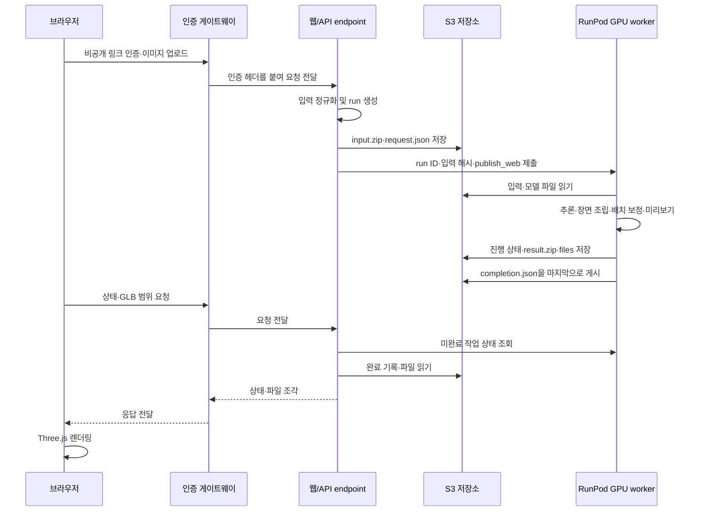

# MapMaker 상세 구현

이 문서는 단일 이미지에서 객체별 3D 장면을 생성하는 현재 구현을 설명한다. 프로젝트 소개와 기본 실행 방법은 [README](../README.md)에서 다룬다.

기준: 2026-10-15, 배치 보정 `placement v4`와 바닥 메시 제거 이후의 코드·배포 검증. 직접 구현한 범위는 기존 모델 연결, 장면 조립·배치 보정, 클라우드 실행·브라우저 인증, 웹 뷰어다. 모델 자체의 신규 학습이나 새로운 생성 모델 개발을 의미하지 않는다.

1~8절은 배포·검증된 v4 기준이다. 이후 절의 v5~v7은 각 시점의 실험 기록이다.
현재 작업 트리는 미배포 placement v10 이후의 수정 작업이다. 2026-10-18 최신 로컬 후보는 최대 48개의 생성 예산, 추가 선택의 관측 영역 조건과 엄격한 원본 관측 보존 검사를 포함한다. 최신 후보의 실제 생성·품질 검증은 진행 중이며, 아래 과거 실행 결과를 최신 후보의 통과 근거로 사용하지 않는다. 정식 배포는 v4이며, 임시 전환한 전체 GPU 검증은 완료 후 v4 환경과 워커 설정의 복원을 확인했다. 최신 전체 실행은 생성 객체 31개·관측 공간 패치 5개를 포함한다. 저장 결과의 데스크톱·세로 화면 표시, 공간/객체 표시 전환, GLB 다운로드 일치를 확인했지만, 최신 후보의 인증 업로드부터 생성까지의 통합 경로와 전체 품질 통과를 증명한 것은 아니다. [실제 결과와 실행 상태](V10_LOCAL_PROGRESS.md)를 참고한다.

최신 지지 자세 보정은 `finalize_scene(..., supported_repair=True)` 또는 `MAPMAKER_SUPPORTED_REPAIR=1`로 선택한다. 기본값은 비활성이며 운영 v4에는 배포하지 않았다. 검증된 공유 pointmap과 `geometry` 선택 의존성이 필요하고, 이미 최종화한 결과는 원본 추론 산출물에서 재생해야 한다. 활성화하면 공간 추정은 `reference_stable_normals`와 `guarded_enclosed_plane_evidence`를 사용한다. 해시 검증한 확장 이전 마스크로 평면을 맞추고, 현재 마스크로 내보낼 메시 범위를 결정해 마스크 확장으로 먼 평면까지 다시 움직이지 않게 한다. 확장 이력이 없으면 현재 마스크가 기준이다.

평면 보완은 `local_plane_evidence`의 기존 삼각형을 보존한 상태에서 관측 평면의 경계 내부만 대상으로 한다. 유효한 전경 깊이로 가려짐이 확인된 추가 면을 현재 장면의 생성 객체 메시와 검사하고, 교차하거나 내부에 들어가거나 판정이 불확실한 면은 보류한다. 관측 경계 밖은 연장하지 않는다. `extension_guard`에 추가·유지·제외 삼각형과 판정 근거를 기록한다. 필터 후 픽셀 수는 재산정하지 않으므로 `inferred_pixels`는 null이며, 필터 전 수는 `proposed_inferred_pixels`로 구분한다. 세 개발 입력의 독립 평면 비교에서는 기존 삼각형을 모두 보존하고 새 교차를 2건에서 0건으로 줄였으며 집의 접촉 개선 1건을 유지했다. 이 결과는 전체 복원·생성·브라우저 경로의 품질 통과를 의미하지 않는다.

개발 v54의 지지 자세 보정 후보에는 다른 생성 객체의 실제 삼각형에서 측정한 국소 평면도 포함한다. 낮은 객체 정점 아래에서 유한 삼각형 교차를 구하고, 접촉 후보가 중심을 둘러싸며 평면 잔차와 방향 조건을 만족할 때만 후보 평면을 만든다. 경계 상자 윗면이나 객체 이름으로 지지면을 만들지 않는다. 후보는 실제 유한 접촉·원본 일치·기존 지지·전체 메시 충돌 검사를 그대로 거친다. 객체는 충돌 검사에서 방 평면으로 취급하지 않는다. 이 범위 확대는 미배포이며, 실제 품질 개선은 별도 개발 장면 검증 중이다.

`scene_supported_refinement`는 객체 이름 없이 접촉 회전 후보, 제한된 균일 크기 보정과 평면 방향 원본 맞춤을 순차 검사한다. 기존 접촉 보존, 원래 마스크와 확장 마스크의 원본 일치도, 최종 위치 및 이동 경로 검사를 모두 통과해야 장면을 변경한다. 첫 교차 광선 수가 감소하면 깊이 오차가 줄어도 거부한다. 닫힌 물체의 초기 관통은 내부 표본 또는 검증된 양의 교차 체적으로 입증한다. 열린 평면은 실제 유한 평면 교차와 평면 뒤의 정점·투영 위치, 보정 후의 빈 교차를 별도로 검사한다. 이는 생성 장면의 관통 수정 판정이며, 물리적으로 충돌 없이 이동하는 애니메이션을 보장하지 않는다.

선행 `refine_poses` 단계도 움직이는 객체의 기존 지지와 그 객체 위에 놓인 다른 객체의 지지를 검사한다. `supported_repair` 활성화 시 이 단계의 `strict_source`도 켜져 현재 마스크와 해시 검증한 확장 이전 마스크 모두에서 가시 깊이·광선 수·최근접 깊이·실루엣 보존을 요구한다. 후보 탐색 중뿐 아니라 최종 적용 직전에도 같은 검사를 확인하며, 거부 근거는 `rejected_preservation_candidates`에 남긴다. 이 추가 연결 이전에 시작한 실행은 변경 전 비교 결과로 구분한다.

현재 개발 장면의 통합 검사 결과는 생성 객체 30개, 후보 3개, 적용 0개다. 일부 후보는 접촉·관통·깊이 지표가 개선됐으나 원본 광선 누락과 최근접 깊이 오차가 남아 탈락했다. `logs/supported_refinement.json`에 후보별 거부 근거를 남긴다. 마스크 확장 이전 원본 마스크도 해시 검증 후 재생 폴더에 복사해 두 입력 모두를 다시 검증할 수 있다. 이후 광선 일치도를 직접 사용하는 탐색은 별도 진단이며 아직 적용 경로에 채택하지 않았다.

앞선 실험에서 확인한 한계는 다음과 같다.

- 확대 점 탐색은 집·사무실·식당에서 선택 마스크 수를 늘렸으나 물체의 부분 조각도 포함했다. 집의 전체 추출 결과에 합친 비교에서는 기존 영역 5개가 유사한 마스크로 교체됐으며 누락 개선을 입증하지 못했다. 기본 적용은 꺼져 있다.
- 중복 제거의 수직 지지 검사 외에 방향과 무관한 접촉 표본 검사를 추가했다. 진열장 후보는 주변 4개 객체의 접촉 손실로 제외했다. 사무실 후보의 빈 접촉 표본은 보존 통과로 취급하지 않는다.
- 닫힌 메시의 색상 보존 합집합은 내부 겹친 체적을 정리하지만, 실제 사무실 후보의 이중 판·다리 형상은 그대로였다. 열린 메시를 임의로 채우지 않는다.
- 초기 제한 회전 접촉 후보는 합성 테스트를 통과했지만 당시 실패 11쌍에서는 유효한 후보가 없었다. 이후 관측 지지면·크기·원본 맞춤을 결합한 선택 기능을 추가했으며, 현재 검증 상태는 위 설명과 실행 기록에 구분한다.
- 최근접 표면 거리만으로는 앞쪽의 잘못된 표면을 놓칠 수 있어 카메라 광선의 첫 교차 깊이를 별도로 측정한다. 집의 실제 시드 43 후보 3개 중 1개는 원본 영상과의 일치도가 좋아졌으나, 최종 장면에서 기존 객체·바닥과의 접촉 표본 손실이 확인되어 배포 후보에서 제외했다. 나머지 2개도 작은 구조 누락 등으로 제외했다. 접촉 표본은 물리적 지지의 완전한 증명이 아니며, 열린 메시의 교차 부피가 미확인인 것을 관통 없음으로 처리하지 않는다.
- 명시적인 `MAPMAKER_VISIBLE_DEPTH_REVIEW=1`의 미배포 경로는 모든 시드 42 결과를 측정한 뒤, 신뢰 조건을 충족한 첫 교차 깊이 오차가 큰 객체 최대 2개에 시드 43을 배정한다. 동률은 마스크 해시로 정하며 이름은 사용하지 않는다. 선택에는 실루엣·최근접 깊이·첫 교차 깊이의 꼬리 오차·광선 적중률의 비악화를 요구한다. 실패하거나 탈락하면 원본 메시·배치·가우시안 출력을 유지한다. 실제 파일 기반 통합 테스트는 통과했으나, 이 두 단계 자동 경로의 새 GPU 실행과 다른 개발 입력의 품질 검증은 남아 있다. 기본 경로는 기존 추가 시도 1회 정책을 유지한다.
- 현재 작업 트리에는 주변 객체의 접촉 손실 후보를 제외하는 검사도 연결했다. 실제 집 후보가 이 검사에서 제외되는 것을 저장된 원본 카메라 좌표의 자산으로 확인했다. 초기 접촉 회복 강체 보정 실험은 동일한 표본으로 계산·검사했지만 제한된 탐색에서 실패했다. 당시 사무실 GPU 작업은 접촉 제외 검사 추가 전 고정 배포 파일을 사용했으므로, 그 결과와 최신 작업 트리의 검증을 구분한다. 해당 GPU 작업은 종료됐으며 최신 접촉 실험은 저장된 개발 산출물을 사용하는 CPU 검사다.

이 실험들은 미사용 평가 세트를 통과하지 않았고 배포하지 않았다. 아래 과거 절은 각 시점의 구현 기록이다.

## 2026-10-17 후보의 후속 구현 기록 (미배포)

최신 실행 구분: 체크포인트를 처음 확보한 집 실행 `199311a76ec14766b23335606295fa03`은 최종 생성·GLB·브라우저 검증과 v4 복원을 완료했다. 31개 객체·5개 공간 표면이며 중복 제외와 지지 이동은 0건으로 품질은 미달이다. 아래 선택 예산 변경을 포함한 후속 실행 `d10b5d963ac24c28aad5d6984eb8928a`는 중간 산출물 65개 자산 검증과 최종 생성·파일 검증·저장 결과 브라우저 검증을 완료하고 v4를 복원했다. 최종 결과는 31개 객체·5개 공간 표면이며 지지 보정은 0건이다. 원본 시점에서 부분 중복과 공간 빈틈이 남아 품질 기준은 미달이다. 개발 이미지의 사전 표시 영역 대응은 직전 9/11에서 10/11로 늘었고 작은 객체는 1/2로 유지됐다. 공통 26개 마스크·초기 자세는 동일하지만 메시가 완전히 같지는 않으므로 최종 형상·접촉·겹침 검증을 별도로 수행한다. 앞선 배치 회귀 5개 장면은 완료됐으며, 이 회귀는 저장된 추론을 재사용하므로 새 선택 방식의 검출·생성 검증과 구별한다.

- 원래 집 이미지의 후속 GPU 실행은 메시 검사 중 1시간 실행 제한으로 실패했다. 최종 산출물 없이 종료됐으며 운영 v4 복원을 확인했다. 별도 분할 경계 진단은 완료했고 v4 복원을 확인했다. 정상 객체도 점 질의가 불일치할 수 있어 자동 제거에 사용하지 않으며 로컬 회귀는 진행 중이다. 전체 테스트는 348개를 통과했지만 전체 품질 완료를 뜻하지 않는다.
- 직전 집 실행 `199311a76ec14766b23335606295fa03`에서 체크포인트 저장과 65개 자산 해시 검증을 완료했다. 이 실행은 최종 후처리도 완료했으며, 31개 생성 객체의 선택 영역 대응은 기존 6/11에서 9/11로 늘고 작은 객체 대응은 1/2로 같았다. 재구성 하위 프로세스의 `finish_scene`에서 무거운 배치 검사 직전에 `inference.zip`을 저장한다. 서버리스 컨트롤러가 `inference_checkpoint` 옵션을 해당 프로세스까지 전달한다. 업로드 크기를 확인한 뒤 `inference-checkpoint.json`에 해시·입력·release·객체 수와 `scene_complete=False`를 기록한다. 최종 결과나 웹 완료 기록과 구분한다. `scripts.collect_inference_checkpoint`는 예상 입력·release 해시, 아카이브와 개별 자산 해시를 검증한 후 별도 디렉터리로 회수하며, 이후 기존 CPU 재조립 검증에 사용할 수 있다. 이미 시간 초과한 이전 작업을 소급 복구하는 기능은 아니다.
- 전체 정합 이력이 충돌로 거절되면 첫 이동의 절반·1/4·1/8·1/16 후보를 추가 검사한다. 회전·크기는 중심 기준으로 보간하며 깊이 개선량, 투영 보존, 실제 이동 경로 충돌 기준은 유지한다. 계단 홀과 추가 5개 저장 장면의 순차 재검증을 완료했다. 계단 홀·기존 집·새 선룸에서 제한된 자세 개선을 확인했고 나머지 장면의 기존 배치를 보존했다. 이는 저장 추론에 대한 회귀이며 신규 검출 품질 검증과 구별한다.
- 자세 보정은 `scene_pose_refinement.py`에서 원본 카메라 좌표로 계산한다. 방 방향 정렬 때문에 표본 선택·이동 허용량이 바뀌지 않도록 원본 루트 변환과 하위 메시 변환을 사용한다. 제안된 변환은 월드 좌표로 합성한 뒤 실제 충돌 검사를 거친다.
- 후속 로컬 수정은 정합 이력의 후보 선택에 투영·충돌 검사를 함께 적용한다. 마지막 후보가 충돌해도 이전 후보가 독립 깊이 검증과 동일한 충돌 기준을 통과하면 유지한다. 최종 위치의 교차가 확실한 후보는 이동 경로 검사 전에 제외한다. 식당 저장 장면에서 한 객체의 깊이·투영 일치도가 개선됐고 다른 객체의 배치는 유지됐다. 나머지 개발 장면 회귀는 진행 중이며, 이전 선룸 GPU 후보에는 이 수정이 없으며 현재 집 이미지 재실행에는 포함된다.
- 추가 로컬 최적화는 같은 객체의 후보들을 검사하는 동안 변하지 않는 초기 교차·관통 근거를 재사용한다. 후보별 최종 위치와 이동 경로는 다시 검사하고, 객체가 바뀌면 캐시를 버린다. 공간 검색도 최대 128개씩 묶되 그룹 경계로 결과 배열 크기를 제한하고, 과밀하거나 bulk API가 없는 경우 기존 단건 검색을 사용한다. 후보 순서·쌍 검사 상한·실제 삼각형 판정은 유지한다. 실제 저장 메시의 후보 집합 일치와 전체 테스트 333개를 통과했다. 최적화본의 고정 회귀를 실행 중이며 현재 체크포인트를 확보한 집 이미지 GPU 후보에는 이 성능 변경이 포함된다. 앞서 시간 초과한 집 실행에는 포함되지 않았다.
- `scene_structure.py`는 각 삼각형 내부의 원본 픽셀을 검사한다. 관측 표면에는 유효하고 마스크에 가려지지 않은 픽셀만 사용하며, 분류된 평면에는 해당 평면의 깊이 허용 오차도 요구한다. 삼각형 바깥의 구멍 때문에 유효한 삼각형까지 지우지 않는다. 관측 삼각형과 제한된 가림 보완 삼각형 수를 별도로 기록한다. 이 처리는 보이지 않는 방 전체를 완성하는 기능이 아니다.
- `scene_contacts.py`는 천장을 실제 접촉 후보에 포함한다. 열린 지지 메시의 내부 체적이 불명확해도, 최종 발 위치보다 높은 다른 면과 몸체의 이동 경로를 삼각형 단위로 검사한다. 큰 이동, 불확실한 충돌, 원본 관측 악화는 적용하지 않는다.
- 후속 접촉 보정은 샘플링한 발바닥이 미세한 표면 굴곡을 지나치는 경우, 전체 지지 메시와 처음 닿는 위치 직전까지 이동량을 줄인다. 초기 교차가 없고 첫 접촉이 발 영역에 한정되며 기존 접촉 허용 오차 안에 있을 때만 적용한다. 다른 물체·공간·원본 이미지 검사는 그대로 유지한다.
- 평면 탐색은 거절된 후보도 횟수를 소모하므로 기본 상한을 6회에서 12회로 늘렸다. 같은 깊이·법선·연결성 기준으로 개발 입력의 천장 패치를 추가로 찾았으며, 24회 비교에서는 추가 변화가 없었다. 숨은 면을 채우거나 신뢰도 기준을 낮추지 않는다.
- `point_confirmation.py`는 격자점 하나에서만 발견된 안정적인 작은 마스크를 내부의 떨어진 두 지점에서 다시 확인한다. 두 결과가 모두 기존 점수·안정성·마스크 일치 기준을 만족해야 유지하며, 장면당 최대 32개 후보·64개 추가 점으로 제한한다. 현재 집 이미지 체크포인트의 작은 선택 객체 대응은 1/2로 이전과 같으며, 이 변경만의 실제 누락 개선은 아직 입증하지 못했다.
- `mask_selection.py`는 중복 별칭을 먼저 정리한 뒤 서로 다른 작은 마스크 최대 3개를 예약한다. 후보 수가 32개 예산을 넘을 때 나머지 큰 마스크는 이미 선택된 영역 밖의 픽셀 수, 신뢰도, 면적, 기하 해시 순으로 선택한다. 이름과 입력 순서를 사용하지 않으며 신뢰도 기준을 낮추지 않는다. 제외된 마스크는 삭제하지 않고 예산 제외로 기록한다. 저장 후보 4개 개발 장면의 재검증에서 집 영역 대응은 9/11→10/11, 다른 3장면은 같은 선택 집합을 유지했다. 이는 미생성 후보 비교이며 새 3D 품질이나 작은 객체 재현율 향상의 증명이 아니다. 이 선택 변경은 현재 실행 중인 고정 GPU 후보 이후의 로컬 변경이다.
- 데스크톱 뷰어는 작업 영역 높이를 화면에 맞추고 객체 목록을 따로 스크롤한다. 실제 31개 객체·4개 공간 표면 장면에서 화면 범위, 표시 전환, 내부 관찰과 다운로드 일치를 검증했다.
- 추가 깊이 조건과 마스크 밖 RGB 중립화는 별도의 GPU 실험이었다. 둘 다 일부 지표를 악화시켜 일괄 적용에서 제외했다. 현재 생성 경로는 기존 생성 조건을 유지한다.

이 절을 작성한 2026-10-17 시점에는 로컬 테스트 348개가 통과했다. 저장된 추론 결과의 회귀와 새 GPU 생성은 별도 실행이며, 전자의 완료가 후자의 품질을 입증하지 않는다. 첫 통합 GPU 실행은 결과 ZIP 저장 중 용량 초과로 실패했다. 기존 저장소를 550GB에서 650GB로 확장하고 분할 업로드·다운로드 해시 검증 후 같은 고정 후보의 재시도를 완료했다. 이후 최적화·체크포인트를 포함한 별도 집 이미지 후보를 검증 중이다. 상세 해시·실행 ID·실패 사례는 [진행 기록](V10_LOCAL_PROGRESS.md)에 남긴다.

## v8 구현 기록 (2026-10-16, 개발 GPU 품질 기준 미달)

공유 pointmap으로 카메라 투영을 맞추고 이미지 선분의 소실점과 표면 법선을
대조한다. 방향 근거가 충돌하면 방 평면 분류를 보류한다. 전체 화면 마스크는
독립 객체를 포함하는 하나의 닫힌 물체로 생성하는 대신 관측된 깊이 표면으로
남긴다. 이 표면은 숨겨진 공간을 복원한 완전한 방이 아니다.

지지는 실제 삼각형의 접촉점이 중심을 안정적으로 둘러싸는지 확인하며,
이동 경로의 삼각형 충돌과 유한한 공간 패치를 검사한다. 이동량은 소품 크기로도
제한한다. 열린 메시의 내부 체적은 불확실한 상태로 기록한다. 모든 보정은 이름에
의존하지 않으며, 이름은 탐지 프롬프트와 표시에서만 사용한다.

작은 객체의 후보 탐색에는 다중 크기 이미지 영역과 지역 후보의 예약 슬롯을
사용한다. 누락 감소는 새 GPU 생성으로 검증해야 한다. 생성 후 큰 메시를 잘라
중복을 제거하는 실험은 형상을 훼손해 제외했다. 깊이 기반 추가 평행 이동도
충돌·투영 검사를 통과하는 개선이 없어 실행 경로에서 제외했다.

GLB는 `mapmaker_objects`와 `mapmaker_space` 부모 그룹을 실제로 내보낸다.
관측 표면·벽·천장 표시 및 내부 관찰은 로컬 새 UI에 구현했다. GPU의 최종 배치
처리는 scipy/rtree가 설치된 기존 SAM3D 환경에서 수행하고, 제어 환경에서는
동일 결과 해시를 재확인한다. 웹 UI 배포와 GPU application 배포는 별개다.

162개 로컬 검사와 6개 개발 결과의 GLB 변환·그룹, Chrome 표시·다운로드 검사는
통과했다. 이 결과는 생성 품질 통과나 운영 배포를 의미하지 않는다.
[현재 근거](V8_WORKLOG.md)와 [독립 평가·추가 GPU 검증 계획](V8_VALIDATION_PLAN.md)을 따른다.

## 1. 시스템 구조



현재 클라우드 배포의 웹/API는 Runpod Load Balancer endpoint, 추론은 별도 GPU Queue endpoint에서 실행한다. 웹/API의 `MAPMAKER_GPU_ENDPOINT_ID`가 GPU 대상을 지정한다. Runpod이 주입하는 `RUNPOD_ENDPOINT_ID`는 웹 endpoint 자신의 ID이므로 GPU 대상으로 사용하지 않는다. 클라우드 경로에는 로컬 Python 서버와 로컬 장면 후처리가 없다.

일반 브라우저 접속은 상시 실행 CPU Pod의 [인증 게이트웨이](../scripts/cloud_browser_gateway.py)를 거친다. 비공개 링크의 URL fragment로 인증한 뒤 fragment를 제거하고 Secure·HttpOnly·SameSite=Strict 쿠키를 설정한다. 게이트웨이는 서버 측에서 Runpod 인증 헤더를 붙여 전달하며, 생성 연산은 수행하지 않는다. 따라서 전체 배포에는 서버리스 endpoint 외에 상시 실행 게이트웨이가 포함된다. 이미지·릴리스 고정 및 환경 설정은 [배포 안내](../deploy/runpod/README.md)를 따른다.

기존 로컬 서버 경로도 유지한다. 이 경로에서 Windows의 기본 backend는 RunPod, Linux의 기본값은 local이며 `MAPMAKER_BACKEND`로 선택한다. local 추론은 모델 환경이 준비된 Linux GPU를 전제로 한다. 로컬 서버의 원격 결과 수신은 `finalize_scene()`으로 보정을 확인하거나 적용한다. 이미 보정된 결과에 같은 변환을 누적하지 않는다.

## 2. 입력과 실행 단위

코드: [scene_pipeline.py](../mapmaker/scene_pipeline.py), [scene_run.py](../mapmaker/scene_run.py), [cloud_web.py](../mapmaker/cloud_web.py), [web.py](../mapmaker/web.py).

`create_run()`은 이미지를 읽고 16MP 제한을 확인한 뒤, EXIF 방향을 반영하여 RGB PNG로 저장한다. HTTP 업로드에는 별도로 25MiB 제한을 적용한다. 원본 파일의 인코딩 대신 정규화한 입력 이미지의 SHA-256을 기록한다.

실행마다 UUID 기반 디렉터리를 생성한다. 원격 실행 ID는 32자리 소문자 16진수이며, 입력·객체·메타데이터·로그를 같은 실행 아래 모은다.

```text
runs/<run_id>/
├── input/source_image.png       정규화한 입력
├── object_candidates.json       태그·후보·제외 사유
├── masks/<object_id>.png        원본 해상도 객체 마스크
├── objects/<object_id>.glb      원본 객체 메시
├── objects/<object_id>.pose.json 모델 추정 위치·회전·크기
├── scene.glb                    보정된 객체 장면, 바닥 메시 없음
├── scene_metadata.json          객체 목록·변환·시간·오류
├── status.json                  현재 실행 상태
├── previews/                    마스크 및 장면 미리보기
└── logs/                        단계별 실행·검증 기록
```

위 구조는 로컬 실행 폴더의 형태이며, 클라우드 worker에서는 임시 작업 디렉터리에서 동일한 파일을 생성한다. 로컬 JSON은 임시 파일에 쓴 뒤 교체하고, 상태 변경은 `status.json`과 누적 `logs/run.log`에 남긴다. 클라우드의 영속 저장 구조는 다음과 같다.

```text
mapmaker-jobs/<run_id>/
├── input.zip          입력 묶음
├── request.json       제출 시각·제한 시간·endpoint·job ID·입력 메타데이터
├── progress.json      worker가 전송한 진행 상태
├── result.zip         실행 산출물 묶음
├── files/             위 실행 폴더의 개별 산출물
├── completion.json    최종 상태·메타데이터·파일 크기와 해시
└── terminal.json      API가 관찰한 실패·취소·시간 초과 시 저장
```

완료 파일은 `completion.json` 게시 이후에 제공한다. S3 기록과 파일이 유지되면 worker 교체 후에도 저장된 결과 링크를 사용할 수 있다.

## 3. 기존 모델을 연결하는 방식

### 3.1 RAM++: 객체 후보 이름 추출

코드: [scene_vision.py](../mapmaker/scene_vision.py), [object_candidates.py](../mapmaker/object_candidates.py).

RAM++는 이미지에서 태그를 추출한다. 이 단계에서는 객체 개수나 정확한 마스크를 정하지 않는다. 태그를 SAM3에 전달할 후보 이름으로 변환한다.

| 처리 | 현재 코드의 설정 |
|---|---|
| 모델 입력 | `ram_plus`, `swin_l`, 입력 크기 384 |
| 태그 임계값 | 모델의 클래스별 임계값에 0.75를 곱함 |
| 추가 관찰 영역 | 원본 긴 변이 768px를 넘으면 가로·세로 각각 60% 크기의 겹치는 crop 5개 추가 |
| 이름 정리 | 소문자·공백 정리, `sofa → couch`, `cocktail table → coffee table` 등의 alias 적용 |
| 후보 제외 | 배경·색상·재질·동작·일부 작은 부속품 등의 공통 제외 목록 적용 |
| 후보 우선순위 | 여러 관찰 영역에서 반복된 이름을 우선하고 최대 40개 선택 |

Crop은 RAM++의 태그 추출에만 사용한다. 이후 SAM3와 SAM3D에는 정규화한 원본 전체 이미지가 전달된다. 후보 필터는 이미지별 수기 목록으로 객체를 추가하지 않으며, 모델이 찾지 못한 이름을 만들어 넣지도 않는다.

### 3.2 SAM3: 후보 이름에서 객체별 마스크로

SAM3에 원본 이미지를 설정하고 후보 이름마다 텍스트 프롬프트를 전달한다. 같은 이름의 객체가 여러 개면 각각 별도의 마스크가 될 수 있다.

| 선택 기준 | 값 |
|---|---:|
| 마스크 신뢰도 | 0.6 이상 |
| 최소 면적 | 전체 이미지의 0.003 이상, 즉 0.3% |
| 중복 제외 | 이미 선택한 마스크와 IoU가 0.8 초과 |
| 포함 영역 제외 | 새 마스크 면적의 90% 초과가 이미 선택한 마스크와 겹침 |
| 최종 개수 | 최대 12개 |

면적이 큰 순서, 신뢰도가 높은 순서로 검사하므로 주요 객체가 먼저 선택된다. 이름과 순번으로 `coffee_table_00` 같은 ID를 만들고, 마스크·경계 상자·면적·신뢰도·해시를 기록한다. 탈락한 후보의 이유도 로그에 남긴다.

이 기준은 현재 구현의 선택 규칙이다. 다른 값과 비교해 최적임을 입증한 하이퍼파라미터 탐색 결과는 아니다. 작은 소품이나 서로 겹치는 객체가 제외될 수 있다.

### 3.3 SAM3D Objects: 마스크별 메시와 pose 생성

코드: [scene_reconstruct.py](../mapmaker/scene_reconstruct.py).

공식 notebook의 `Inference`를 `compile=False`로 초기화하고, 객체마다 `MODEL(image, mask, seed=42)`를 실행한다. 반환된 GLB와 `rotation`, `translation`, `scale`을 각각 저장한다. 이 단계에서 객체 메시의 원점이나 크기를 임의로 다시 정규화하지 않는다.

SAM3D 프로세스는 상주하며 초기화한 모델을 다음 작업에서도 재사용한다. 비전 단계는 별도 프로세스에서 실행한다. 반복 호출 비용을 줄일 수 있지만 GPU worker가 새로 시작되면 모델 준비 비용이 다시 발생한다.

현재 SAM3D 내부에는 DINOv2와 MoGe 계열 보조 모델도 필요하다. 이는 초기 파이프라인에서 직접 깊이를 추정하고 배치하던 독립 MoGe 단계와 구분한다. 초기 경로를 제거했다는 이유로 현재 모델 환경의 MoGe·DINOv2 의존성까지 제거할 수는 없다.

객체 하나가 실패하면 해당 객체에 오류를 남기고 다음 객체를 처리한다. 하나 이상 성공하면 성공 객체로 조립을 계속하며, 전부 실패하면 전체 작업을 실패 처리한다. 마스크 수, 성공 객체 수, 최종 장면의 객체 수를 구분해야 하는 이유다.

## 4. 장면 조립과 좌표계

코드: [scene_assembly.py](../mapmaker/scene_assembly.py).

### 4.1 GLB 축 변환과 모델 pose 연결

SAM3D의 native pose와 내보낸 GLB의 정점 좌표는 같은 표현이 아니다. 모델의 메시 내보내기 과정에 축 회전이 있으므로, 내보낸 정점에 native pose를 그대로 적용하면 공식 장면과 다른 위치가 될 수 있다.

현재 조립 행렬은 공식 `compose_transform()` 결과와 내보내기 축 변환을 연결한다.

```text
E = [[1, 0,  0],
     [0, 0, -1],
     [0, 1,  0]]

M_i = official_pose_row.T @ E4
```

`E4`는 E를 4×4 동차 행렬로 확장한 것이다. 최종 `M_i`는 열벡터 기준이며, 객체 내부의 child transform도 유지한다. 행렬의 전치와 축 변환은 같은 3D 관계를 GLB 표현으로 옮기는 과정이다.

### 4.2 독립 객체 노드와 검증

```text
Scene
├── object_00                 객체별 변환
│   └── object_00__0          메시와 내부 변환
└── object_01
    ├── object_01__0
    └── object_01__1
```

조립 과정에서 표본 정점을 공식 `SceneVisualizer.object_pointcloud()` 결과와 비교하고, 최대 좌표 오차가 `1e-5`를 넘으면 실패한다. 저장한 GLB를 다시 읽어 객체 노드와 변환 행렬도 확인한다.

이 검사는 **공식 pose를 올바르게 옮겼는가**를 확인한다. 모델이 추정한 pose 자체가 현실과 일치하는지, 물체가 실제 바닥에 닿는지를 입증하는 검사는 아니다. 그 차이 때문에 별도의 배치 보정이 필요했다.

## 5. 배포된 배치 보정: placement v4

코드: [scene_placement.py](../mapmaker/scene_placement.py).

### 5.1 전체 장면의 공통 방향 정렬

객체 i의 조립 행렬을 `M_i`, 객체 내부 정점에 필요한 변환을 모두 적용한 월드 정점을 `p`라고 하면 공통 보정은 다음과 같다.

```text
u_i = normalize(M_i의 두 번째 열의 XYZ 성분)
m = mean(u_1, ..., u_n)
R = normalize(m)을 월드 +Y로 맞추는 최소 회전
h = min(모든 객체 정점에 R을 적용한 뒤의 Y)
G = translation(0, -h, 0) @ rotation(R)
M_global_i = G @ M_i
```

각 방향을 먼저 정규화하므로 객체 크기에 의한 가중치를 주지 않는다. 생성에 성공한 모든 객체를 동일 가중치로 포함하며, 가구만 선택하거나 이상치를 제거하지 않는다. 평균 길이가 `1e-6` 미만이면 정렬 방향을 임의로 고르지 않고 실패 처리한다. 정확히 반대 방향이면 고정 X축 180도 회전을 사용한다.

같은 G를 모든 객체에 적용하는 이 단계에서는 객체 사이의 상대 변환이 보존된다. 다만 최저 정점 하나를 Y=0에 맞추는 것이므로 나머지 가구까지 모두 접지되지는 않는다.

### 5.2 객체별 직립과 지정 가구의 접지

공통 정렬 후 모든 객체의 로컬 +Y를 월드 +Y로 맞춘다. 회전 중심은 메시의 바운딩 박스 중심이 아니라 **객체 root의 월드 위치**다.

```text
c_i = 공통 정렬 후 객체 root 위치
Q_i = 해당 객체의 로컬 +Y를 월드 +Y로 맞추는 최소 회전
D_i = translation(c_i) @ rotation(Q_i) @ translation(-c_i)

지정 가구인 경우:
    d_i = -min(D_i로 회전한 실제 메시 정점의 Y)
    D_i = translation(0, d_i, 0) @ D_i

M_final_i = D_i @ G @ M_i
```

`FLOOR_CATEGORIES`의 정확한 이름 목록에 해당하는 객체만 접지한다. 예로 chair, table, couch, bed, cabinet, bookcase 등이 있다. 원본 이미지에서 지지 관계를 새로 판별하는 모델은 아니다.

가구의 root XZ와 크기는 보존하지만 Y 위치는 바뀐다. 비가구는 root XYZ를 보존하고 회전만 한다. **원점이 움직이지 않아도 메시의 최저점은 회전으로 달라질 수 있다.** 비가구가 바닥을 관통하거나 소품이 가구와 떨어지는 현상은 이 단계에서 해결하지 않는다. 객체별 변환이 달라지므로 공통 정렬 단계와 달리 전체 객체 간 상대 배치는 보존되지 않는다.

월드 bounds는 descendant node 및 공유 geometry instance의 변환을 반영한 실제 정점으로 구한다. 원점 높이나 로컬 bbox만으로 접지 높이를 판단하지 않는다.

### 5.3 바닥 메시 제거와 보정 기록

현재는 바닥 메시를 생성하지 않는다. 메타데이터의 `background`는 빈 배열이며 `pipeline.structural_geometry`는 false다. Y=0은 가구 접지를 위한 좌표 기준으로 유지한다. 웹 뷰어의 `GridHelper`와 좌표축 표시가 방향·높이 기준을 제공하며, GLB에는 포함되지 않는다.

메타데이터에는 보정 전 행렬, 공통 정렬 행렬, 개별 회전 중심·변환·접지 이동량, 전후 bounds, 원본·최종 GLB 해시, 보정 버전을 남긴다. `individual.applied`는 개별 회전 적용, `individual.grounded`는 가구 접지를 구분한다.

동일 v4 결과는 해시를 확인한 뒤 재사용한다. 이전 v4 결과에 `background`가 남아 있으면 `finalize_scene()`이 `background_floor`를 제거하고 bounds·최종 해시·미리보기를 갱신한다. 객체 배치 보정은 재적용하지 않는다. 다른 보정 버전이 이미 있으면 직접 덮어 적용하지 않는다. [reprocess_scene.py](../scripts/reprocess_scene.py)는 완료된 **보정 전 원본 run**에서 새 run을 만드는 도구이며, v1~v3 결과를 자동 변환하는 범용 migration 도구는 아니다. 저장된 모든 클라우드 결과가 자동으로 갱신되는 것은 아니다.

## 6. 원격 GPU 실행과 결과 수신

코드: [cloud_web.py](../mapmaker/cloud_web.py), [scene_remote.py](../mapmaker/scene_remote.py), [serverless_worker.py](../mapmaker/serverless_worker.py), [scene_transfer.py](../mapmaker/scene_transfer.py), [model_cache.py](../mapmaker/model_cache.py).

### 6.1 전송과 모델 준비

입력 이미지와 메타데이터를 `input.zip`으로 묶어 S3에 저장한다. RunPod 요청에는 대형 바이너리 대신 protocol·run ID·입력 ZIP 해시를 전달한다. worker는 ZIP과 정규화 이미지 해시를 확인한 뒤 실행한다.

모델 파일은 manifest의 경로·크기·SHA-256을 기준으로 준비한다. 이미 일치하는 파일은 재사용하고, 다운로드는 `.part` 파일에 받은 뒤 검증하여 교체한다. Python 환경은 orchestration, vision, SAM3D로 분리한다.

### 6.2 클라우드 결과 게시

1. GPU worker가 `Pipeline.run()`에서 추론·조립·보정·미리보기를 끝낸다.
2. 실행 폴더를 `result.zip`으로 묶어 업로드한다.
3. 개별 산출물을 `files/`에 업로드하고 크기·SHA-256 목록을 만든다.
4. 최종 상태·메타데이터·파일 목록을 담은 `completion.json`을 마지막으로 게시한다.
5. 웹/API는 이 완료 기록을 기준으로 상태와 파일을 제공한다. 진행 메시지의 `done`만으로 완료 처리하지 않는다.

브라우저는 GLB를 8MiB씩 HTTP Range 요청하고 Blob으로 합쳐 표시·다운로드한다. 서버는 요청당 최대 16MiB를 허용하며, S3를 서버 측에서 읽어 같은 origin으로 전달하므로 S3 CORS나 공개 버킷이 필요하지 않다. 최종 해시는 배치 보정 후 GLB를 기준으로 한다.

### 6.3 기존 로컬 서버의 결과 수신

1. 결과 ZIP의 SHA-256을 검사한다.
2. 임시 staging 디렉터리에 압축을 푼다. 경로 이탈·심볼릭 링크·중복 파일을 거부하고 압축 해제 크기를 제한한다.
3. run ID, 원래 입력 이미지, 원격 상태, 원격 GLB 해시를 확인한다.
4. 성공 결과에 `finalize_scene()`을 호출해 보정·미리보기를 완료하거나 기존 v4 결과를 확인한다.
5. 결과 파일을 실행 디렉터리에 옮기고 `status.json`을 마지막으로 게시한다.

브라우저가 `done`을 보았는데 GLB가 아직 없거나 보정이 끝나지 않은 상황을 막기 위한 순서다. ZIP의 해시는 worker 결과의 무결성을, 최종 GLB 해시는 로컬 보정 결과를 나타내므로 둘을 구분해서 보존한다.

### 6.4 실패·중단 처리

현재 클라우드 경로:

| 상황 | 처리 |
|---|---|
| 웹 worker 재시작·교체 | GPU 작업은 계속되고 다른 웹 worker가 S3에서 상태·결과를 조회 |
| 제출 응답이 불명확함 | 저장된 run ID를 반환하고 완료·시간 초과를 기다림. 자동 재제출하지 않음 |
| 실패·취소·시간 초과 관찰 | `terminal.json`에 기록. API 제한 시간 초과 시 대상 job 취소 시도 |
| 아무도 상태를 조회하지 않음 | 제출 시 설정한 GPU 작업 실행 제한 시간·TTL로 수명 제한 |
| 일시적인 상태 HTTP 오류 | 브라우저가 429·502·503·504에 대해 최대 12회, 5초 간격으로 재시도 |
| 객체 일부 생성 실패 | 성공 객체로 계속하고 오류 기록 |
| 결과 업로드 실패 | 완료 기록이 게시되지 않으므로 추론 성공만으로 결과를 제공하지 않음 |

웹/API에는 로컬 서버의 단일 작업 lock이 없다. GPU worker 안에서는 lock으로 작업을 직렬 처리한다. 별도 사용량 제한·전역 중복 방지·S3 자동 정리는 구현되어 있지 않으며, 보존 정책으로 파일을 삭제하면 저장된 결과 링크도 사용할 수 없게 된다.

기존 로컬 서버 경로:

| 상황 | 처리 |
|---|---|
| 생성 중 추가 웹 요청 | 프로세스 내 lock으로 HTTP 409 반환 |
| 상태 조회의 일시 오류 | 제한적으로 재시도, 연속 5회 실패하면 종료 |
| 제출 결과가 불명확함 | GPU 작업이 중복될 수 있어 제출을 자동 재시도하지 않음 |
| 원격 제한 시간 초과·중단 | 취소를 시도하고 실패 상태 기록 |
| 로컬 서버 재시작 | 미완료 원격 작업을 실패 처리하고 저장된 job ID로 취소 시도 |
| 객체 일부 생성 실패 | 성공 객체로 계속하고 오류 기록 |
| worker pipeline 실패 | 가능한 경우 실패 로그를 결과 ZIP으로 회수 |

RunPod 상태와 S3 진행 상태를 함께 사용한다. 진행 정보 전송 실패 자체로 실행 중인 GPU 작업을 중단하지 않는다. 반대로 결과 업로드가 실패하면 추론이 성공했더라도 로컬에서 완료 결과를 받지 못할 수 있다. 자동 작업 재개, 여러 서버 프로세스 사이의 전역 lock, S3 결과 자동 정리는 구현되어 있지 않다.

## 7. 웹 뷰어

코드: [cloud_web.py](../mapmaker/cloud_web.py), [web.py](../mapmaker/web.py), [app.js](../web/app.js).

| 요청 | 역할 |
|---|---|
| `POST /api/runs` | 이미지 바이트 제출, 성공 시 HTTP 202와 run ID 반환 |
| `GET /api/runs/<id>` | 상태·메타데이터 조회 |
| `GET /runs/<id>/scene.glb` | 클라우드는 Range 요청으로 최종 GLB 조각 로드 |
| `GET /runs/<id>/scene.glb?download` | 다운로드 헤더 지원. 클라우드의 요청당 크기 제한은 동일 |

브라우저는 약 1.5초 간격으로 상태를 조회한다. 진행 막대는 처리 단계에 대응하며 전체 실행 시간의 정확한 완료율은 아니다. 완료 후 `GLTFLoader`로 GLB를 읽고, 장면 bounds를 기준으로 카메라와 `OrbitControls` 중심을 설정한다.

메타데이터의 객체 ID로 GLB 노드를 찾아 `visible`을 변경하므로 객체 내부의 여러 메시를 함께 표시하거나 숨길 수 있다. 클라우드의 다운로드 버튼은 수신한 GLB Blob을 저장하며, 로컬 경로는 파일 다운로드 URL을 사용한다. 모두 표시 전환과 격자·좌표축을 저장 결과에 반영하지 않는다. 뷰어는 이전 GLB의 `background_floor`도 숨기지만 다운로드 원본은 바꾸지 않는다. 금속성·거칠기 값을 조절해 표시하므로 외부 뷰어와 외관이 완전히 같지는 않을 수 있다.

URL에 run ID를 저장하여 새로고침 시 상태·결과를 다시 연다. 클라우드는 실행 중인 GPU 작업도 같은 ID로 계속 조회할 수 있다. 중단된 GPU 연산을 체크포인트에서 재개하는 기능은 아니다. 완료 전에는 원본 이미지 파일을 제공하지 않으므로 실행 중인 링크를 다시 열면 미리보기가 깨지고, 완료 시에도 이미지 자동 재요청이 없어 그대로 남을 수 있다. 모델을 교체할 때 geometry·material·texture의 GPU 자원도 해제한다.

## 8. 검증과 해석

| 검증 층 | 확인하는 것 | 확인하지 못하는 것 |
|---|---|---|
| CPU 단위·회귀 테스트 | 입력 정규화, 좌표·bounds, 보정, 전송 오류와 게시 순서 | 실제 GPU 모델 품질 및 원격 서비스 가용성 |
| 산출물 검사 | 객체 노드, 메시·pose·마스크, 행렬·해시, 바닥 메시 부재 | 실제 공간의 정답 형상과 일치하는지 |
| 브라우저 검사 | 실제 WebGL 렌더링, 표시 전환, 시점 이동, 다운로드 | 모든 시점에서의 자연스러움과 의미상 정확성 |
| 화면 검토 | 기울기·부유·형상 깨짐·소품 분리의 관찰 | 넓은 입력 분포에 대한 정량적 일반화 성능 |

검증 도구는 [tests](../tests), [validate_scene_run.py](../scripts/validate_scene_run.py), [로컬 브라우저 E2E](../web/e2e.mjs), [클라우드 브라우저 검증](../scripts/verify_cloud_browser.mjs)에 있다.

클라우드 브라우저 검증은 기본 7,500초(125분) 동안 생성 완료를 기다린다. 서버의 기본 작업 제한 7,200초보다 먼저 검증이 종료되는 것을 방지한다. 서버 제한을 바꾼 환경에서는 `TEST_GENERATION_TIMEOUT_SECONDS`를 60~21,900초의 정수로 지정할 수 있다. 검증 시간 초과는 GPU 취소나 자동 재제출을 실행하지 않는다. 보고서의 기존 `run_id` 상태를 확인하고 필요하면 `RESUME_RUN`으로 이어서 검사한다. 재개 검증은 새 업로드부터의 단일 세션 검증과 구분한다.

관통 보정 후보를 검토하는 도구는 `python scripts/search_overlap_repairs.py RUN --output REPORT.json`이다. `geometry` 선택 의존성(`manifold3d==3.5.4`)이 필요하다. 생성 마지막 단계에는 `scene_overlap_refinement.refine_overlaps`가 선택 기능으로 연결되어 있으며, 기본값은 비활성이다. `finalize_scene(..., overlap_repair=True)` 또는 `MAPMAKER_OVERLAP_REPAIR=1`로 활성화한다. 활성화 시 네이티브 라이브러리와 검증된 pointmap이 필요하며, 없는 경우 조용히 생략하지 않고 실패한다. 이미 완료된 결과에 기능만 덧붙이지 않고 원본 추론 산출물에서 재조립한다. 객체 이름 없이 기존 깊이 적합 후보 주변의 제한된 이동을 비교한다. 닫힌 메시에서는 실제 교차 부피와 상대 관통률을 함께 검사하고, 열린 메시에서는 관측된 표면 교차와 이동 객체 내부로의 포함을 검사한다. 열린 면 뒤의 부피는 추정하지 않는다. 결과는 변경하지 않은 한 장면에 대한 개별 후보이므로 여러 후보를 함께 적용하려면 순차 재검사와 지지 관계·화면 검토가 필요하다. 후보 검출을 전체 품질 통과로 취급하지 않는다.

2026-10-15에 수행한 검증 기록:

- 로컬 `pytest -q`: 66개 통과. mock 기반 클라우드 계약 검사를 포함하며 실제 서비스 가용성을 보장하지 않는다.
- 실제 Chrome으로 비공개 인증 링크 → 거실 이미지 업로드 → 객체 6개 생성 → WebGL 표시 → 전 객체 표시 전환·시점 회전 → GLB 다운로드 → 새로고침 복원을 확인했다.
- 업로드 접수 직후 검증 도구가 응답 본문을 읽는 과정에서 중단되어, 동일 run `dc2e63b20a5246f29885a73aad950636`을 다시 열어 나머지 검사를 완료했다. 생성은 1회이며 무중단 단일 브라우저 세션 검증은 아니다.
- GLB 크기는 46,012,620바이트, SHA-256은 `b84f6e28afda7550c6a20c23bf2fb93adad8cfb509a6d92a91de48544b3d4853`이다. 다운로드 파일 전체 해시가 서버 완료 기록과 일치했다.
- JavaScript 페이지 오류는 없었다. 첫 GLB Range 요청에서 HTTP 400이 한 번 발생했지만 자동 재시도로 복구됐다. 생성 중 다시 연 화면의 원본 미리보기 문제는 7절에 기술했다.

원본 증거는 해당 검증 환경의 `.runtime/cloud-browser-e2e/`에 있는 `submission-report.json`, `report.json`, `scene.png`, `scene.glb`다. `.runtime`은 Git 제외 대상이므로 새 checkout에는 포함되지 않는다. 과거 22개 장면·120개 객체의 보정 수치 검증과 기존 샘플 화면은 바닥 메시 제거 전 기록이며, 최신 클라우드 검증은 단일 입력의 기능 확인이다. 이번 문서 수정에서는 GPU 작업을 추가 제출하지 않았다.

최종 장면의 외관은 `scene.glb`를 불러온 WebGL을 기준으로 확인한다. Gaussian 미리보기는 원래 SAM3D pose를 보존하여 배치 보정이 없으며, CPU 메시 미리보기는 정밀한 픽셀별 깊이 렌더러가 아니다. 뷰어 격자·좌표축도 이 미리보기에는 포함되지 않는다. 서로 다른 종류의 미리보기를 같은 조건의 개선 전후 이미지로 비교하면 안 된다.

## 9. 로컬 v5 품질 개선

v5 단계에서 구현한 내용이다. 승인 후 클라우드에 임시 적용하여 실제 GPU·브라우저 검증을 완료했고 운영 설정은 v4로 복원했다. 현재 로컬 v6의 변경은 10절에 설명한다. 아래 내용이 3.2절의 마스크 선택과 5절의 보정·버전 처리에서 달라진 부분이다.

### 작은 객체 선택

[mask_selection.py](../mapmaker/mask_selection.py)는 최소 면적을 전체 이미지의 0.05% 및 64픽셀로 설정한다. 면적 0.3% 미만 마스크에는 신뢰도 0.8 이상을 요구하고 최대 3개 슬롯을 우선 배정한다. 나머지는 큰 객체 순서로 선택하며 총 12개 제한을 유지한다. 작은 객체가 부족하면 빈 슬롯은 큰 객체에 돌아간다. IoU 중복은 계속 제외하고, 포함률 90% 초과 제외는 같은 이름 또는 면적비 0.5 초과인 유사 크기 마스크에 적용한다. 다른 이름의 작은 소품이 가구 마스크 안에 포함됐다는 이유만으로 제거되지 않는다. RAM++ 후보 추출·태그 제외 목록은 그대로다.

### 소품 지지와 가구 겹침

[scene_contacts.py](../mapmaker/scene_contacts.py)는 직립·접지 후 추가 이동을 적용한다.

- 접지 가구의 경계 상자가 얕게 겹치면 작은 가구의 X 또는 Z 분리를 검토한다. 누적 이동은 해당 가구의 짧은 수평 변 길이의 8% 이하로 제한한다. 다른 객체와 겹치는 이동은 보류하고 최대 4회 순회한다.
- 지정 소품과 테이블·캐비닛류 사이에서 실제 메시의 수평 면을 찾는다. 중심과 안쪽 모서리 4곳 모두에 수직 교차가 있고 높이 차이가 작아야 한다. 경계 상자의 윗면만으로 빈 공간을 지지면으로 처리하지 않는다.
- 소품이 가구보다 크거나 멀거나 지지 후보가 모호하면 이동하지 않는다. 채택된 소품은 XZ·회전·크기를 유지하고 최저점을 지지면에 맞추는 Y 이동만 적용한다. 다른 객체와 경계 상자가 겹치게 되면 보류한다.
- 객체별 추가 이동과 장면별 미해결 소품·남은 경계 상자 겹침을 기록하고 최종 변환·bounds·해시를 갱신한다. 경계 상자 겹침은 실제 메시 관통의 증거가 아니다. 벽 부착, 소품끼리 쌓기, 복잡한 표면 전체의 접촉과 물리적 안정성은 해결하지 않는다.

동일 v5 결과는 해시 확인 후 재사용한다. v4 결과는 해시를 확인하고 기록된 `original_matrix`로 객체 root를 복원한 뒤 바닥 메시를 제거하고 v5로 재계산한다. 변환을 누적하지 않으며 원본 객체 메시·pose는 유지한다. v1~v3는 보정 전 원본 run에서 재처리해야 한다. 저장된 클라우드 결과는 자동 변경되지 않는다.

### 검증과 한계

회귀 테스트 74개가 통과했다. 부유·침투 소품의 접촉, 지지면 구멍, 먼 소품 유지, 얕은 가구 겹침과 깊은 겹침의 구분, 작은 마스크 예약·중복·저신뢰도 제외, v4 업그레이드·재실행 동일성을 검사했다.

저장된 3개 장면·28개 객체의 v4 결과를 복사해 v5로 재처리했다. 거실의 책 1개가 테이블 지지면으로 보정됐고 나머지 장면은 보수적인 조건 때문에 이동 없이 유지됐다. GLB 재로드 시 변환·bounds와 반복 실행의 파일 동일성을 확인했다. 증거는 Git에서 제외되는 `.runtime/quality-validation/`에 있다.

추가 검증: 새 관통 방지·모호한 지지 유지·작은 객체 슬롯 반환 검사를 포함해 78개 회귀 테스트가 통과했다. 저장된 거실 v4/v5 결과를 Chrome WebGL로 비교하여 객체 6개·삼각형 수 유지, 페이지 오류 없음, 다운로드 바이트 일치를 확인했다. 책의 높이 보정도 화면에서 확인했다. 기록은 `.runtime/v5-validation/local-browser-report.json`과 `v4-scene.png`, `v5-scene.png`에 있다. 첫 GPU 시도는 임시 endpoint의 비공개 Hub 이미지 인증 실패로 시작되지 못해 작업을 취소하고 endpoint를 삭제했다.

이후 사용자 승인으로 기존 운영 GPU endpoint에 v5를 임시 적용하고 실제 생성 1회를 완료했다(2026-10-15 UTC / 2026-10-16 KST).

- run `1d08183407494980b7207f0c61c29b44`, release SHA-256 `6f3fe44c1c3ce42864618b0e430c15dbb6aa07e7c874c10bbe663cd69528b6c8`. 기준 v4와 입력 해시가 동일하다.
- 비공개 인증 링크 → 업로드 → 생성 → WebGL 표시 → 12개 객체 각각 숨김·표시 → 시점 회전 → 다운로드 → 저장 run 새로고침을 단일 브라우저 세션에서 통과했다. 페이지 JavaScript 오류는 없었다. 첫 Range 요청의 HTTP 400은 재시도로 복구됐다.
- GLB 120,291,252바이트의 다운로드 전체 SHA-256 `9923f9c08faaa48681dae108976e3daa75828830951e5b7413da29aefdd14d84`가 완료 메타데이터와 일치했다.
- 선택 객체는 6개에서 12개로 늘었다. 실제 컵 2개와 작은 식물이 추가로 포착됐고, 책과 컵 2개의 Y 위치가 테이블 메시 지지면으로 보정됐다.
- 선반·수납장 일부의 중복 추출과 경계 상자 겹침이 남았다. 식물 2개와 TV는 지지 관계 미해결로 기록됐다. 경계 상자 겹침만으로 메시 관통을 확정할 수 없으며, 객체 수 증가를 정확도·재현율 향상으로 해석하지 않는다. 정답 마스크 없는 단일 입력이므로 품질 개선은 부분 확인이다.
- 완료 후 v5 worker를 종료하고 release key·hash 및 worker 설정을 원래 v4 값으로 복원해 API 재조회로 확인했다. 복원 후 v4 생성 작업을 다시 실행하지는 않았다.

증거는 `.runtime/v5-validation/live-browser/`의 `report.json`, `quality-comparison.json`, `scene.png`, `masks.png`, `scene.glb`와 `.runtime/v5-validation/rollback-result.json`에 있다. 후속 v6에서는 이름을 사용하지 않는 부분 마스크 중복 처리와 벽 부착 객체의 지지 관계를 다뤘다.

## 10. v6 이름 없는 기하 보정과 관측 공간 복원

이 절은 v6 검증 당시 구현 기록이다. 후속 v7의 실제 받침 검사, 깊이 법선 방향 추정, 다중 평면 공간 후보 분리, 제한된 가림 영역 연장과 남은 제약은 [V7_VALIDATION_PLAN.md](V7_VALIDATION_PLAN.md)에 기록했다. v7도 운영 미배포이며 지지·관통·공간 전체 복원의 완료 기준을 충족하지 못했다.

2026-10-16 실제 GPU 검증은 집·사무실·식당 3장 모두 생성·표시·다운로드에 성공했지만, **품질 배포 기준은 실패**했다. 중복 제외와 접촉 보정은 모두 0건이었고, 공간 패치 6/6/5개는 연속된 방을 이루지 못했다. 넓은 장면·재질 마스크의 중복 생성, 떠 있는 객체, 작은 객체 누락이 남아 있다. 임시 검증 뒤 운영 v4 release와 worker 설정을 복원했다. 상세 판정·run ID·증거 위치는 [품질 평가 결과](QUALITY_EVALUATION.md#실제-검증-결과--2026-10-16)에 기록했다.

v6는 실험 구현이며 정식 운영 버전은 v4다. 객체 이름은 SAM3 탐지 프롬프트와 화면 설명에 사용하지만, 마스크 중복 판별·배치 보정에는 사용하지 않는다. 이전 이름별 접지 목록과 소품/지지 가구 목록, 모든 객체의 개별 직립 강제를 제거했다. 공유 좌표 정렬의 평균 up 방향 추정은 남아 있으므로, 상대 기울기는 보존하지만 잘못된 객체 pose가 공간 방향에 영향을 줄 수 있다.

### 공유 깊이와 공간

고정된 [SAM3D pointmap 구현](https://github.com/facebookresearch/sam-3d-objects/blob/f91db411c50efee93d8db7aeb323885650f6f722/sam3d_objects/pipeline/inference_pipeline_pointmap.py)의 `compute_pointmap`을 전체 이미지에서 한 번 호출한다. PyTorch3D 카메라 좌표의 H×W×3 점군을 각 객체의 공식 추론 입력에도 전달하고 `input/pointmap.npz`에 저장한다. 별도 깊이 모델을 추가하거나 서로 다른 스케일의 깊이를 섞지 않는다. 프레임·해시·공유 여부를 메타데이터에 기록한다.

`scene_structure.py`는 객체 마스크와 경계 픽셀을 제외하고, 동일한 공유 변환을 점군에 적용한다. 고정 seed의 RANSAC과 SVD로 수평·수직 평면을 찾고 관측 카메라 기준으로 바닥·벽·천장을 구분한다. 최대 6개 평면, 최대 변 160개 표본의 제한된 메시이며, 관측된 인접 점 세 개가 모두 같은 평면에 속할 때만 삼각형을 만든다. 마스크 구멍·가려진 방 뒤편을 임의로 메우지 않는다. 화면 색상은 표면 종류별 단색이며 원본 텍스처 복원은 아니다.

이는 관측 공간 패치 복원이다. 독립적인 카메라 보정, 소실점 기반 중력 추정, 방 경계 완성, 곡면·계단의 구조 복원, 실측 크기 검증은 아직 구현하지 않았다. 객체 밖의 넓은 평면도 오인할 수 있으므로 실제 입력 검토가 필요하다. 점군 없는 기존 run은 `structure.status=unavailable`로 기록하고 공간을 생성하지 않는다.

### 중복·접촉·관통

후속 후보 재검토에서는 서로 분리되고 깊이 구간도 분리된 자식 마스크들의 정확한 합집합 부모만 중복으로 제외한다. 연결 부분·미확인 깊이는 보존하고, 부모를 대신하는 자식은 부분 중복 제외에서 보호한다. 후보 검토 근거는 `geometric_mask_selection.candidate_reviews`, 접촉 거절은 `placement.contacts.rejections`와 `rejection_counts`에 기록한다. 이는 접촉 알고리즘의 정확도 개선과 별개인 진단 기능이다. 저장된 실제 실패 장면 세 장에서 새 중복 제외는 0건이었다. 테스트는 후속 추가분을 포함해 99개 통과했으며, [후속 평가](QUALITY_EVALUATION.md)에 결과와 한계를 기록했다.

- `mask_selection.py`: 이름 대신 마스크 비트 해시로 동률 순서를 결정한다. 같은 이름이라는 이유로 작은 포함 마스크를 제거하지 않는다.
- `mask_geometry.py`: 실제 깊이를 얻은 뒤 선택 마스크를 재검토한다. 작은 마스크가 큰 마스크에 포함되고, 경계를 충분히 공유하고, 깊이 평면·인접 깊이·색상이 이어지는 경우에만 부분 중복으로 제외한다. 작은 독립 소품, 깊이 단차, 뚜렷한 색 경계, 모호한 경우는 유지한다. 제외 기록과 원본 마스크는 보존한다. coplanar·동색 물체를 잘못 제외할 가능성은 남아 있다.
- `scene_contacts.py`: 모든 객체를 지지 후보로 검사한다. 객체 밑부분의 실제 정점으로 접촉 footprint를 잡고, 실제 지지 메시의 중심·안쪽 모서리 교차로 높이를 확인한다. 낮은 객체부터 처리하여 지지 객체가 이동한 뒤의 메시를 사용한다.
- 벽 접촉은 관측 벽의 유한한 삼각형 영역과 객체 뒤쪽의 넓은 접촉 영역이 확인될 때만 제한된 법선 이동을 허용한다. 수평 지지와 벽 부착 후보가 비슷하면 보류한다. 물리적 부착 장치나 하중 안정성을 판별하는 것은 아니다.
- 경계 상자는 후보 검색과 보수적 충돌 방지에 사용한다. 닫힌 메시의 내부 표본을 winding 검사로 확인한 얕은 교차만 수평 분리하며, 누적 이동을 수평 짧은 변의 8%로 제한한다. 열린 메시, 검사 예산 초과, 깊은 겹침은 보류한다. 다른 객체나 공간 평면으로 새로운 관통을 만들 이동은 거부한다. 내부 표본 0개는 무관통의 증명이 아니다.

### 버전·화면·검증

v4/v5 결과는 해시 검증 후 기록된 원본 root에서 v6로 재계산한다. v6 재실행은 결과 해시를 확인하고 그대로 재사용한다. 원본 메시·pose는 바꾸지 않는다. 공간 표면은 독립 `structure_XX` 노드로 GLB에 들어가며 `background`와 `structure.surfaces`에 기록된다. `web/app.js`는 공간 전체, 바닥/벽/천장 각각, cutaway(벽·천장 숨김)를 지원한다. 화면의 숨김 상태는 다운로드 원본에 반영하지 않는다.

평가 입력과 기준은 [QUALITY_EVALUATION.md](QUALITY_EVALUATION.md)에 고정했다. 합성 공간·이름 불변성·접촉·중복·버전 테스트 89개와 기존 실제 결과 22개 장면·120개 객체의 이름 불변성·GLB 재로드·재실행 동일성이 통과했다. 기존 결과의 공간 점군이 없으므로 이 회귀 검사는 공간 복원이나 작은 객체 재현율 평가가 아니다. 합성 공간의 표면 5개, 전체/유형별 표시 전환, cutaway, 객체 전환, 다운로드 일치를 Chrome WebGL로 확인했다. 증거는 `.runtime/v6-validation/`에 보관한다.

## 11. v7 실제 비교 검증 — 운영 배포 보류

v7은 표면 법선 합의에 근거한 방향 추정, 실제 밑부분 정점의 접촉 footprint, 유한 삼각형 지지 검사, 기하 기반 공간 후보 분리, 제한된 전경 가림 영역 확장을 추가했다. 세부 구현과 한계는 [V7_VALIDATION_PLAN.md](V7_VALIDATION_PLAN.md)에 기록했다. 이름은 탐지·표시용이고 보정 근거로 사용하지 않는다. 소실점 독립 검증과 열린 메시의 일반적인 관통 해결은 여전히 미구현이다.

2026-10-16 고정된 새 평가 3장을 v4/v5/v7으로 각각 실행했다. 9개 결과의 무결성·GLB 검증·Chrome 표시와 다운로드는 통과했다. 선택한 25개 객체의 2D 상자 대응은 v4 9개, v5 14개, v7 14개였고 작은 객체 4개 중 v7은 1개만 대응했다. v7의 구조 패치는 6/1/0개, 접촉 이동은 0/0/1건이며 마지막 이동도 실제 적합성이 입증되지 않았다. 큰 공간 객체·선반 중복과 계단 복원 실패가 남아 품질 기준을 통과하지 못했다.

운영 release·전체 환경·worker 설정은 v4로 복원하고 재조회했다. 새 UI는 로컬 실제 결과 검증까지만 완료했으며 운영 배포는 보류했다. 기존 인증 경로에서 저장된 v7 결과를 재열어 표시·다운로드하는 검사도 통과했지만, 간헐적 HTTP 400/502/503 후 재시도 성공 기록이 있어 전송 안정성이 완전히 해결된 것은 아니다. 전체 브라우저 업로드·새 생성 요청은 이번 9회에 추가하지 않았다. 결과·실패 사례·7단계 잔여 기준은 [GPU 비교 보고서](V7_GPU_COMPARISON.md)를 기준으로 한다.

## 12. 현재 로컬 후보 — 관통·지지 검증 진행 중

생성 경로의 순차 검증은 `python scripts/replay_inference_regression.py SOURCE --output NEW_DIRECTORY --overlap-repair`로 실행한다. 깊이 후보를 만든 시점의 월드 변환을 기록하고, 접촉 보정 등으로 시작 위치가 달라졌으면 그 후보를 보류한다. 각 이동은 원본 깊이·실루엣·전체 메시 교차 부피·이미 검출된 접촉을 검사한다. 이동이 적용된 뒤에는 이전 메시 스냅샷을 폐기한다. 이 검사는 복원 결과의 최종 위치를 다루며, 애니메이션 이동 경로의 무충돌이나 관측되지 않은 실제 지지를 증명하지 않는다. Linux 빌드는 메인 환경의 잠금 파일과 SAM3D 환경용 SHA256 고정 wheel을 사용하며, 기존 SAM3D 의존성은 갱신하지 않는다. 빌드 설정 반영만으로 Linux 실행 검증 또는 운영 배포가 완료된 것은 아니다.

기존 GPU 이미지를 사용하는 후보는 `python -m scripts.freeze_geometry_candidate --wheel WHEEL --output NEW_DIRECTORY`로 별도 동결한다. 허용된 wheel 해시와 내부 파일 목록을 검증한 뒤 앱 묶음에 포함하며, 업로드나 배포는 수행하지 않는다. 부트스트랩은 기존 패키지를 덮어쓰지 않는 전용 경로에 확장 모듈을 배치한다. SAM3D 자식 프로세스에만 이 경로를 전달하고, 실제 운영 Python 3.11.0·NumPy 1.26.4·manifold3d 3.5.4 및 정육면체 교차 부피 0.125를 확인한 뒤 작업을 시작한다. 전송받은 완료 결과를 확인하는 메인 Python은 해당 확장 모듈을 불러오지 않는다. 현재 별도 Linux Python 3.11.13 사전 검사는 통과했으며, 운영 Python에서의 검사와 새 GPU 생성은 아직 별도 검증 대상이다.


2026-10-18 현재 최종 겹침 보정은 유효한 원래 깊이 적합 후보를 먼저 검사한 뒤 제한된 평행이동 대안을 검사한다. 이전에는 원래 후보를 건너뛰었다. 모든 후보에 같은 깊이·투영·교차 부피·검출된 접촉 보존 기준을 적용한다. 합성 사례의 개선과 이름 제거 불변성은 확인했으나, 변경된 선택 순서의 실제 장면 효과는 별도로 비교 중이다.

지지 후보에는 분류된 바닥 외에도 출처가 확인된 관측 표면을 포함한다. `valid_unclaimed_shared_pointmap_neighbors`와 `all_original_pixels_in_triangle_observed_and_unmasked` 근거가 있는 표면의 실제 수평 삼각형만 조회한다. 경계 상자를 가상의 평면으로 연장하지 않는다. 안정적인 접촉 영역·이동 한도·상단 및 측면 메시 충돌·원본 마스크와 깊이 보존 검사를 모두 통과해야 이동한다. 수평 열린 패치의 접촉과 이름 불변성, 벽·빈 영역·상단 관통·근거 누락·원본 불일치 거부는 테스트했으며 실제 장면 개선은 아직 검증 중이다.

`python scripts/replay_final_overlap.py SOURCE --output NEW_DIRECTORY`는 검증된 저장 메시에서 이전 겹침 이동만 되돌려 최종 단계를 비교한다. `--replay-contacts`는 원본 접촉 이동이 0건인 경우에만 접촉·겹침을 함께 재실행한다. 모든 기록된 원점과 변환을 확인하고 원본 파일을 보존하며, 접촉 재실행에서도 원본 투영·깊이 검사를 사용한다. 내보낸 메시를 이용하는 단계별 비교이므로 새 추론, 객체 누락, 공간 복원 전체의 검증을 대신하지 않는다.

시각 관계 모델 실험은 개발 입력에서 중복과 독립 객체를 비교했지만 혼합 영역을 같은 객체로 판정하는 오류가 남았다. 마스크 연결성을 추가한 사후 분석은 새로운 개발 입력에서 재검증해야 하며, 운영 생성 경로의 자동 삭제에 적용하지 않았다. 모델의 동의나 테스트 통과만으로 7단계 품질 목표를 완료 처리하지 않는다.

`supported_repair=True`인 실험 경로는 일반 자세 보정과 최종 겹침 보정 모두 현재 마스크와 검증된 확장 전 원본 마스크의 가시 깊이 보존을 검사한다. 겹침 보정은 기존 깊이·투영·교차 검사에 더해 같은 엄격 보존 기준을 적용하며, 실패한 후보를 이동시키지 않는다. 공간 표면 전체를 기존 기하 접촉 보존 검사에 전달하지만, 이 검사는 수직 방향 지지의 대리 지표이며 벽 부착이나 관측되지 않은 물리적 지지를 증명하지 않는다. 2026-10-18에 보완한 겹침 경로는 로컬 테스트 단계이며, 먼저 고정해 제출한 v47 GPU 번들에는 포함되지 않았다.

생성 상한에 도달하면 작은 마스크 3개를 우선 확보한 뒤 나머지 작은 마스크와 큰 마스크를 함께 미표현 픽셀 수로 비교한다. 이미 선택된 영역 안의 큰 부분 마스크가 크기만으로 새 작은 영역보다 앞서지 않게 했다. 신뢰도·최소 면적·중복 판정 기준과 32개 상한은 유지한다. 이는 생성 예산 배분이며 동일 객체 판정이나 작은 객체의 존재 증명이 아니다. 개발용 집·사무실 후보 아카이브에서는 선택된 작은 마스크 수와 픽셀 범위가 증가하고 기존 주석 상자 대응 수가 유지됐지만, 추가 마스크의 실제 3D 생성 품질은 GPU 검증 전이다. 이 변경도 v47 고정 번들에는 포함되지 않았다.


### 2026-10-18 생성 예산 48개 검증 후보

현재 작업 트리의 생성 상한은 48개다. 신뢰도·최소 면적·중복 판정과 이름을 사용하지 않는 선택 규칙은 그대로 유지한다. 기존 32개 GPU 식당 체크포인트에서 지정된 작은 객체의 고신뢰도 마스크가 상한 때문에 탈락한 것을 확인했다. 같은 저장 후보에서 48개로 비교하면 지정 영역 대응은 5/8→6/8, 작은 객체는 0/1→1/1이며, 64개에서는 이 지표의 추가 개선이 없었다. 집·사무실의 동일 비교에서는 기존 대응 수가 유지됐다. 이 수치는 선택된 마스크의 개발용 상자 대응이며 추가 물체의 실제 메시·지지·관통 품질을 증명하지 않는다. 추가 후보에는 잘린 물체와 건축 요소 부분도 포함되어 최종 GPU·시각 검증이 필요하다. 운영 v4와 이미 실행 중인 v47/v50 번들은 변경하지 않았다.

### 2026-10-18 초기 지지 증거 재사용

미배포 자세 보정의 후보 검색은 한 객체를 검사하는 동안 변하지 않는 초기 지지 증거를 재사용한다. 객체가 바뀌면 캐시를 버리고, 후보의 최종 지지·원본 관측·충돌은 계속 검사한다. 배열 교체, 객체·표면 목록, 허용 오차 변경은 캐시를 무효화한다. 캐시 사용 중 기하 배열의 제자리 변경은 허용하지 않는다. 독립적으로 보존한 이전 함수와 실제 사무실 객체 두 개의 세 변환씩을 비교해 판정 기록이 완전히 같았으며, 해당 지지 검사만 약 2.9배 빨라졌다. 두 실제 사례의 초기 접촉 목록은 비어 있었으므로 이 비교는 물리적 지지 정확도의 증명이 아니다. 접촉이 있는 합성 사례의 보존·거부·캐시 무효화 검증도 통과했다. 전체 테스트는 532개 통과했으며, 이미 실행 중인 v47/v50/v51 GPU 번들에는 이 최적화가 없다.


### 2026-10-18 추가 생성 예산의 관측 조건

48개 상한만 적용하면 집에서 제외했던 소파 부분들이 다시 선택되는 회귀 가능성이 확인됐다. 현재 선택은 기본 32개 이후에도 최대 48개까지 허용하되, 추가 후보가 기존 선택 밖에서 설명하는 픽셀 수가 작은 객체의 기존 최소 면적 기준 이상이어야 한다. 이름이나 이미지별 예외를 쓰지 않으며 신뢰도·중복 판단 기준은 유지한다. 조건에 미달한 후보는 중복으로 단정하거나 삭제하지 않고 추가 예산의 근거 부족으로 기록한다. 현재 기준으로도 선택되지 않은 실제 중첩 객체가 있을 수 있어 작은 객체 품질 검증은 별도로 필요하다. 이는 실행 중인 고정 v51 번들 이후의 로컬 변경이다.
