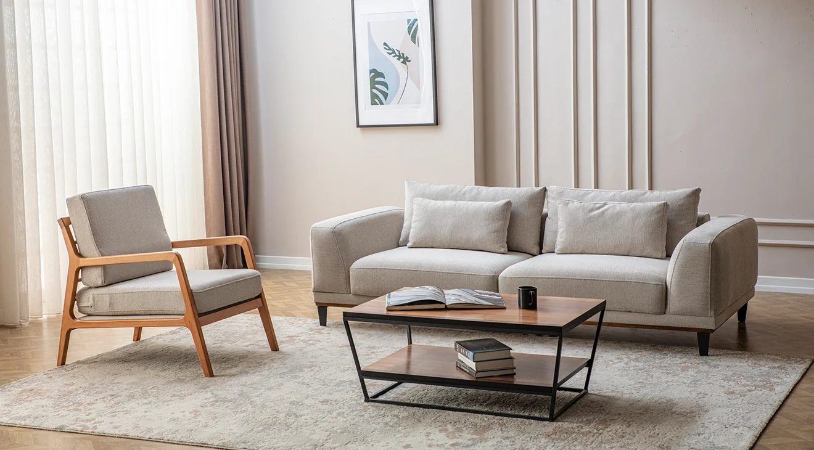
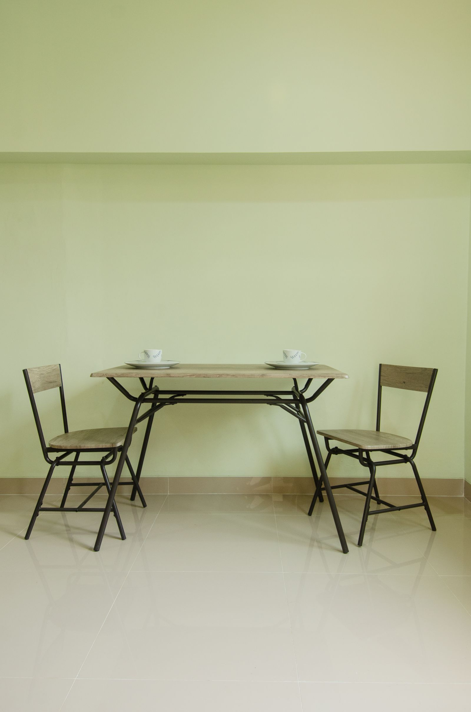
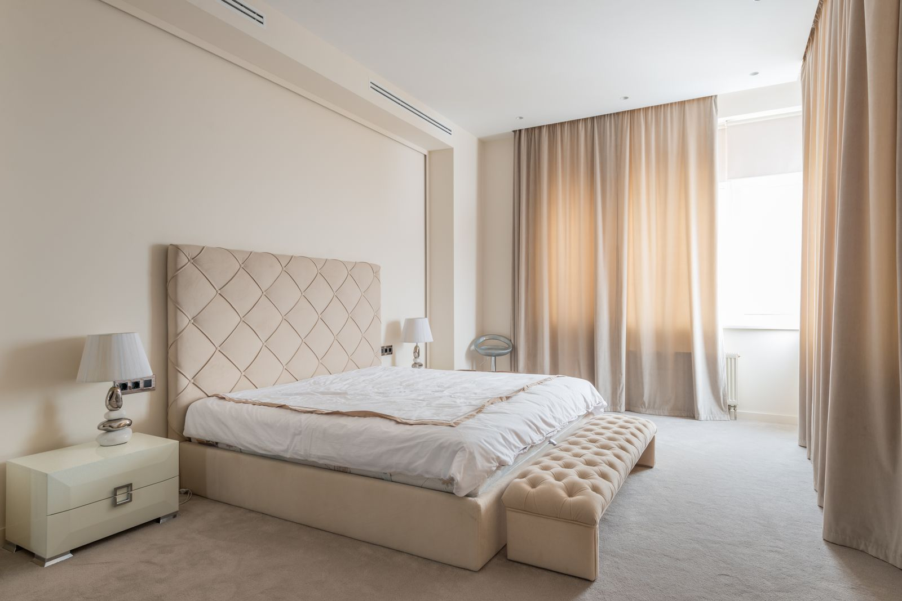
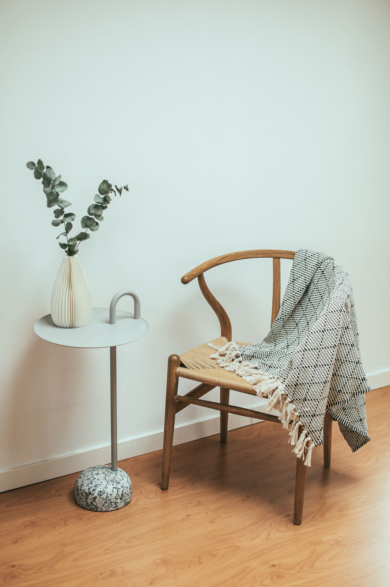
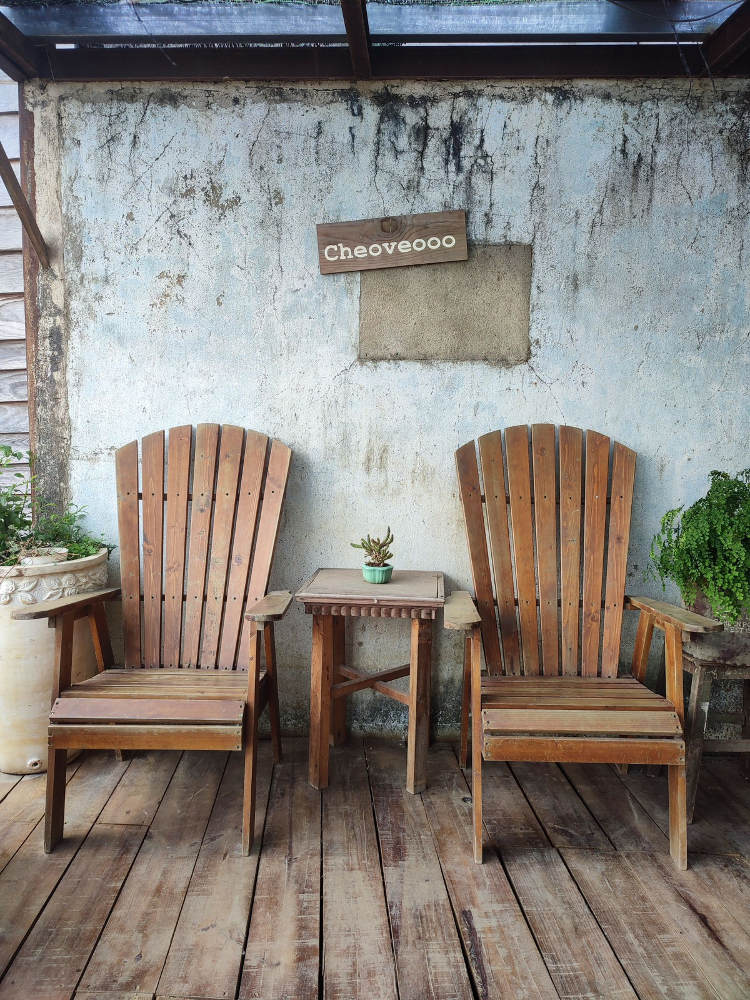

# 새 비교 사진 6장 · 실행 전 선정 기록

선정 고정: 2026-10-25T12:09:06.719572+00:00

32장 원본 검토 후 6장 선정. 결과에 따라 사진을 교체하지 않는다. 실사/렌더 종류가 확인되지 않은 자료는 추정 또는 미확인으로 표시한다.
주요 가구 목록은 평가용이며 모델 프롬프트에 제공하지 않는다. 사진은 비율 유지 최대 1600px, 자르기·리터치 없음.

## 거실 · new-living

[원본 출처](https://sivrilermobilya.com/product/konfor-koltuk-takimi/) · 제품 연출 이미지 · 실사/렌더 미확인

주요 가구: sofa ×1, armchair ×1, coffee table ×1

소파·안락의자·불투명 테이블 전체가 보이고 가구 사이와 바닥 접점이 구분된다.

남은 위험: 테이블 선반과 책, 쿠션이 별도 객체로 중복 추출될 수 있다.

## 작업 공간 · new-office

[원본 출처](https://www.pexels.com/photo/minimalist-setup-office-27920699/) · 렌더 추정 · 업로더가 3D artist로 소개

주요 가구: desk ×1, office chair ×1, drawer unit ×1, monitor ×1

책상·의자·서랍장이 프레임 안에 있고 가구 윤곽과 바닥 접점이 보인다.

남은 위험: 검은 서랍장과 벽의 대비, 책상과 서랍장의 접촉, 의자의 얇은 다리가 어렵다.

## 식사 공간 · new-dining

[원본 출처](https://www.pexels.com/photo/wooden-chairs-and-table-before-tea-5991536/) · 실사

주요 가구: table ×1, chair ×2

테이블과 의자 두 개가 잘리지 않고 분리되어 보이며 식기와 배경 장식이 거의 없다.

남은 위험: 가구가 차지하는 면적이 비교적 작고 얇은 금속 다리의 형상이 어렵다.

## 침실 · new-bedroom

[원본 출처](https://www.pexels.com/photo/bedside-tables-and-ottoman-bench-in-classy-bedroom-7534540/) · 실사

주요 가구: bed ×1, nightstand ×2, bench ×1, table lamp ×2

침대와 앞쪽 벤치 전체, 넓은 바닥이 보이고 조명이 확산되어 있다.

남은 위험: 침대·벤치가 접하고 같은 색이라 합쳐질 수 있으며 뒤쪽 협탁은 침대에 일부 가린다.

## 독서 코너 · new-reading

[원본 출처](https://www.pexels.com/photo/wooden-chair-beside-a-side-table-6633498/) · 실사

주요 가구: chair ×1, side table ×1

의자와 협탁의 윤곽·다리·바닥 접점이 뚜렷하고 단순한 배경이다. 간단한 대조 사례다.

남은 위험: 담요가 좌판 일부를 가리고 화병의 가지와 가는 협탁 지지대는 어렵다.

## 야외 좌석 · new-patio

[원본 출처](https://www.pexels.com/photo/two-lounge-chairs-by-the-wall-16153260/) · 실사

주요 가구: lounge chair ×2, side table ×1

두 의자와 작은 테이블 전체가 보이고 서로 겹치지 않으며 강한 그림자나 유리가 없다.

남은 위험: 나무판 틈새, 벽 표지판, 가장자리 화분이 추가 객체로 나올 수 있다.
