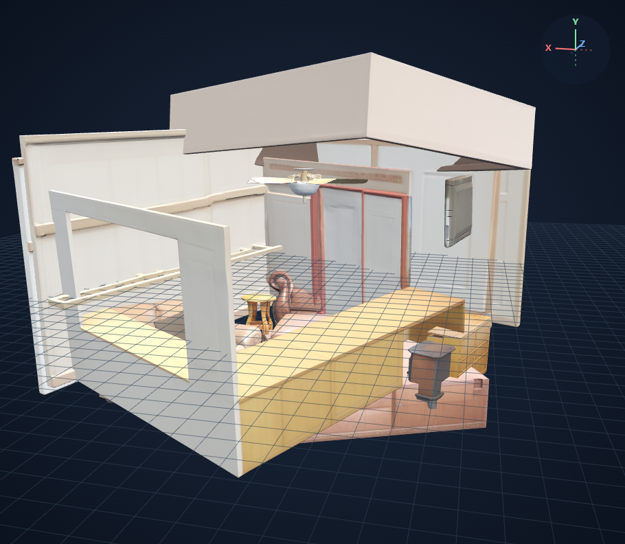
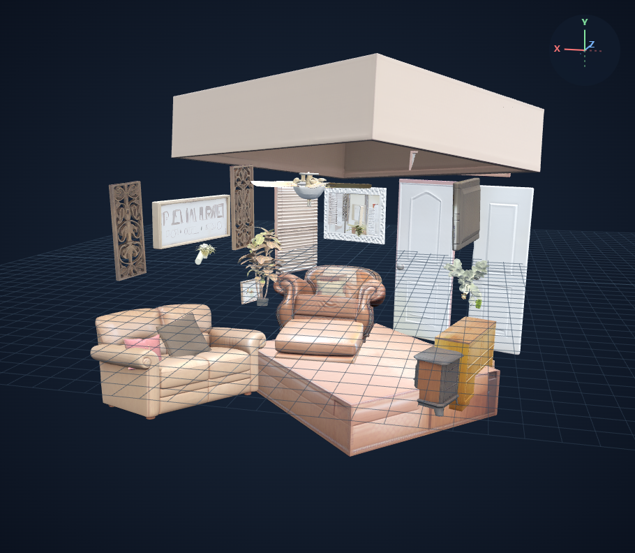
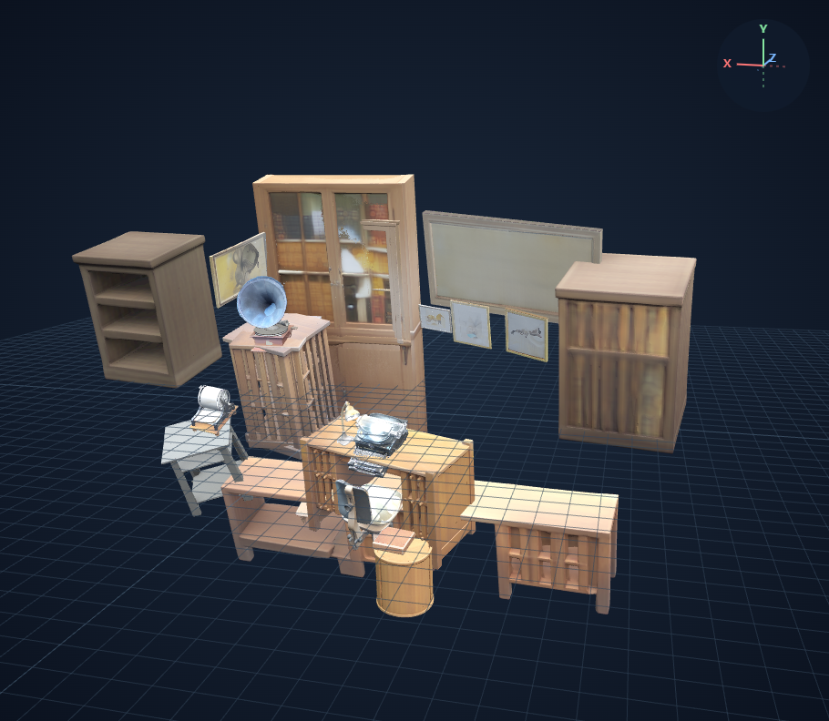
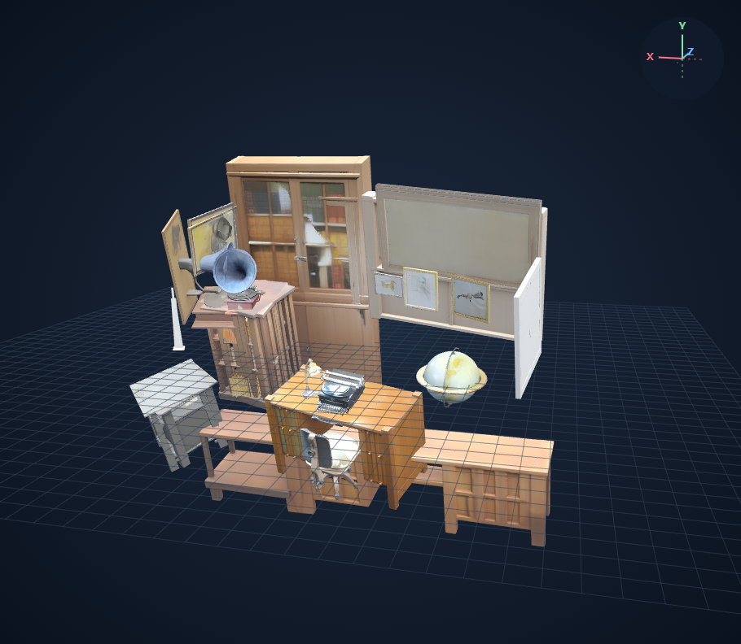

# 현재 1번 비교: RAM++와 Qwen2.5-VL

모델: `Qwen/Qwen2.5-VL-7B-Instruct` / revision `cc594898137f460bfe9f0759e9844b3ce807cfb5`.

현재 1번의 태그 생성기만 교체한다. SAM3 기본 임계값, 모든 반환 마스크의 SAM3D 입력, seed 42, 공식 pose 배치를 유지한다. 태그 치환·중복 제거·마스크 선별·개수 제한은 없다.

Qwen은 고정 어휘 분류기가 아니라 지시문에 따라 태그를 생성한다. 아래 공통 지시문과 greedy decoding(seed 42, 최대 2048 새 토큰)을 사용한다. 이미지 전처리는 모델 기본값이다. JSON 전체를 감싼 Markdown 코드블록만 벗기며 태그 문자열은 수정하지 않는다. 출력이 잘리거나 JSON 형식이 잘못되면 실패로 기록한다.

```text
List the items visible in this image as short English tags for text-prompted image segmentation. Include visible objects and scene elements, including small items and structural elements. Return only a JSON array of strings, without explanations, bounding boxes, or counts.
```

Qwen Transformers 4.51.3 / tokenizers 0.21.4는 별도 경로에 설치한다. Qwen 프로세스가 종료된 뒤 기존 SAM3와 SAM3D 환경을 그대로 사용한다.

기존 RAM++ 실행의 입력 PNG와 SHA-256이 같은 집·사무실만 실행한다. 웹뷰어는 로컬 검토 서버가 필요하다.

## house

| RAM++ 현재 1번 | Qwen 현재 1번 |
|---|---|
| <br>[웹뷰어](http://127.0.0.1:8118/viewer?run=baseline-house-new) | <br>[웹뷰어](http://127.0.0.1:8118/viewer?run=qwen-house-new) |

Qwen 태그 18개 / 마스크 37개 / 생성 성공 37개 / 실패 0개.

반환 태그: ceiling_fan, light_bulb, tv, cabinet, fireplace, rug, sofa, ottoman, chair, pillow, plant, mirror, door, wall_decor, sign, blinds, ceiling, floor

## office

| RAM++ 현재 1번 | Qwen 현재 1번 |
|---|---|
| <br>[웹뷰어](http://127.0.0.1:8118/viewer?run=baseline-office-new) | <br>[웹뷰어](http://127.0.0.1:8118/viewer?run=qwen-office-new) |

Qwen 태그 27개 / 마스크 34개 / 생성 성공 34개 / 실패 0개.

반환 태그: gramophone, bookshelf, books, cabinet, lamp, typewriter, globe, chair, desk, map, paintings, wall, floor, wooden_floor, window, light_bulb, door, picture_frame, inkwell, pen, pencil, key, keyhole, drawer, handle, corkboard, nail
