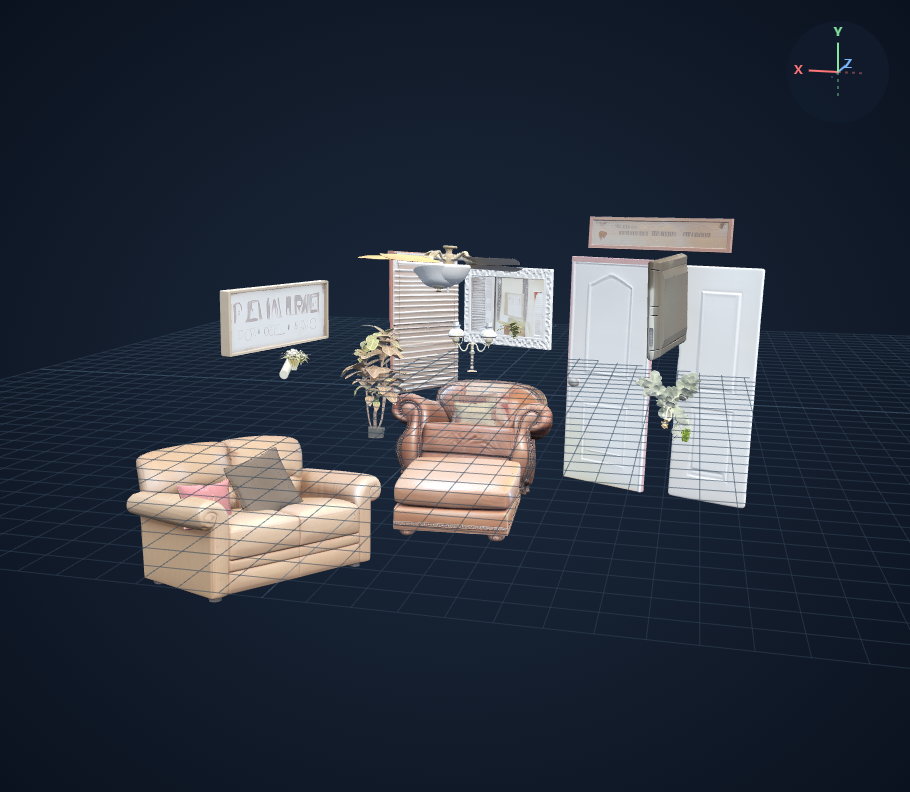
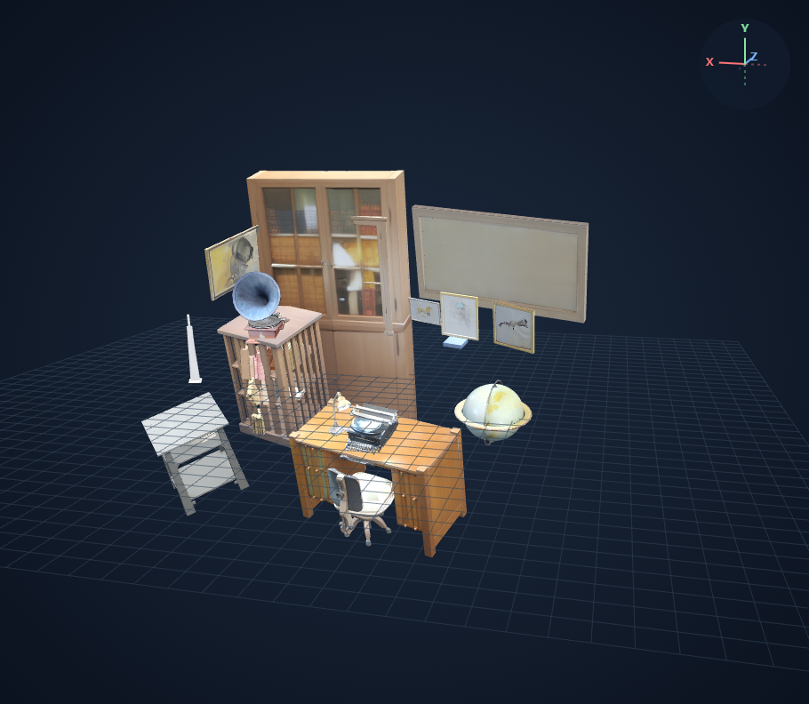
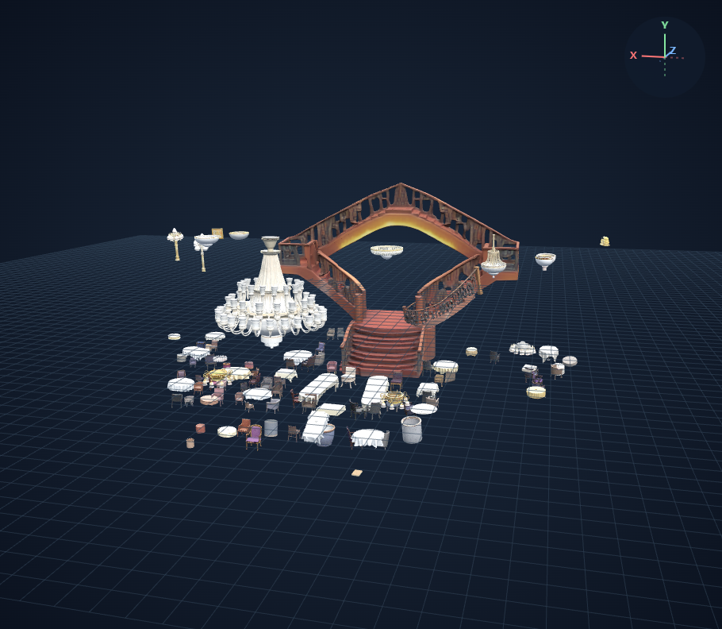
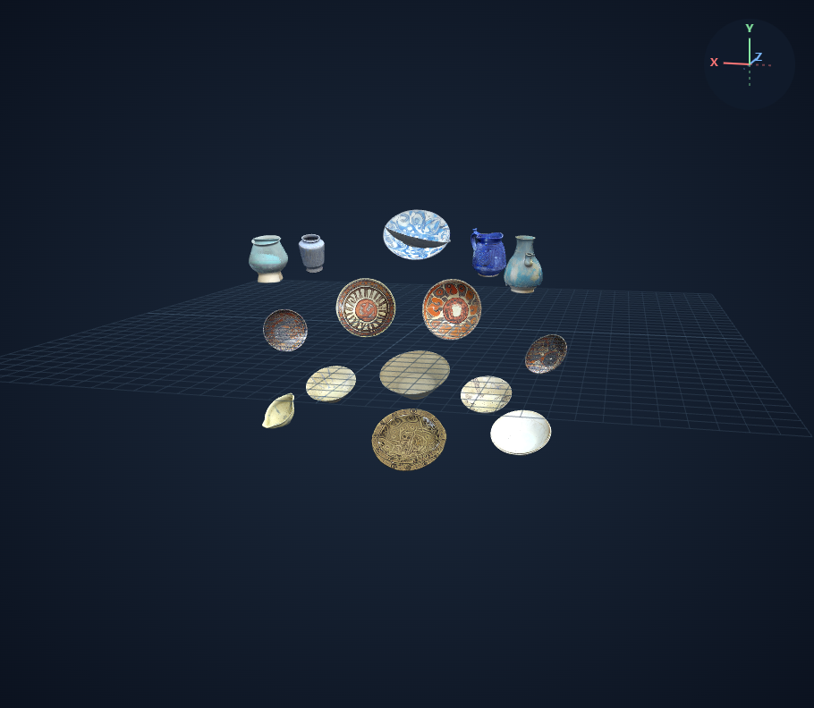
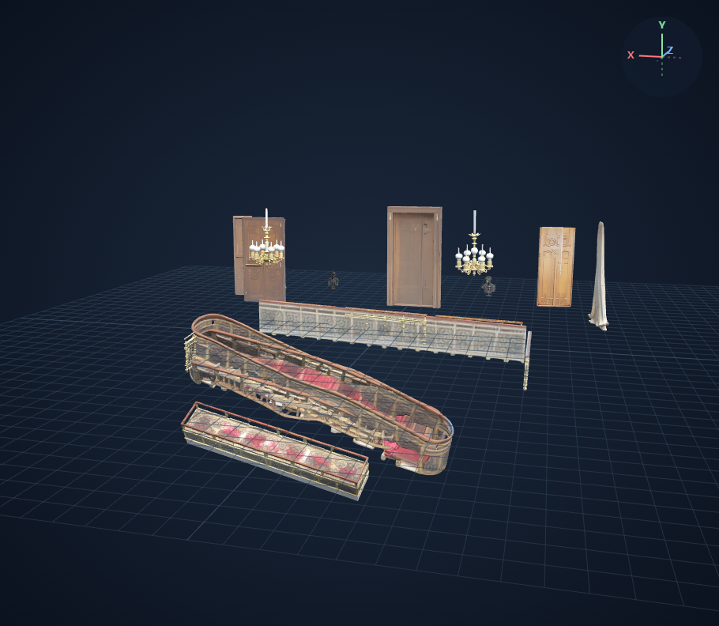
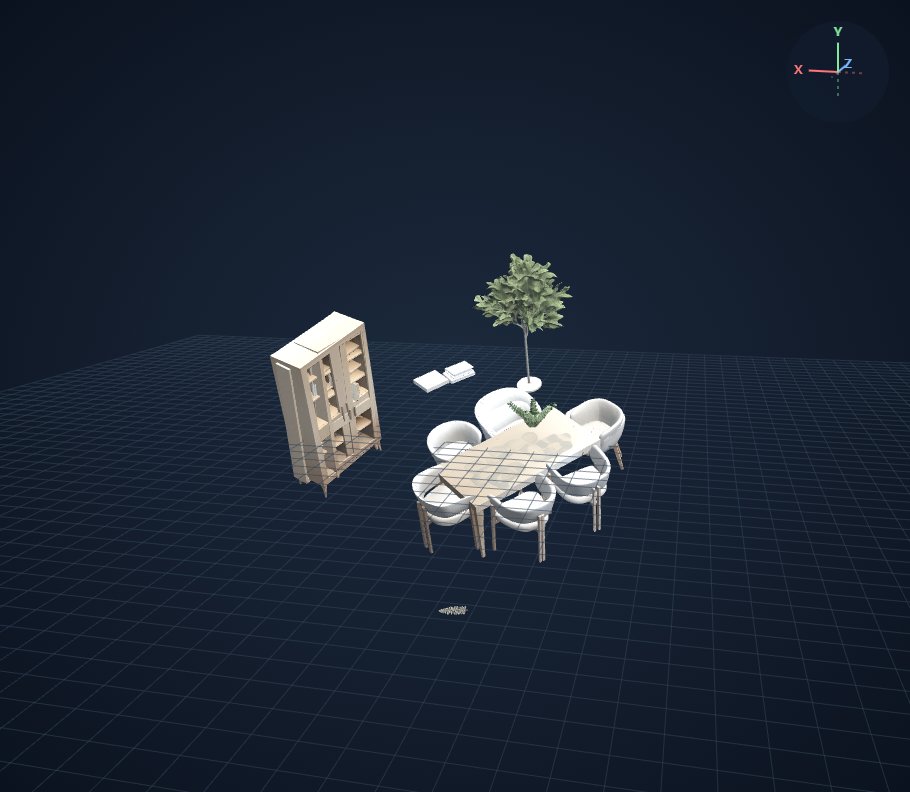
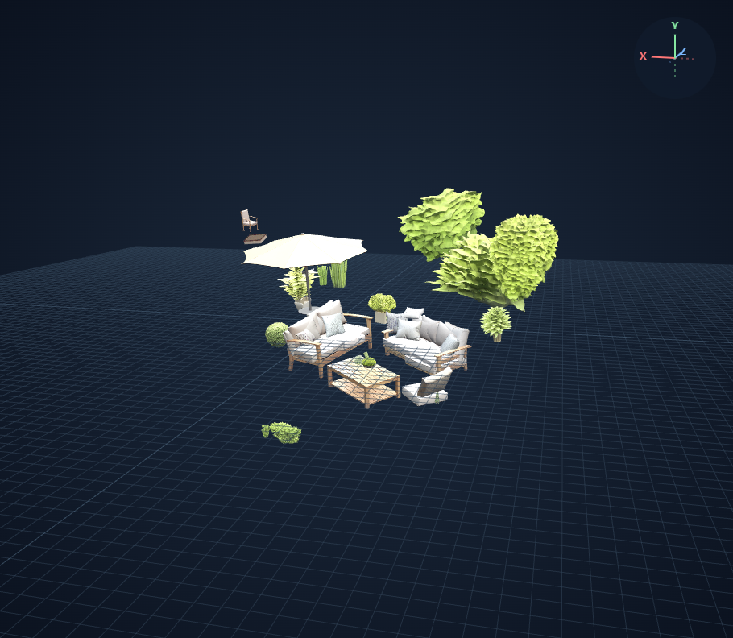
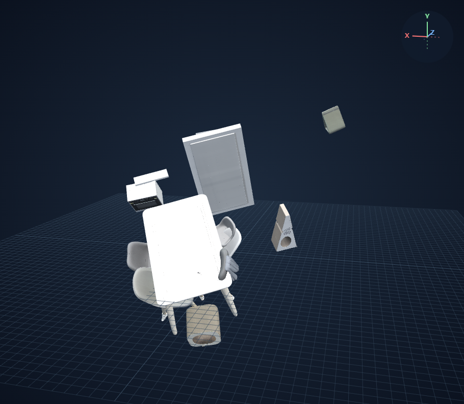
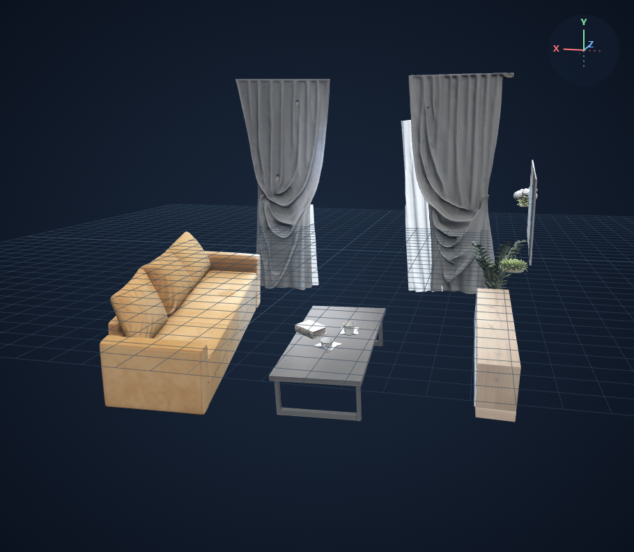
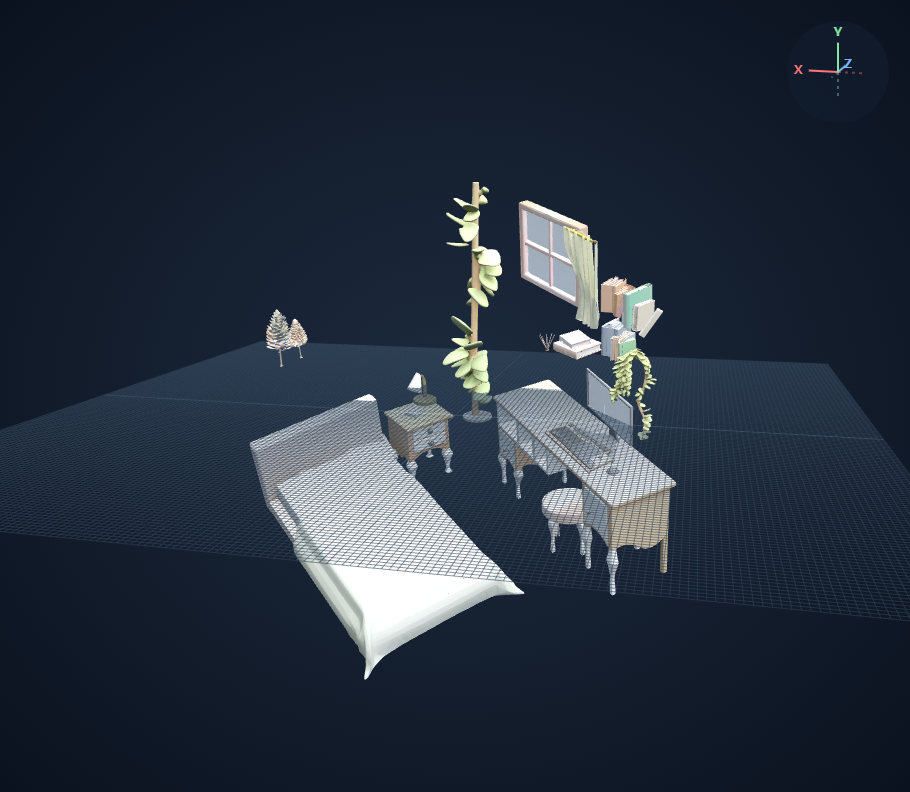

# Qwen 프롬프트 비교: 기존과 문·창문 포함 객체 중심 버전

모델: `Qwen/Qwen2.5-VL-7B-Instruct` / revision `cc594898137f460bfe9f0759e9844b3ce807cfb5`.

Qwen에 입력하는 지시문만 변경한다. SAM3 기본 임계값, 모든 반환 마스크의 SAM3D 입력, seed 42, 공식 pose 배치를 유지한다. 태그 치환·중복 제거·마스크 선별·개수 제한은 없다.

Qwen은 고정 어휘 분류기가 아니라 지시문에 따라 태그를 생성한다. 아래 공통 지시문과 greedy decoding(seed 42, 최대 2048 새 토큰)을 사용한다. 이미지 전처리는 모델 기본값이다. JSON 전체를 감싼 Markdown 코드블록만 벗기며 태그 문자열은 수정하지 않는다. 출력이 잘리거나 JSON 형식이 잘못되면 실패로 기록한다.

```text
Identify the distinct categories of clearly visible, standalone physical
objects in this image for text-prompted instance segmentation and individual
3D reconstruction.

Include furniture and separate objects such as cushions, books, plants,
lamps, and decorative objects. Include doors and windows as well.

Exclude architectural background such as walls, floors, ceilings, and the room
itself. Exclude shadows, reflections, materials, colors, and abstract scene labels.

Name each object as a whole. Do not separately list attached components such as
handles, drawers, legs, frames, or keyholes when they belong to an object already
listed. Treat door handles and window frames as parts of doors and windows.

Use short, common English noun phrases with spaces, not underscores.
List each object category once, even when multiple instances are visible.
Avoid synonyms or overlapping names for the same category.
Do not infer objects that are not clearly visible.

Return only a JSON array of strings.
```

Qwen Transformers 4.51.3 / tokenizers 0.21.4는 별도 경로에 설치한다. Qwen 프로세스가 종료된 뒤 기존 SAM3와 SAM3D 환경을 그대로 사용한다.

집·사무실의 프롬프트 비교와 같은 개선 프롬프트로 실행한 나머지 테스트 이미지 8장을 함께 기록한다. 웹뷰어는 로컬 검토 서버가 필요하다.

## house

| Qwen 기존 프롬프트 | Qwen 개선 프롬프트 |
|---|---|
| <br>[웹뷰어](http://127.0.0.1:8118/viewer?run=qwen-house-new) | <br>[웹뷰어](http://127.0.0.1:8118/viewer?run=qwen-v2-house-new) |

Qwen 태그 12개 / 마스크 26개 / 생성 성공 26개 / 실패 0개. 이전 결과: 태그 18개 / 마스크 37개 / 생성 성공 37개.

반환 태그: couch, ottoman, chair, pillow, plant, lamp, sign, door, window, mirror, television, fan

벽·바닥·천장 태그 포함 여부: []

실행 코드: `7d9e3fdaef030a438b3088f75e8d7dfe0ef1323bda83004547048abeb10366c5`. 장면 SHA-256: `bf088b5bf9c61f6b3c350bf0ce58550f4ddb2b1d4a536274e7ef39cf253280a5`.

## office

| Qwen 기존 프롬프트 | Qwen 개선 프롬프트 |
|---|---|
| <br>[웹뷰어](http://127.0.0.1:8118/viewer?run=qwen-office-new) | <br>[웹뷰어](http://127.0.0.1:8118/viewer?run=qwen-v2-office-new) |

Qwen 태그 12개 / 마스크 35개 / 생성 성공 35개 / 실패 0개. 이전 결과: 태그 27개 / 마스크 34개 / 생성 성공 34개.

반환 태그: desk, chair, bookshelf, gramophone, typewriter, globe, lamp, picture_frame, book, cushion, door, window

벽·바닥·천장 태그 포함 여부: []. 공백 사용 지시와 달리 밑줄이 포함된 태그도 반환됐으며, 후처리 치환 없이 그대로 SAM3에 전달했다.

실행 코드: `7d9e3fdaef030a438b3088f75e8d7dfe0ef1323bda83004547048abeb10366c5`. 장면 SHA-256: `a6c60189e823baf77cf5e289de20f8125cebb9ed2a25a48a320417a5a4a74d0a`.

## 저장 실패 진단과 복구

재실행에서 확인한 오류: `S3 UploadPart QuotaExceeded: storage quota exceeded`. 추론 뒤 중간 결과와 최종 ZIP을 원격 저장소에 업로드할 때 용량 한도에 걸렸다.

사용자 승인 후 완료 실행의 중간 체크포인트 11개를 로컬에 백업하고 SHA-256을 검증한 다음 원격 중복 사본을 정리하여 8,315,465,148바이트를 확보했다. 최종 결과 ZIP과 모델 파일은 유지했다.

저장 재시도·업로드 크기 검증·독립 오류 기록을 추가했다. Qwen 프롬프트, SAM3 마스크 처리, SAM3D 생성 및 배치 설정은 유지했다. 아래 완료 표시는 결과 ZIP과 GLB 해시, 모델 및 프롬프트를 검증한 실행만 뜻한다.

sample-02의 대형 GLB를 브라우저에서 열 때 발생한 Blob 읽기 오류도 수정했다. 조각 다운로드를 단일 ArrayBuffer에 합쳐 직접 파싱하며, 원본 GLB 데이터는 변경하지 않는다.

restaurant의 3.40GB ZIP은 멀티파트 업로드를 합치는 단계에서도 용량 제한에 걸렸다. 사용자 승인 후 저장소 `qv17bc1sx8`를 650GB에서 700GB로 증설했고, 진행 중이던 업로드 재시도에서 중간 저장에 성공했다. 저장소 추가 비용은 월 $3.50 상당이다.

## 추가 테스트 이미지 8장

집·사무실과 동일한 개선 프롬프트 및 모델 설정으로 실행한다.

### restaurant

태그 7개 / 마스크 116개 / 생성 성공 116개 / 실패 0개.



[웹뷰어](http://127.0.0.1:8118/viewer?run=qwen-v2-restaurant-new)

반환 태그: chandelier, staircase, statue, table, chair, lamp, painting

실행 코드: `56020d732de4e5f2ce749299ce3c23db53a4a2d1fb27e7b8e358cb897d7d8b9e`.

### displaycase

태그 4개 / 마스크 30개 / 생성 성공 30개 / 실패 0개.



[웹뷰어](http://127.0.0.1:8118/viewer?run=qwen-v2-displaycase-new)

반환 태그: ceramic bowl, ceramic dish, ceramic jug, ceramic vase

실행 코드: `7d9e3fdaef030a438b3088f75e8d7dfe0ef1323bda83004547048abeb10366c5`.

### stairhall

태그 6개 / 마스크 22개 / 생성 성공 22개 / 실패 0개.



[웹뷰어](http://127.0.0.1:8118/viewer?run=qwen-v2-stairhall-new)

반환 태그: chandelier, statue, door, window, staircase, railing

실행 코드: `7d9e3fdaef030a438b3088f75e8d7dfe0ef1323bda83004547048abeb10366c5`.

### sample-01

태그 9개 / 마스크 27개 / 생성 성공 27개 / 실패 0개.



[웹뷰어](http://127.0.0.1:8118/viewer?run=qwen-v2-sample-01-new)

반환 태그: dining table, chair, cushion, bookshelf, book, plant, lamp, door, window

실행 코드: `7d9e3fdaef030a438b3088f75e8d7dfe0ef1323bda83004547048abeb10366c5`.

### sample-02

태그 7개 / 마스크 40개 / 생성 성공 40개 / 실패 0개.



[웹뷰어](http://127.0.0.1:8118/viewer?run=qwen-v2-sample-02-new)

반환 태그: outdoor sofa, cushion, coffee table, plant, umbrella, door, window

실행 코드: `56020d732de4e5f2ce749299ce3c23db53a4a2d1fb27e7b8e358cb897d7d8b9e`.

### sample-03

태그 13개 / 마스크 15개 / 생성 성공 15개 / 실패 0개.



[웹뷰어](http://127.0.0.1:8118/viewer?run=qwen-v2-sample-03-new)

반환 태그: dining table, chair, kitchen counter, oven, cabinet, trash can, remote control, mask, tissue box, pen, cat scratcher, door, window

실행 코드: `7d9e3fdaef030a438b3088f75e8d7dfe0ef1323bda83004547048abeb10366c5`.

### sample-04

태그 10개 / 마스크 17개 / 생성 성공 17개 / 실패 0개.



[웹뷰어](http://127.0.0.1:8118/viewer?run=qwen-v2-sample-04-new)

반환 태그: couch, coffee_table, book, cup, saucer, plant, curtain, window, tv_stand, tv

실행 코드: `7d9e3fdaef030a438b3088f75e8d7dfe0ef1323bda83004547048abeb10366c5`.

### sample-05

태그 14개 / 마스크 33개 / 생성 성공 33개 / 실패 0개.



[웹뷰어](http://127.0.0.1:8118/viewer?run=qwen-v2-sample-05-new)

반환 태그: bed, nightstand, desk, stool, computer, keyboard, mouse, lamp, cushion, pillow, book, plant, window, curtain

실행 코드: `56020d732de4e5f2ce749299ce3c23db53a4a2d1fb27e7b8e358cb897d7d8b9e`.
