# RAM++ 기본값 + Qwen 배경 필터: 실제 장면 비교

기존 1번 결과에서 Qwen v1이 제외한 태그에 해당하는 객체만 제거했다. RAM++·SAM3·SAM3D 재추론 없이 기존 객체 파일로 재조립했다. 남은 객체의 메시·텍스처와 배치 행렬은 보존했다.

전후 카메라 위치와 시선은 같다. 적용 전은 해시를 검증한 기존 1번 캡처를 재사용했다. 바닥 격자는 뷰어 보조선이며 장면 크기에 따라 간격·범위가 달라질 수 있다.

[전체 비교 화면](http://127.0.0.1:8134/docs/RAM_QWEN_FILTER_SCENES.html) · [프롬프트와 태그 판정](RAM_QWEN_FILTER_V1.md)

## house — 21 → 8개

| 기존 1번 | Qwen 필터 적용 |
|---|---|
|  [웹뷰어](http://127.0.0.1:8134/viewer?run=ram-filter-house-before) | 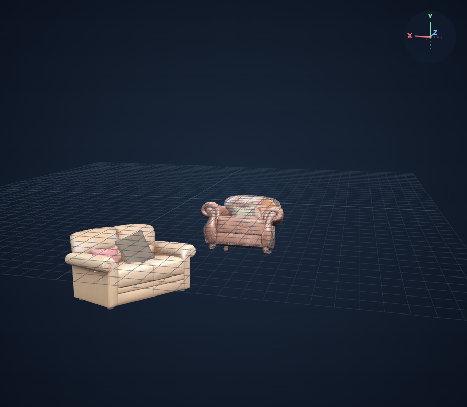 [웹뷰어](http://127.0.0.1:8134/viewer?run=ram-filter-house-after) |

제외 태그: carpet, ceiling, ceiling fan, den, furniture, home, living room, room, television

## office — 26 → 24개

| 기존 1번 | Qwen 필터 적용 |
|---|---|
|  [웹뷰어](http://127.0.0.1:8134/viewer?run=ram-filter-office-before) |  [웹뷰어](http://127.0.0.1:8134/viewer?run=ram-filter-office-after) |

제외 태그: fill, floor, room, wood floor

## displaycase — 80 → 80개

| 기존 1번 | Qwen 필터 적용 |
|---|---|
|  [웹뷰어](http://127.0.0.1:8134/viewer?run=ram-filter-displaycase-before) | 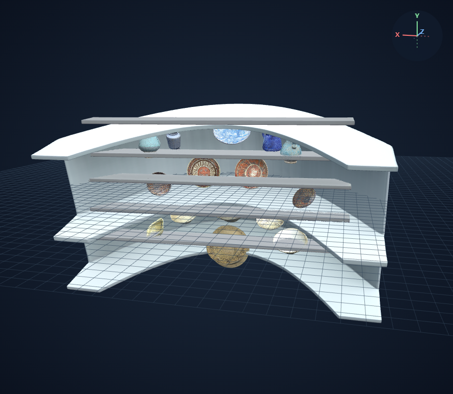 [웹뷰어](http://127.0.0.1:8134/viewer?run=ram-filter-displaycase-after) |

제외 태그: case

## stairhall — 27 → 26개

| 기존 1번 | Qwen 필터 적용 |
|---|---|
| 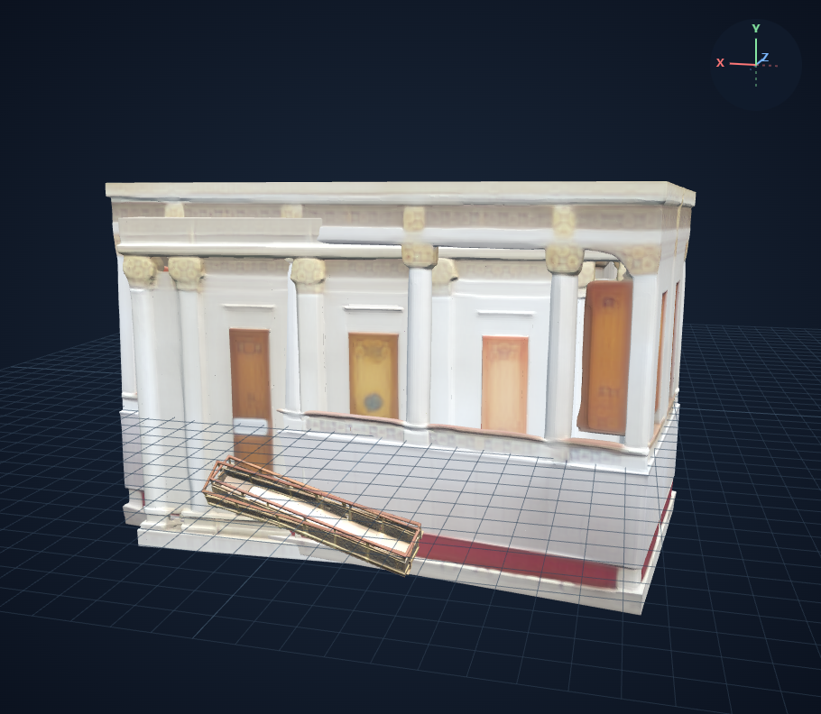 [웹뷰어](http://127.0.0.1:8134/viewer?run=ram-filter-stairhall-before) |  [웹뷰어](http://127.0.0.1:8134/viewer?run=ram-filter-stairhall-after) |

제외 태그: building, carpet, ceiling

## sample-01 — 15 → 10개

| 기존 1번 | Qwen 필터 적용 |
|---|---|
|  [웹뷰어](http://127.0.0.1:8134/viewer?run=ram-filter-sample-01-before) | 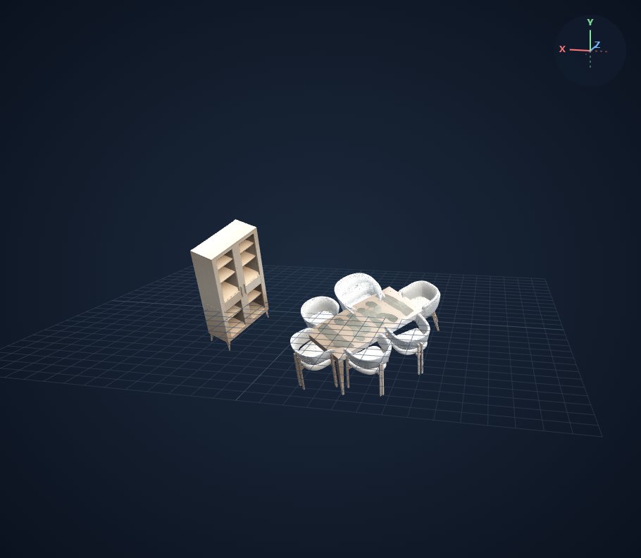 [웹뷰어](http://127.0.0.1:8134/viewer?run=ram-filter-sample-01-after) |

제외 태그: dining room, dinning table, floor, room, wood floor

## sample-02 — 44 → 43개

| 기존 1번 | Qwen 필터 적용 |
|---|---|
|  [웹뷰어](http://127.0.0.1:8134/viewer?run=ram-filter-sample-02-before) | 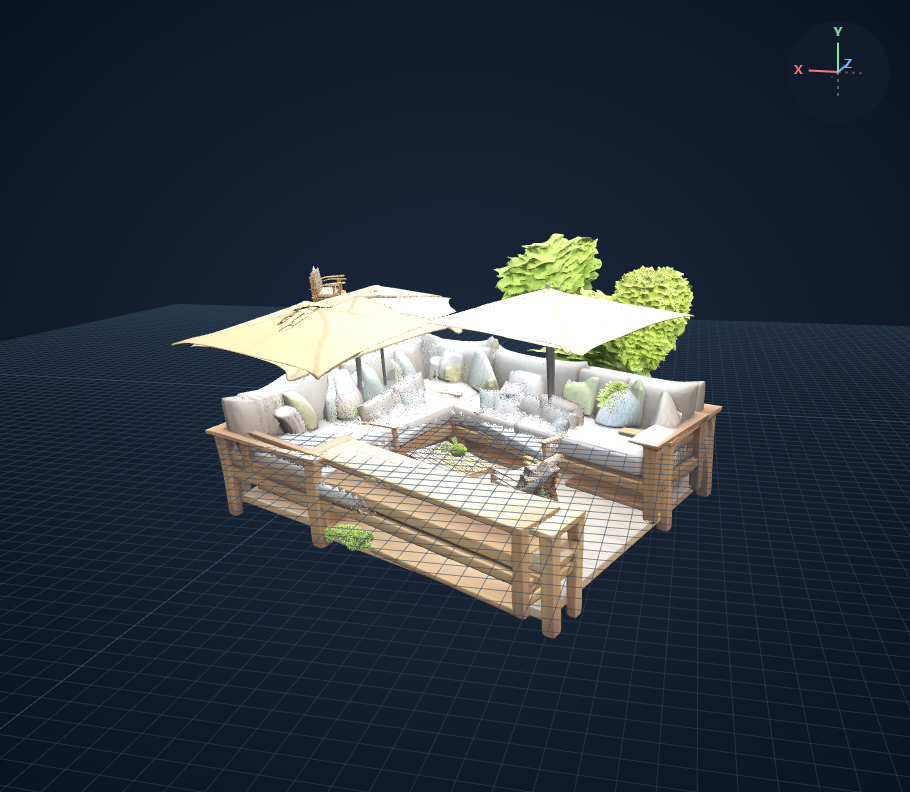 [웹뷰어](http://127.0.0.1:8134/viewer?run=ram-filter-sample-02-after) |

제외 태그: backyard, fire pit

## sample-03 — 24 → 21개

| 기존 1번 | Qwen 필터 적용 |
|---|---|
|  [웹뷰어](http://127.0.0.1:8134/viewer?run=ram-filter-sample-03-before) | 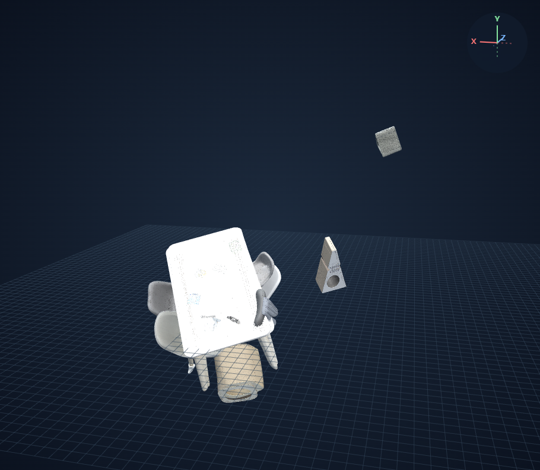 [웹뷰어](http://127.0.0.1:8134/viewer?run=ram-filter-sample-03-after) |

제외 태그: floor, home appliance, kitchen table, mat, room, yoga mat

## sample-04 — 17 → 3개

| 기존 1번 | Qwen 필터 적용 |
|---|---|
| 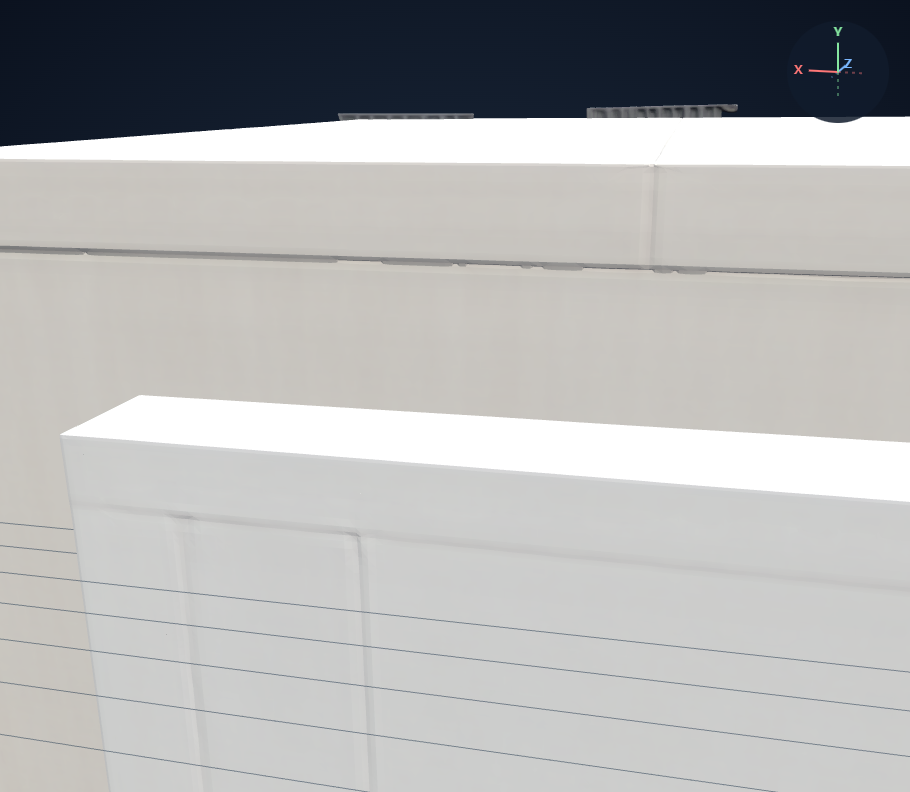 [웹뷰어](http://127.0.0.1:8134/viewer?run=ram-filter-sample-04-before) | 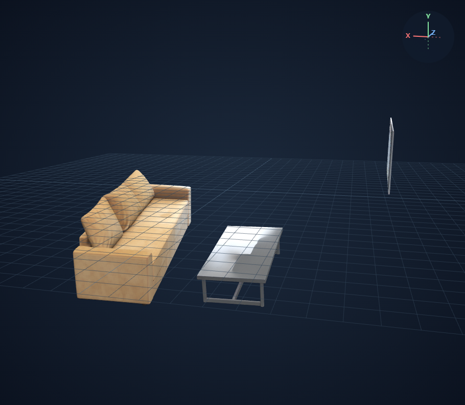 [웹뷰어](http://127.0.0.1:8134/viewer?run=ram-filter-sample-04-after) |

제외 태그: apartment, carpet, curtain, furniture, glass door, living room, modern, room, slide, window

## sample-05 — 17 → 14개

| 기존 1번 | Qwen 필터 적용 |
|---|---|
|  [웹뷰어](http://127.0.0.1:8134/viewer?run=ram-filter-sample-05-before) | 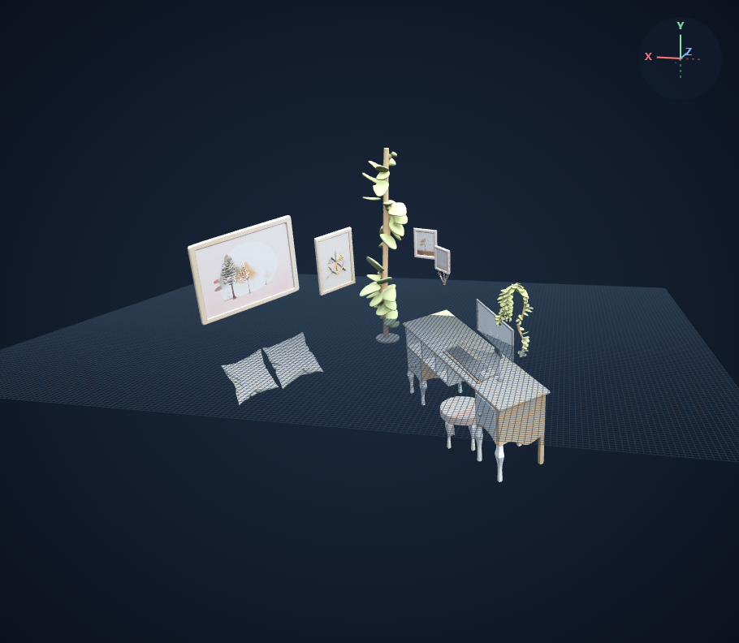 [웹뷰어](http://127.0.0.1:8134/viewer?run=ram-filter-sample-05-after) |

제외 태그: bed, bedroom, bureau, table, dollhouse, nightstand, room

## restaurant — 149 → 143개

| 기존 1번 | Qwen 필터 적용 |
|---|---|
| 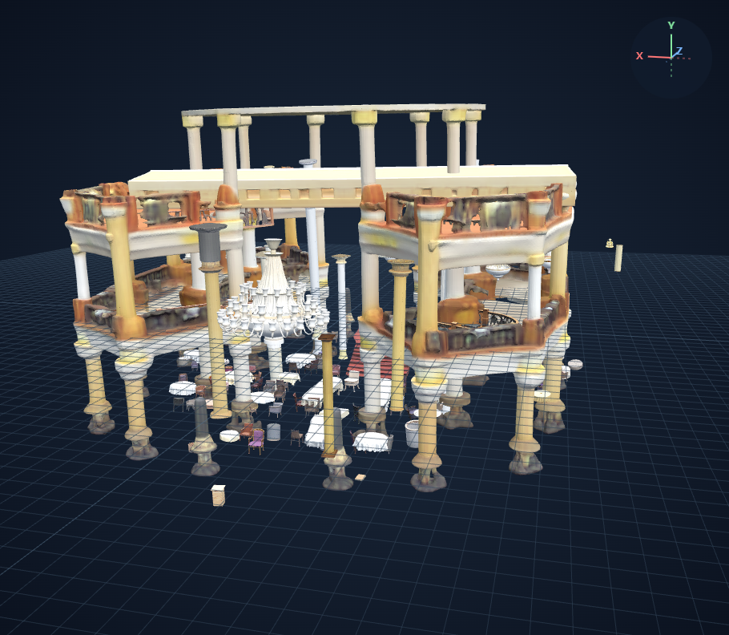 [웹뷰어](http://127.0.0.1:8134/viewer?run=ram-filter-restaurant-before) | 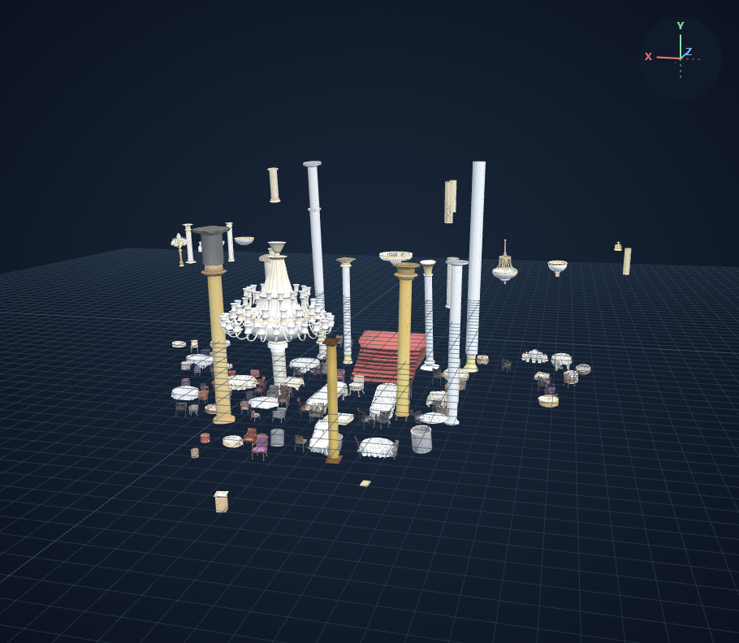 [웹뷰어](http://127.0.0.1:8134/viewer?run=ram-filter-restaurant-after) |

제외 태그: atrium, balustrade, building, carpet, ceiling, cruise ship

[객체별 적용 및 해시 검증 기록](assets/ram-qwen-filter-v1/scene-manifest.json) · [카메라 기록](assets/ram-qwen-filter-v1/captures.json)
