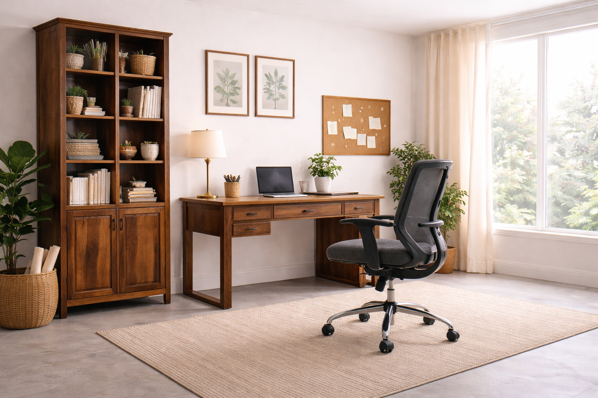
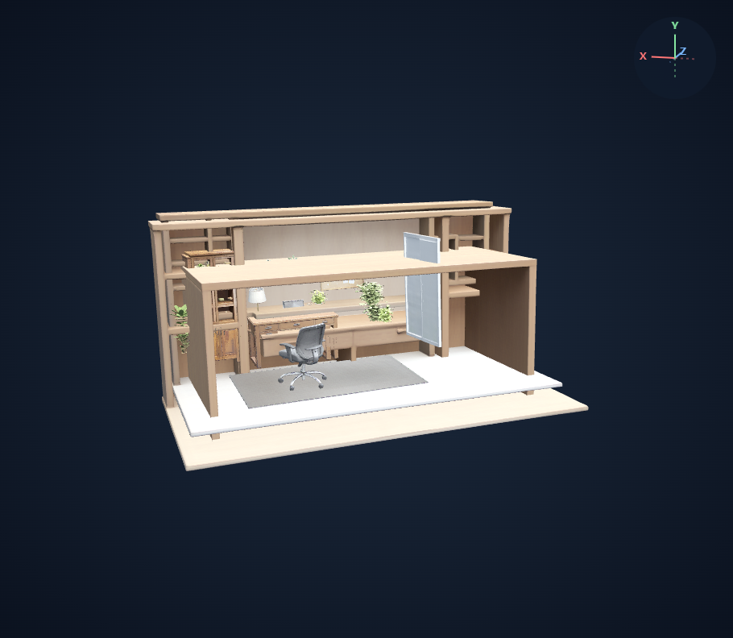
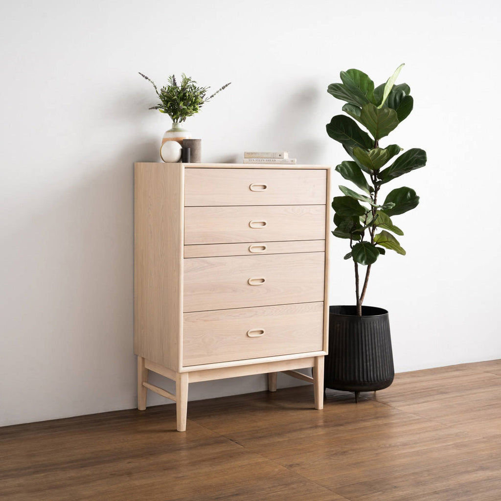
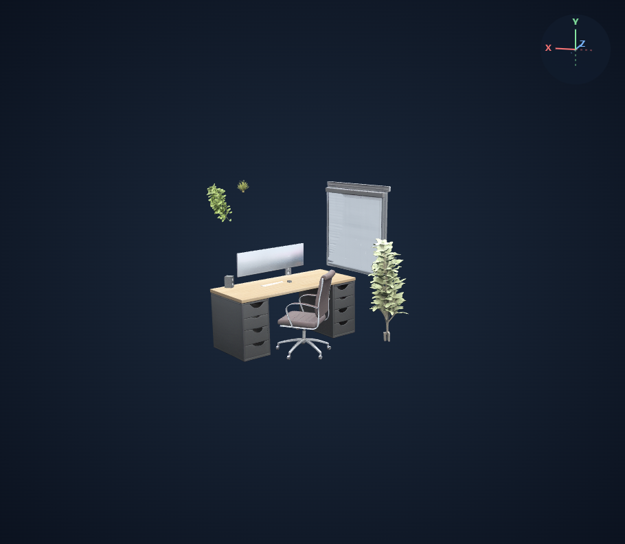

# 발표 최종 선정

발표 최종 버전은 Qwen 비전 furniture로 고정합니다. 원목 서재, 수납장·식물, 작업 공간의 세 장면을 선정했습니다. 모두 같은 프롬프트와 생성 설정을 사용하며, 장면별로 다른 버전을 섞지 않았습니다.

- 비교 베이스라인: RAM++ 기본 태그 → SAM3 → SAM3D
- 최종 버전: Qwen 비전 furniture → SAM3 → SAM3D

기여: SAM3D 자체의 형상 성능 개선이 아니라, 이미지 기반 객체 선택을 통해 불필요한 배경·중복 생성을 줄이는 것. 수동 객체 삭제·배치 보정 없이 기존 결과를 사용한다.

## 01. 원목 서재 — 대표 결과물 · 복합 가구 장면

책상·의자·책장에 화분과 소품이 함께 있는 장면입니다. 정면과 양옆에서 주요 가구의 몸통과 지지 구조를 확인했고, 원목 색감과 책장 내부 표현도 남습니다.

### 원본 이미지

[원본 출처](https://zior.in/collections/study-room)

### 베이스라인 · RAM++

[3D 열기 ↗](/viewer?run=presentation-present-office-c-baseline)

### 최종 · Qwen 비전 furniture

[3D 열기 ↗](/viewer?run=presentation-present-office-c-vision-furniture)

보여줄 개선: 베이스라인에서는 책장·책상 동의어와 방 관련 태그로 거대한 중복 형상이 생깁니다. 최종 결과는 desk / chair / bookcase를 각각 1개씩 생성해 주요 가구 구성이 드러납니다. 전체 생성 객체는 44개에서 22개로 줄었습니다.

남은 한계: 책상 다리 일부가 판형으로 변하고 소품·화분의 높이 오차가 남습니다. 벽 없는 액자와 코르크보드가 떠 보이며, 소품 중복까지 모두 해결된 것은 아닙니다.

## 02. 수납장과 식물 — 주요 가구 중복 개선

수납장의 몸통·서랍 면·다리가 이어지고 큰 식물과의 구성이 읽힙니다. 여러 각도에서 주요 가구 형상을 확인했습니다.

### 원본 이미지

[원본 출처](https://www.modernfurniture.com.au/products/hayton-tall-ideboard-70cm-white-oak)

### 베이스라인 · RAM++

[3D 열기 ↗](/viewer?run=presentation-present-cabinet-baseline)

### 최종 · Qwen 비전 furniture

[3D 열기 ↗](/viewer?run=presentation-present-cabinet-vision-furniture)

보여줄 개선: 베이스라인에서는 bureau / dresser / furniture와 개별 drawer가 겹칩니다. 최종 결과는 dresser 1개로 주요 수납장 중복을 줄였습니다.

남은 한계: 작은 화병이 상판 위에 떠 있고 소품 중복이 남습니다. 원본 나무색보다 밝게 표현됩니다.

## 03. 작업 공간 — 배경 메시 제거 효과

기본 RAM++ 결과에서는 방 메시가 가구를 가립니다. 최종 결과에서는 책상·의자·모니터의 구성이 드러나 변화가 분명합니다.

### 원본 이미지

[원본 출처](https://www.pexels.com/photo/minimalist-setup-office-27920699/)

### 베이스라인 · RAM++

[3D 열기 ↗](/viewer?run=new-comparison-new-office-baseline)

### 최종 · Qwen 비전 furniture

[3D 열기 ↗](/viewer?run=new-comparison-new-office-vision-furniture)

보여줄 개선: 장면 전체를 가리는 방·바닥·천장 관련 객체가 줄어, 개별 가구 중심의 장면을 확인할 수 있습니다.

남은 한계: 창·블라인드는 남고 서랍장 형상이 확장되어, 정밀한 형상·배치 복원을 주장하는 사례는 아닙니다.

## 확정 프롬프트

```text
List the furniture and other movable physical objects visible in this image.

Use specific, common object names, with one tag per object category.
Return only a JSON array of strings.
```

이전 실험과 탈락 후보는 Git 이력에 보존되어 있습니다.